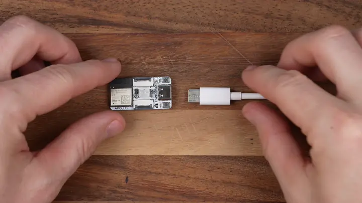
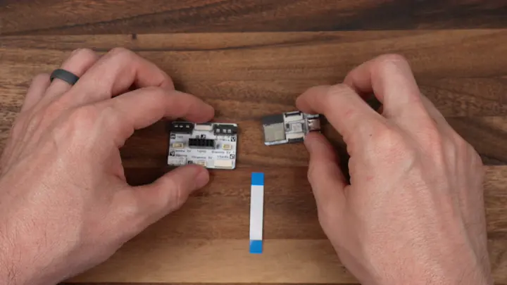
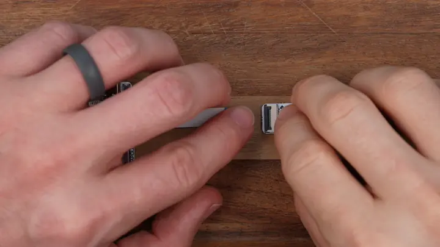
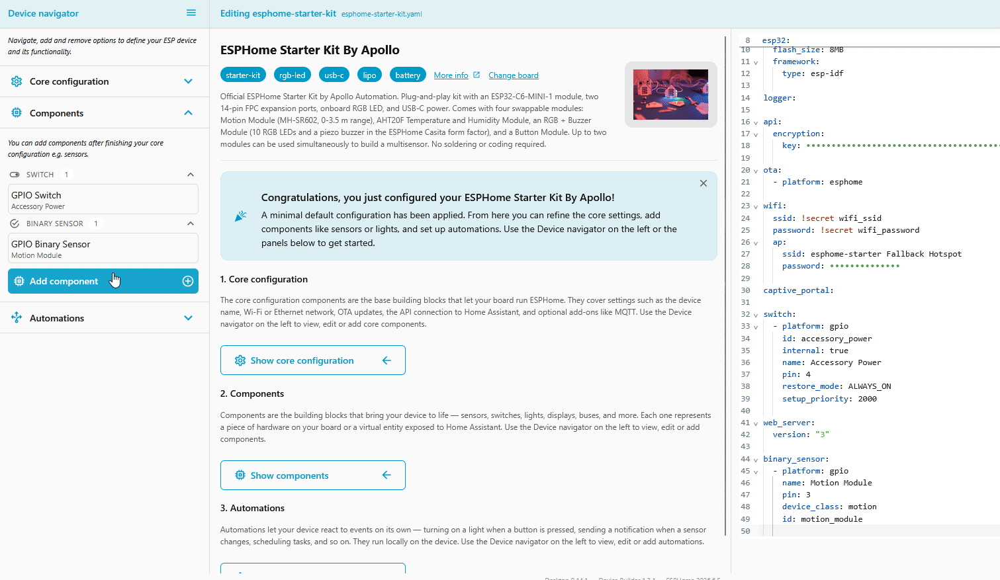
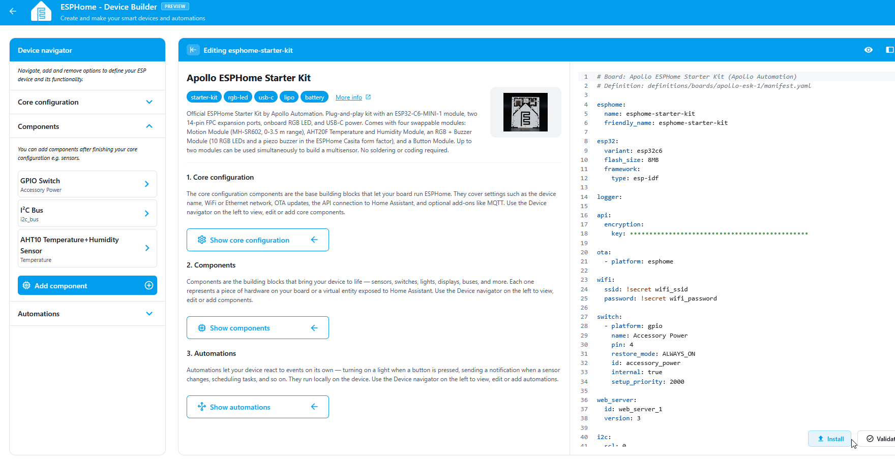
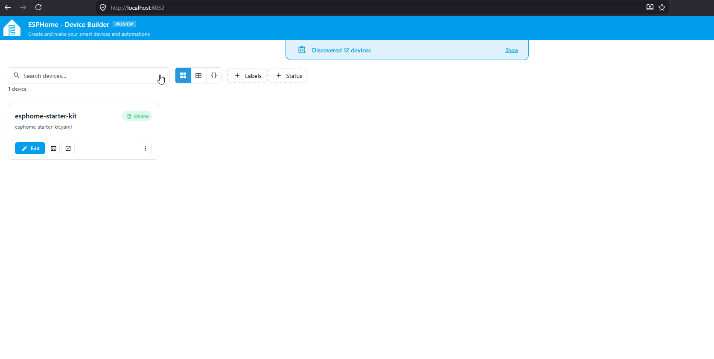

# Adding the temperature and humidity module

The temperature and humidity module is your starter kit's first environmental sensor, reading the air around it on whatever interval you choose. By the end of this tutorial you'll have an AHT20F wired to your ESP32-C6, surfaced as two sensors in your YAML, and updating live in the web server.

!!! note "Before you start"

    Work through the two prerequisites first:

    * [Start Here](/products/ESPHome-Starter-Kit/start-here.md) to snap the temperature and humidity module off the panel.
    * [First Steps](/products/ESPHome-Starter-Kit/setup/first-steps.md) to install ESPHome Device Builder and create your starter kit device.

## Attach temp and humidity module

Connect the Temperature and Humidity module to the ESP32-C6 using one of the FPC ribbon cables that came with the kit. Either FPC connector on the ESP32-C6 works, top or bottom.

1\. Unplug the USB-C cable from the ESP32-C6 so it is powered off.



!!! warning "Handle the FPC connectors gently"

    The latches are small and the ribbon cable is fragile. Lift the latch with a fingernail, slide the cable in, and press the latch down. Never pull on the cable itself.

2\. Flip up the latch on the FPC connector then gently slide the ribbon cable into the connector with the blue side facing upwards. Gently press the latch down to lock it in place.



3\. Slide the ribbon cable into the temperature and humidity module with the blue side facing upwards then press the latch down to lock it in place.



4\. Plug the ESP32-C6 back into your computer.

## Add to ESPHome Device Builder

ESPHome Device Builder ships an **Add Component** flow that knows the pin layout for every Apollo Starter Kit module. Use it instead of writing the I2C bus and sensor block by hand, and you'll get the right pins, address, and variant on the first try.

1. Open your starter kit device in Device Builder and click **Edit**.
2.  Navigate to the **Components** section and look for a **GPIO Switch** named **Accessory Power**. The temperature and humidity module gets its power from that switch, so without it the sensor doesn't get enough power to answer on the I2C bus. (1)
    { .annotate }

    1.  Projects you created from the Apollo ESPHome Starter Kit board already include it, and the component picker hides it once your device has it. That's why it isn't in the list of components you can add.

3.  If it isn't there, click **Add Component**, find the **Accessory Power Rail** card, and click **Add**. (1)
    { .annotate }

    1.  [Accessory Power Rail](/products/ESPHome-Starter-Kit/learning-the-basics/core-components.md#accessory-power-rail) covers what the switch does and the settings worth knowing about.

4. Click **Add Component** in the editor toolbar.
5. Select the **I2C** component.
6. Click **Add**. Device Builder inserts the I2C bus into your YAML.
7. Search for **Temperature and Humidity** and select the Apollo Starter Kit temperature and humidity component.
8. Toggle the **Humidity** and **Temperature** selections on.
9. Click **Add**. Device Builder inserts the AHT20F sensor block into your YAML.



??? note "What the temperature and humidity YAML does"

    The blocks Add Component drops into your config look like this:

    ```yaml
    i2c:
      - scl: 0
        sda: 1
        id: i2c_bus

    sensor:
      - platform: aht10
        variant: AHT20
        humidity:
          id: aht20_humidity
          name: Humidity
        temperature:
          id: aht20_temperature
          name: Temperature
        id: aht20
    ```

    Each option does something specific:

    | Option | What it does |
    | --- | --- |
    | `i2c.scl: 0` / `i2c.sda: 1` | The clock (SCL) and data (SDA) pins for the I2C bus the AHT20F speaks on. The starter kit wires them to GPIO0 and GPIO1. |
    | `i2c.id: i2c_bus` | Internal handle for the I2C bus so other components can share it. |
    | `platform: aht10` | The ESPHome platform that drives AHT10, AHT20, and AHT30 sensors. |
    | `variant: AHT20` | Tells the platform which variant of the chip is connected. |
    | `temperature` / `humidity` | Two sub-sensors. Each has a `name` shown in Home Assistant and the web server, and an `id` you can reference from automations and lambdas. |
    | `id: aht20` | Internal handle you can reference from automations and lambdas elsewhere in the config. |

## Install the software

Flash the device so the new temperature and humidity entities go live.

1.  Click **Install** at the bottom right of the editor. (1)
    { .annotate }

    1.  We say software because it's the friendlier word. The technically correct term is firmware: code that runs directly on the chip instead of on a computer. That's the word ESPHome's own docs use.

2. Choose **On the network** if the device is already on your Wi-Fi, or **Plug into this computer** to flash over USB.
3. Wait for the compile and flash to finish. First builds can take a few minutes.
4. The device reboots and reconnects to your Wi-Fi on its own.



## Test the temp and humidity

With the device back online, the temperature and humidity entities are live on the web server. <a href="http://esphome-starter-kit.local/" target="_blank" rel="noreferrer nofollow noopener">Open it in a browser</a> on the same network and watch it react in real time.

1. In a browser, open `http://<your-device-name>.local/`. If you used `esphome-starter-kit` as the device name in [First Steps](/products/ESPHome-Starter-Kit/setup/first-steps.md), that's `http://esphome-starter-kit.local/`.
2. Find the **Temperature** and **Humidity** entities in the sensor list.
3. Watch the values update on the interval you set. Cup your hand over the sensor or breathe on it, the humidity reading will respond within a few cycles.



> Web server page showing the Temperature and Humidity sensors with live readings.

!!! success "Your Temperature and Humidity module is wired up"

    You now have a trustworthy temp and humidity sensor to place anywhere in your home!

## Try it in an automation

Your sensor is reporting. Now make it drive something:

<a href="/products/ESPHome-Starter-Kit/automations/temp-reactive-leds/" class="md-button md-button--primary">  Temp-Reactive LEDs </a>
<a href="/products/ESPHome-Starter-Kit/automations/press-to-check-climate/" class="md-button md-button--primary">  Press to Check Climate </a>

--8<-- "_snippets/community-help.md"