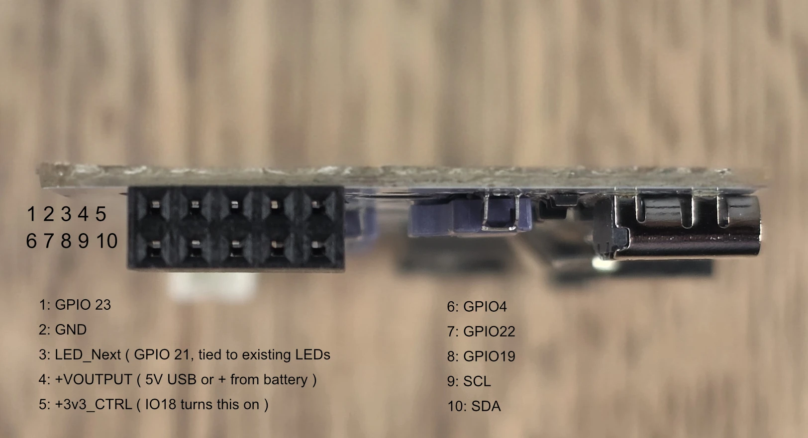
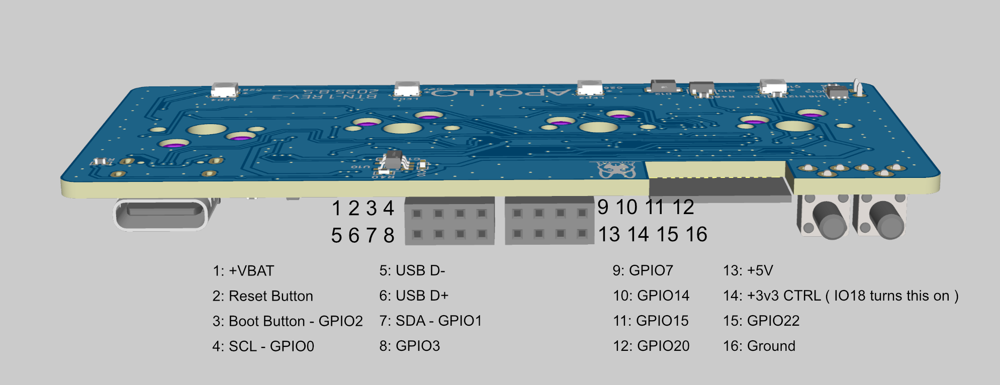

# BTN-1 GPIO pinout

The BTN-1 has two GPIO headers on its circuit board: a 10-pin header on the side and a 16-pin header on the top. Use these maps to wire extra sensors, LEDs, or other hardware to your BTN-1 and to find the GPIO numbers you need in ESPHome.

!!! note "Open the case to reach the headers"

    The headers are on the circuit board inside the case. Follow [Teardown and reassembly of BTN-1](../troubleshooting/btn1-teardown.md) to lift out the board, and flip the battery switch off first if your BTN-1 has a battery.

## Side header

The table below is laid out like the header in the photo, with pin 1 at the end farthest from the USB-C port.

| Row | | | | | |
| --- | --- | --- | --- | --- | --- |
| Nearest the board | **1** GPIO23 | **2** Ground | **3** LED_Next (GPIO21) | **4** +VOUTPUT | **5** +3v3_CTRL |
| Outer | **6** GPIO4 | **7** GPIO22 | **8** GPIO19 | **9** SCL | **10** SDA |

- **LED_Next** is tied to the BTN-1's existing LEDs.
- **+VOUTPUT** is 5V from USB, or + from the battery.

## Top header

The top header is two blocks of eight pins, laid out below like the header in the image.

### Block nearest the USB-C port

| Row | | | | |
| --- | --- | --- | --- | --- |
| Nearest the board | **1** +VBAT | **2** Reset button | **3** Boot button (GPIO2) | **4** SCL (GPIO0) |
| Outer | **5** USB D- | **6** USB D+ | **7** SDA (GPIO1) | **8** GPIO3 |

### Block nearest the buttons

| Row | | | | |
| --- | --- | --- | --- | --- |
| Nearest the board | **9** GPIO7 | **10** GPIO14 | **11** GPIO15 | **12** GPIO20 |
| Outer | **13** +5V | **14** +3v3_CTRL | **15** GPIO22 | **16** Ground |

!!! tip "+3v3_CTRL is switched"

    The +3v3_CTRL pin on both headers only has power while GPIO18 is on. If something you power from it stays off, check that GPIO18 is on.
