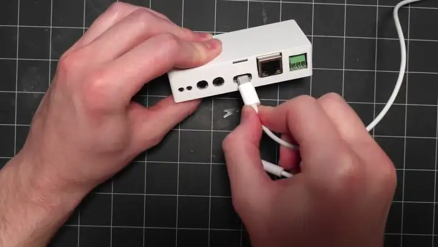

# Play a source through Analog In

The **Analog In** jack on your CAST PRO-1 turns any line-level source into something Music Assistant can play. Plug in a turntable, TV, or CD player, and it shows up in Music Assistant as a **Sendspin Source**. Play it on the speakers connected to your CAST PRO-1, or on any other Music Assistant player in your home.

!!! note "Before you start"

    Finish the [Getting Started guide](../setup/getting-started.md) first, so your CAST PRO-1 is in Home Assistant and Music Assistant is running.

## What you'll need

- **A line-level source.** Most TVs, CD players, and streamers output line level. A turntable needs a phono preamp between it and the CAST PRO-1, unless the turntable has one built in. If the turntable has a **PHONO / LINE** switch on the back, set it to **LINE**.
- **A cable with a 3.5mm plug** for the CAST PRO-1 end. For a source with RCA outputs, use an RCA-to-3.5mm cable.

## Connect your source

1\. Plug the source into the **Analog In** jack, the left of the two 3.5mm jacks. The **Analog/Optical Out** jack is output only, so a source plugged in there won't play.

## Play it in Music Assistant

1\. Open **Music Assistant** from the Home Assistant sidebar and select **Browse**.

2\. Select **Sendspin Source (Apollo CAST_PRO-1 xxxxxx)**, where `xxxxxx` matches the end of your device's name. (1)
{ .annotate }

1.  Your device's name is at the top of its device page in Home Assistant, for example **Apollo CAST_PRO-1 04c6d0**.

3\. Pick the player to hear it on. Choose your CAST PRO-1 to play the source through its own speakers, or any other player to hear it in another room.

<!-- TODO image: /assets/cast-pro-1-sendspin-source.webp | alt: Music Assistant Browse page showing the Sendspin Source for the CAST PRO-1 -->

## Choose the streaming quality

The **Line In Streaming** setting on your CAST PRO-1's device page sets how it sends your source over the network:

| Option | When to use it |
| --- | --- |
| **Compressed** | The default. Best for a weaker Wi-Fi connection, since it uses less bandwidth. |
| **Lossless** | Full quality. Pick it when your CAST PRO-1 is on Ethernet or a strong Wi-Fi signal. |

[Join our Discord if you need more help! :simple-discord:](https://link.apolloautomation.com/discord){ .md-button }
