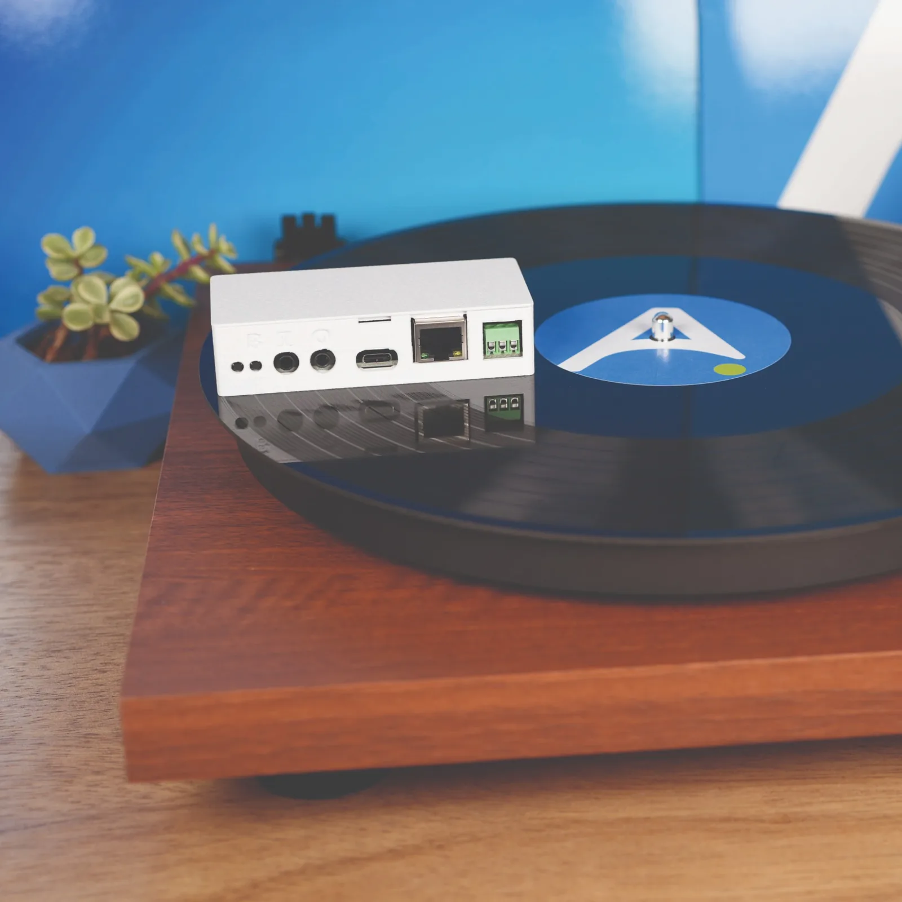

# Introduction

**Make Any Speakers Smart:** Connect the CAST PRO-1 to your speakers, receiver or soundbar, add it to Home Assistant, and it shows up in Music Assistant as a player you can stream to.

**Analog or Optical Output:** The **Analog/Optical Out** jack takes a 3.5mm audio cable for powered speakers, or a mini-TOSLINK optical cable for a receiver or soundbar. Pick which one plays with the **Audio Output** setting on the device page.

**Audio In:** Plug a turntable, TV or other source into the **Analog In (Line In)** jack and it shows up in Music Assistant as a source you can play on any player in your home. See [Play a source through Analog In (Line In)](additional-info/analog-in.md).

**Built-In Ethernet:** The CAST PRO-1 has an Ethernet port on board, so it can run on a wired connection with no addon. Without a cable, it works over Wi-Fi.

**Multi-Room Audio:** Group the CAST PRO-1 with other CAST players to play the same music in sync across every room. Streaming runs locally through Music Assistant and Sendspin, so there's no cloud account and no subscription.

**Onboard RGB LEDs:** Four RGB LEDs on the device show the color and effect you pick in Home Assistant, and turn cyan during announcements.

**LED Strip Terminals:** Connect an addressable LED strip to the screw terminals, with no soldering, and control it from Home Assistant. See [Add an LED strip](examples/led-strip.md).

**WizMote Control:** [Pair a WizMote](examples/wizmote-blueprint.md) for physical control over playback without opening an app. Each button is configurable in Home Assistant.

[Get started with your CAST PRO-1 :material-arrow-right:](setup/getting-started.md){ .md-button .md-button--primary }
[Join our Discord if you need more help! :simple-discord:](https://link.apolloautomation.com/discord){ .md-button }
