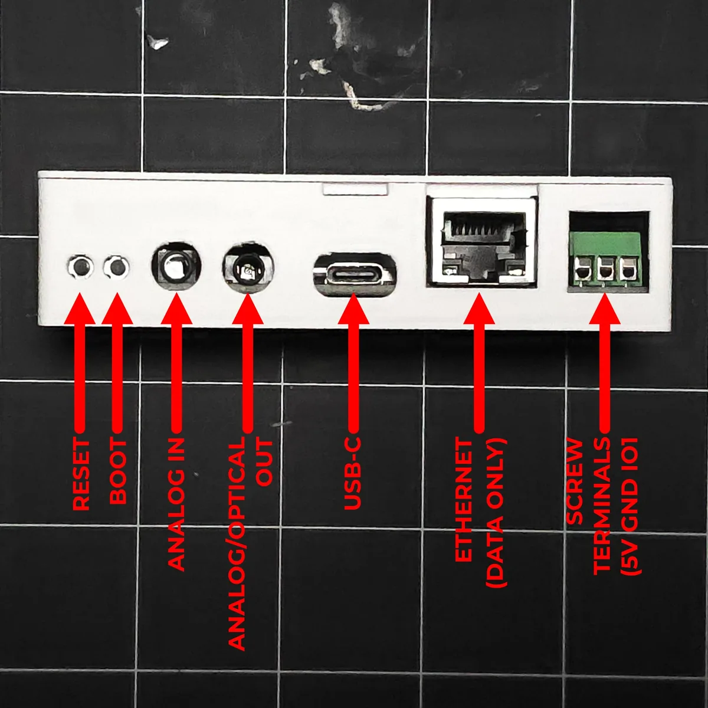
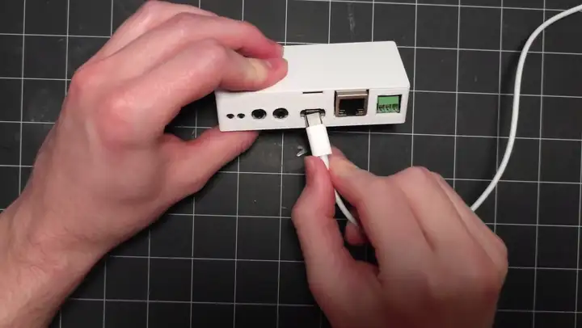
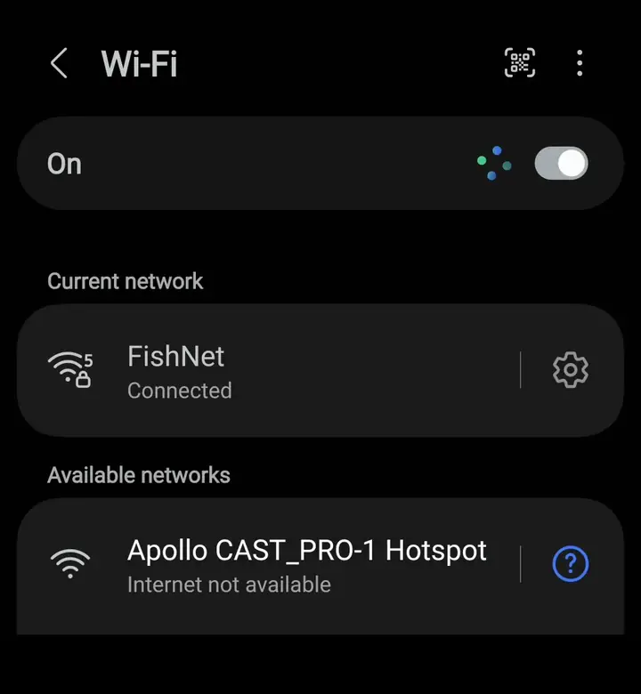
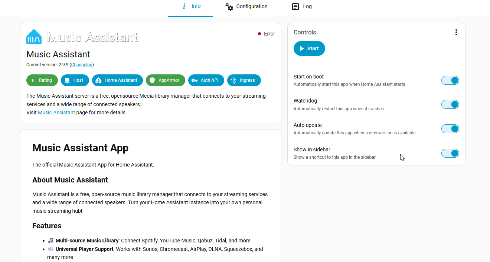

# CAST PRO-1 getting started

This will guide you through connecting your CAST PRO-1 to your speakers, getting it on your network, adding it to Home Assistant, and streaming to it with Music Assistant.

## Know your ports

Every port is on the front of the CAST PRO-1. The two 3.5mm jacks each do a single job, so check which is which before you plug anything in.

| Port | What it's for |
| --- | --- |
| **Reset** and **Boot** | Two recessed buttons. Press them with a pin or a small screwdriver. See [Boot button status check and factory reset](../troubleshooting/castpro1-boot-button.md) for what each hold does. |
| **Analog In (Line In)** | Audio in only. Connect a turntable (through a phono preamp), TV, or other source here to play it through Music Assistant. See [Play a source through Analog In (Line In)](../additional-info/analog-in.md). |
| **Analog/Optical Out** | Audio out only. Takes a regular 3.5mm audio cable for analog speakers, or a mini-TOSLINK optical cable for a receiver or soundbar. |
| **USB-C** | Power. A 5V 1A supply, or 5V 3A if you run an LED strip from the screw terminals. |
| **Ethernet** | Wired network. Data only, it doesn't take power over Ethernet (PoE). |
| **Screw terminals** | **5V**, **GND** and **IO1** from left to right, for an [addressable LED strip](../examples/led-strip.md). |

## Physical setup

1\. Plug your CAST PRO-1 into a 5V USB-C power supply. A 5V 1A supply is plenty. (1)
{ .annotate }

1.  Running an [LED strip](../examples/led-strip.md) from the screw terminals? Use a 5V 3A supply instead. The Ethernet port is for network only and doesn't take power over Ethernet (PoE), so the CAST PRO-1 always needs USB-C power.

2\. Connect your speakers to the **Analog/Optical Out** jack. Pick the cable that matches your speakers:

- **Analog:** a 3.5mm audio cable into the line-in on your powered speakers, receiver, or active soundbar. The CAST PRO-1 has no amplifier of its own, so it needs powered speakers or an amp. For RCA or 6.35mm inputs, use a 3.5mm-to-RCA or 3.5mm-to-6.35mm adapter cable.
- **Optical:** a mini-TOSLINK to TOSLINK cable into the optical input on your receiver or soundbar. The small end looks like a 3.5mm plug and goes into the CAST PRO-1, the square end goes into your receiver. You'll switch the CAST PRO-1 to optical with the **Audio Output** setting once it's in Home Assistant.

## Connect to your network

There are three ways to get your CAST PRO-1 online. Pick whichever is easier, you only need to do one.

- **Ethernet** connects over a network cable straight to your router or switch.
- **Hotspot** works on any phone or computer. The CAST PRO-1 broadcasts its own Wi-Fi network, you join it, then enter your Wi-Fi details.
- **Improv via BLE** sets the CAST PRO-1 up over Bluetooth straight from Home Assistant. It's quick, but it needs Bluetooth on your Home Assistant host or an ESP32 Bluetooth proxy.

=== "Ethernet"

    1\. Plug an Ethernet cable from your router or switch into the CAST PRO-1.

    2\. Your CAST PRO-1 picks up an address from your router on its own, so there's nothing to enter. (1)
    { .annotate }

    1.  Unplug the cable later and your CAST PRO-1 falls back to Wi-Fi on its own, as long as it has Wi-Fi details saved. The [FAQ](../faq.md) covers how the two connections work together.

    3\. Home Assistant discovers your CAST PRO-1 automatically. Add it below, then check the **Network Connection** sensor on the device page to confirm it reads **Ethernet**.

=== "Hotspot"

    !!! note "Unplug the Ethernet cable first"

        Your CAST PRO-1 doesn't broadcast its hotspot while an Ethernet cable is connected. Unplug it while you set up Wi-Fi.

    1\. Plug the CAST PRO-1 in via USB-C.

    !!! success "If your CAST PRO-1 is restarting or not broadcasting Wi-Fi try another USB-C cable and power supply!"

        The CAST PRO-1 needs constant 5V power. Most quality phone chargers will work fine.

        Still no hotspot? A [factory reset](../troubleshooting/castpro1-boot-button.md#factory-reset) makes it broadcast again.

    2\. On your phone or PC, open the Wi-Fi settings and connect to "**Apollo CAST_PRO-1 Hotspot**".

    !!! tip "Setup page didn't open?"

        Your phone should open the Wi-Fi setup page on its own after you join the hotspot. If it doesn't, go to [http://192.168.4.1/setup](http://192.168.4.1/setup).

    3\. Select the Wi-Fi network that you would like your CAST PRO-1 to connect to and type in your Wi-Fi password, then click "**Save**".

    

    4\. Once connected, the dashboard will automatically close. You've successfully connected your CAST PRO-1 to your Wi-Fi.

    !!! tip "Dashboard still open?"

        The dashboard doesn't always close by itself. If you see **Saved. Connecting...** and your phone switches back to your own Wi-Fi, setup is complete and you can close it.

=== "Improv via BLE"

    !!! note "Pre-requirement: Bluetooth proxy or Bluetooth Home Assistant hardware required"

        Bluetooth built in such as a Raspberry Pi or at least one <a href="https://wiki.apolloautomation.com/products/general/setup/bluetooth-proxy/" target="_blank" rel="noreferrer nofollow noopener">ESP32 BLE Proxy</a> is required to use this to set up your Apollo device.

    1\. Open your integrations page in Home Assistant.

    

    2\. Click the **Add** button on your discovered CAST PRO-1, type in your Wi-Fi SSID and password, then click **Submit**.

    3\. Click **Submit** again, give it an **Area**, then click **Finish**.

    <!-- TODO image: /assets/cast-pro-1-add-via-improv-ble.gif | alt: Adding the discovered CAST PRO-1 with Improv via BLE in Home Assistant and entering Wi-Fi credentials -->

    Improv adds your CAST PRO-1 to Home Assistant as part of setup, so skip ahead to [choosing your audio output](#choose-your-audio-output).

## Add to Home Assistant

Open the ESPHome Integration, then click **Add** and **Submit**. Edit the name and choose an **Area** then click **Finish**.

<!-- TODO image: /assets/cast-pro-1-home-assistant-integration.gif | alt: Adding the discovered CAST PRO-1 in the ESPHome integration, naming it, and choosing an area -->

## Choose your audio output

Your CAST PRO-1 needs to know whether the **Analog/Optical Out** jack is feeding analog speakers or an optical input.

1\. Open your CAST PRO-1's device page in Home Assistant.

2\. Under **Configuration**, set **Audio Output** to match the cable you plugged in: **Analog** or **Optical**.

## Music Assistant

The CAST PRO-1 streams through <a href="https://www.music-assistant.io/" target="_blank" rel="noreferrer nofollow noopener">Music Assistant</a>. Once Music Assistant is running, your CAST PRO-1 shows up as a player automatically.

!!! note "Use Music Assistant 2.10.7 or newer"

    Your CAST PRO-1 needs Music Assistant 2.10.7 or newer to connect. If Music Assistant is already installed, update it from its app page first.

### Install Music Assistant

You'll install the Music Assistant app, then add its integration in Home Assistant.

1\. Head to the App Store to install Music Assistant.

2\. Click **Install**, then click **Start** once it finishes.

3\. Home Assistant discovers the Music Assistant integration automatically. Open your integrations page, find **Music Assistant**, then click **Add** and **Submit**.

### Stream to your CAST PRO-1

With Music Assistant running, you can start playing music through your speakers.

1\. Open **Music Assistant** from the Home Assistant sidebar.

2\. Your CAST PRO-1 appears in the player list in Music Assistant. Select it as your player.

If it shows **Setup required**, select it to start the setup and choose **Connect unpaired with audio input**. Picking the option with audio input lets you play its [Analog In (Line In)](../additional-info/analog-in.md) later.

3\. Pick any song, playlist, or radio station and it plays through the speakers connected to your CAST PRO-1.

<!-- TODO image: /assets/cast-pro-1-play-song.gif | alt: Selecting the CAST PRO-1 player in Music Assistant and playing a song -->

### Play in multiple rooms

Have more than one CAST player? Group your CAST PRO-1 with other CAST PRO-1s and CAST-1s to play the same music in sync across every room.

1\. In Music Assistant, open the player you're listening on.

2\. Click the group/sync button and select the other CAST players you want to join.

3\. All grouped players now play the same audio together. Adjust the volume for the whole group or per player.

<!-- TODO image: /assets/cast-pro-1-play-in-multiple-rooms.gif | alt: Grouping the CAST PRO-1 with other players from the Music Assistant players panel -->

!!! tip "One room a little behind the others?"

    A soundbar or receiver can add a short delay of its own. In Music Assistant, go to **Settings → Players**, open that CAST PRO-1, and raise **Static playback delay (ms)** until the rooms line up. It starts at 0 and needs firmware 26.11.3.3 or newer.

!!! success "Next step: play a source through Analog In (Line In)"

    Plug a turntable, TV, or other source into the **Analog In (Line In)** jack and play it through Music Assistant.

    [Play a source through Analog In (Line In) :material-audio-input-stereo-minijack:](../additional-info/analog-in.md){ .md-button .md-button--primary }
