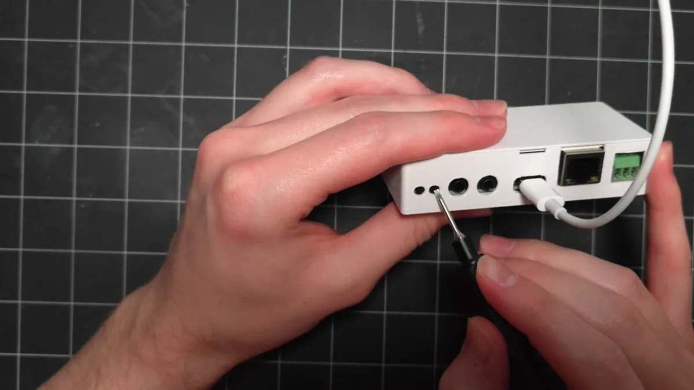

# Boot button status check and factory reset

The **boot** button on your CAST PRO-1 does two things while the device is running, depending on how long you hold it:

| Hold for | What happens |
| --- | --- |
| About 3 seconds | **Status check.** The onboard LEDs show the connection status, then run a component check. |
| 10 seconds | **Factory reset.** Erases your Wi-Fi details and settings, and the setup hotspot comes back. |

The boot button is the second recessed button from the left, next to **reset**. Press it with a pin or a small screwdriver.

## Status check

Use this to see whether your CAST PRO-1 is on your network and talking to Home Assistant, without opening an app.

1\. With the CAST PRO-1 plugged in, hold the **boot** button for about 3 seconds, then let go.

2\. Watch the onboard LEDs. They flash one color to show the connection status:

| Color | What it means |
| --- | --- |
| Yellow | No network connection. Check your Wi-Fi details or Ethernet cable. |
| Green | On your network, but not connected to Home Assistant. |
| Blue | Connected to Home Assistant. |

3\. The LEDs then flash green once more. That's the component check passing.

## Factory reset

A factory reset erases your Wi-Fi details and settings, so you'll set your CAST PRO-1 up again afterward.

!!! note "Unplug the Ethernet cable first"

    Your CAST PRO-1 doesn't broadcast its hotspot while an Ethernet cable is connected, so take the cable out before you start.

1\. With the CAST PRO-1 plugged in, hold the **boot** button for 10 seconds, then let go.

2\. The CAST PRO-1 restarts and broadcasts its hotspot again.

3\. In Home Assistant, delete the old CAST PRO-1 from the ESPHome integration. Open its device page, select the three dots menu, then **Delete**.

4\. Follow the [Getting Started guide](../setup/getting-started.md#connect-to-your-network) to connect your CAST PRO-1 to your network, then [add it to Home Assistant](../setup/getting-started.md#add-to-home-assistant) again.

!!! tip "Still not broadcasting a hotspot?"

    If your CAST PRO-1 won't broadcast its hotspot after a factory reset, [reflash it](castpro1-reflash.md) to restore the factory firmware.

[Join our Discord if you need more help! :simple-discord:](https://link.apolloautomation.com/discord){ .md-button }
