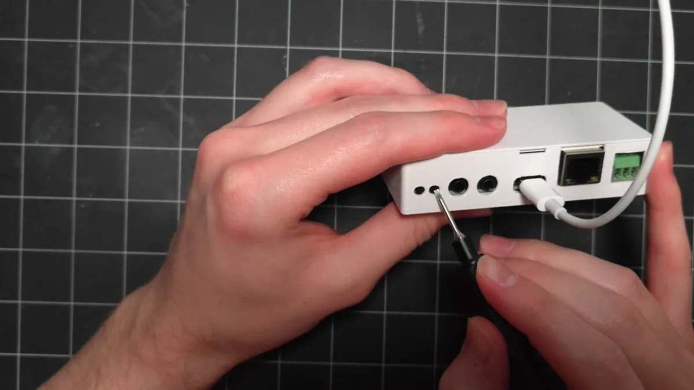
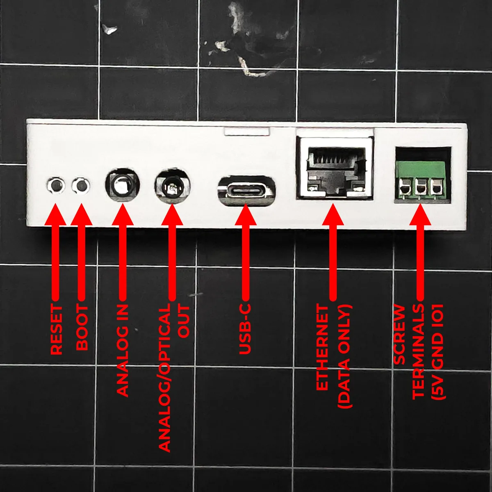

# Putting the CAST PRO-1 in boot mode

!!! info "This will cover how to put the CAST PRO-1 into boot mode."

    This is needed to force the device into boot mode to reflash the firmware. Both methods do the same thing, so use whichever is easier for you.

!!! warning "The buttons are swapped compared to the CAST-1"

    On the CAST PRO-1, **reset** is on the left and **boot** is on the right. Both are recessed, so press them with a pin or a small screwdriver.

## Method 1: Boot button only

1\. Unplug the CAST PRO-1 from power.

2\. Hold down the **boot** button (on the right) while plugging a USB-C data cable into the CAST PRO-1. Once connected, release the button.

<!-- TODO image: /assets/cast-pro-1-boot-mode-method-1.webp | alt: Holding the CAST PRO-1 boot button while plugging in a USB-C cable -->

3\. You are now ready to reflash your device!

[Click here to go to the reflashing guide!](castpro1-reflash.md){ .md-button .md-button--primary }

## Method 2: Boot and reset buttons

This method puts your device into boot mode with the boot and reset buttons.

1\. Plug a USB-C cable that supports power and data into your computer and connect the other end to your CAST PRO-1.

2\. Locate the reset and boot buttons on the front of the CAST PRO-1.

3\. Hold down the **boot** button (on the right), then press and release the **reset** button (on the left) while keeping the boot button pressed. Finally, release the boot button.

<!-- TODO image: /assets/cast-pro-1-boot-mode-method-2.webp | alt: Holding the CAST PRO-1 boot button while pressing and releasing the reset button beside it -->

4\. You are now ready to reflash your device!

[Click here to go to the reflashing guide!](castpro1-reflash.md){ .md-button .md-button--primary }
