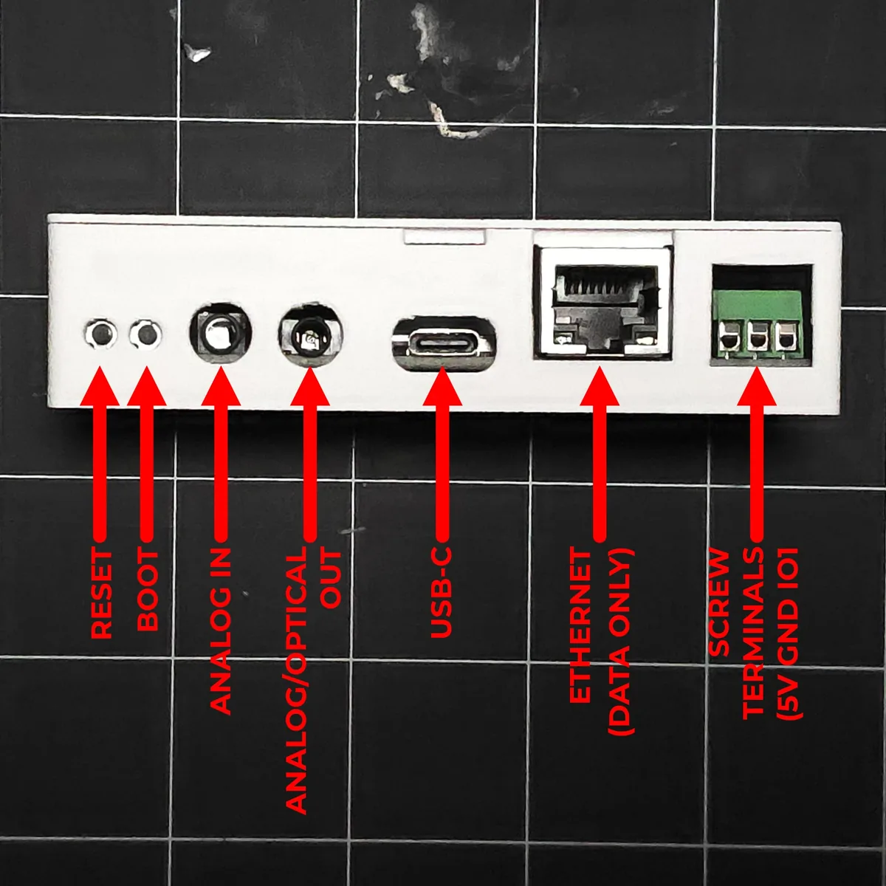

# Reflashing the CAST PRO-1

!!! info "Use this to put your CAST PRO-1 back on the latest factory firmware."

    Reflash if your device becomes unresponsive and you've exhausted the other troubleshooting methods, or to get onto the latest firmware.

1\. Plug a USB-C cable that supports power and data into your computer and connect the other end to your CAST PRO-1.

2\. Locate the **reset** and **boot** buttons on the front of your CAST PRO-1. They're recessed, so you'll need a pin or a small screwdriver. (1)
{ .annotate }

1.  Prefer to boot with a single button? Follow [Method 1 on the Boot Mode page](castpro1-boot-mode.md#method-1-boot-button-only) instead.

3\. Put the CAST PRO-1 into boot mode. Hold down the **boot** button (on the right), then press and release the **reset** button (on the left) while keeping the boot button pressed. Finally, release the boot button.

<!-- TODO image: /assets/cast-pro-1-boot-mode-method-2.webp | alt: Holding the CAST PRO-1 boot button while pressing and releasing the reset button beside it -->

4\. Open the <a href="https://install.apolloautomation.com/#/cast-pro-1" target="_blank" rel="noreferrer nofollow noopener">Apollo CAST PRO-1 Installer</a>.

<!-- TODO: name the firmware option in the install dialog (for example Install ApolloAutomation.CAST_PRO-1). -->

5\. Click **Connect & Install**. In the browser popup, select **USB JTAG/serial debug unit** and click **Allow**. When the installer opens, click **Install** to flash the firmware, then click **Install** again to confirm.

<!-- TODO image: /assets/cast-pro-1-reflash-firmware.gif | alt: Apollo CAST PRO-1 web installer, clicking Connect and Install, allowing the serial port, and confirming -->

6\. Once you see "**Installation complete!**" you are finished. Click **Next** then close out of the browser window.

!!! warning "Power cycle your device before doing anything else!"

    Your device is still in boot mode and needs to be power cycled, meaning power removed, to make it boot in a normal mode!

[Head to the Getting Started article to set up your CAST PRO-1 as a new device!](../setup/getting-started.md){ .md-button .md-button--primary }
