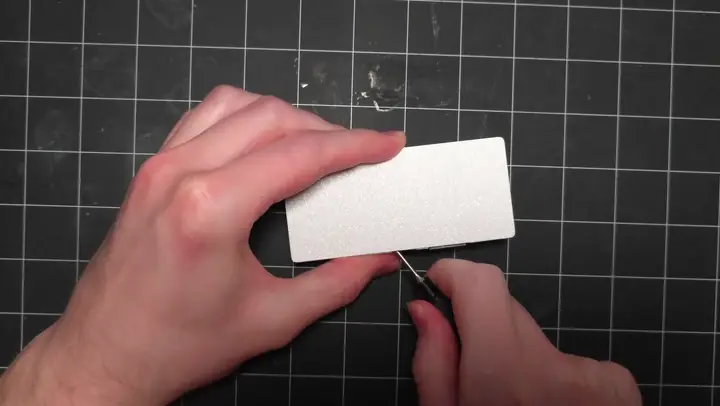
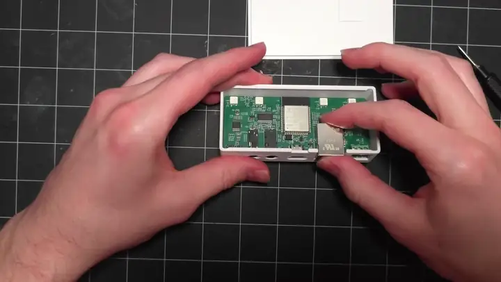
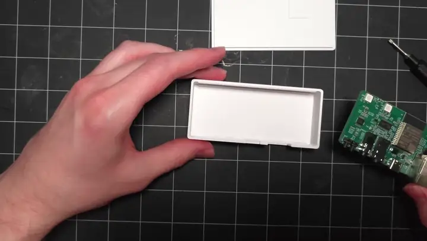
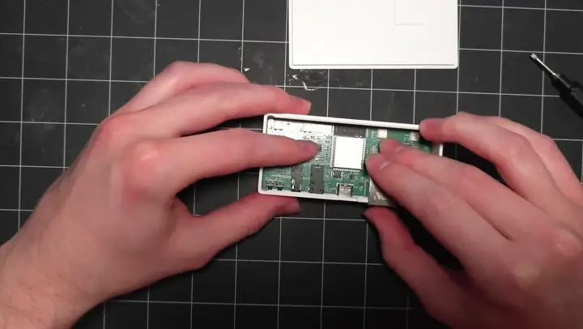

# Teardown and reassembly of CAST PRO-1

You'll pry the cover off, tilt the circuit board out of the case, and reverse the steps to put it back together. You'll need a small flathead screwdriver or a plastic pry tool.

!!! danger "Unplug before opening"

    Unplug the USB-C power cable, the Ethernet cable, both audio cables and any LED strip from the CAST PRO-1 before you open it.

## Disassembly

1\. Hold the case with the cover facing up. Slide a small flathead screwdriver into the gap between the cover and the case, then twist gently to pop the cover off.

2\. With the ports facing you, tilt the circuit board toward you and lift it out of the case. (1)
{ .annotate }

1.  The ports sit in cutouts along the front of the case. Tilting the board toward you lifts them clear of the cutouts, so don't pull the board straight up.

## Reassembly

1\. Tilt the circuit board toward you, slide the ports into their cutouts in the front of the case, then lower the back of the board until it sits flat.

2\. Line the cover up with the case and press it down until it snaps into place.

[Join our Discord if you need more help! :simple-discord:](https://link.apolloautomation.com/discord){ .md-button }
