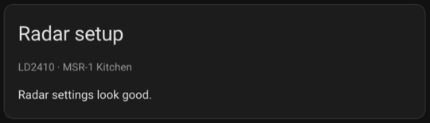
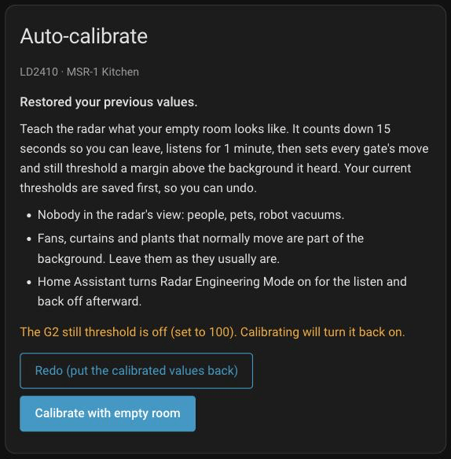
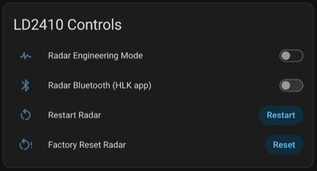
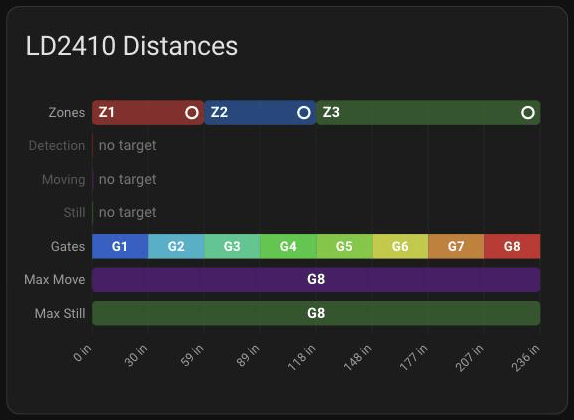
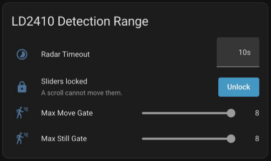
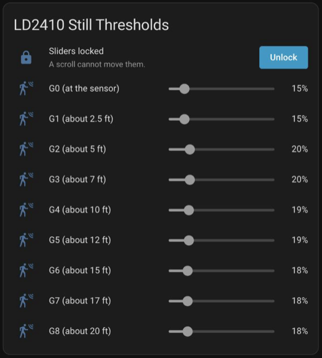
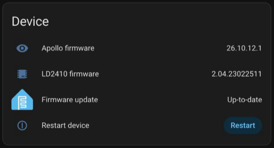
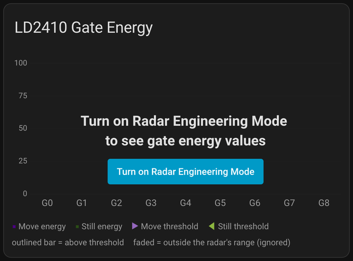

# Tune your radar with the Apollo mmWave dashboard

The Apollo mmWave dashboard puts every setting your radar has on one screen, with live charts that show what the radar sees. On an Apollo MSR-1, Apollo MSR-2, or Apollo R PRO-1 with the optional LD2412 radar addon, it can teach the radar what your empty room looks like in about a minute and a half, so it stops reacting to the room itself and starts reacting to people. On an R PRO-1 or an Apollo MTR-1 it is also where you draw occupancy zones on a map of the room.

Every tab starts with a **Start here** card that lists your sensor's first steps in order, and this guide follows the same order: check the **Radar setup** card, calibrate, set how far the radar looks and how long presence stays on, then fine-tune by hand. If you only do one thing today, press **Calibrate with empty room** and leave the room: [Calibrate with an empty room](#calibrate-with-an-empty-room) shows what to expect. On an MTR-1, or an R PRO-1 without the LD2412, go straight to the [eight steps to your first zone](#draw-zones-on-the-r-pro-1-and-mtr-1).

!!! info "What's new in 2.4.0"

    Most of 2.4.0 is on the zone map of R PRO-1 and MTR-1 tabs, and the [eight zone steps](#draw-zones-on-the-r-pro-1-and-mtr-1) walk you through it.

    - **A Zones panel under the map.** Add a zone, then name it and set its **Type** and **Hold** right there: [Add a zone](#add-a-zone).
    - **Expand map.** One press gives the zone map the whole window, with the **Zones** panel beside it: [Expand the map](#expand-the-map).
    - **A map that shows what's happening.** Zones light up while someone is in them, and each target is a numbered dot with a trail: [Read the map](#read-the-map).
    - **Ignore zones and hold times**, for a fan or a curtain, and for someone who sits still: [Ignore a spot or hold a zone](#ignore-a-spot-or-hold-a-zone).
    - **Zoom up to 8x** with corners that snap to round values, plus [marking corners by walking](#mark-corners-by-walking) and [movement history](#replay-movement-history): [Zoom in and move the map](#zoom-in-and-move-the-map).
    - **Target X and Y in mm.** Apollo mmWave switches an R PRO-1's or MTR-1's position sensors to mm for you: [Target X and Y units](#target-x-and-y-units).
    - **On MSR-1 and MSR-2 tabs**, a line under the Gate Energy chart says whether the radar reports a target: [Third column](#third-column).
    - **After an update**, the cards tell you when the page needs a reload: [Load the new cards](apollo-mmwave-dashboard-setup.md#load-the-new-cards).

Here's the **Start here** card on an MSR-1. On an MTR-1, or an R PRO-1 without the LD2412, it lists three zone map steps instead, and on an R PRO-1 with the LD2412 it covers both radars.

![The Start here card for an MSR-1 named MSR-1 Kitchen, with five numbered steps: fix anything the Radar setup card flags, press Calibrate with empty room, set Max Move Gate and Max Still Gate (each gate is about 2.5 ft), set Radar Timeout, and walk the room while you watch the Gate Energy chart, then the line In automations, use Radar Target for the whole room. If it turns off while someone sits still, raise Radar Timeout to 60 s or more. To ignore people past End Zone 3, use Any zone instead., followed by the Full tuning guide and All settings for this device links](/assets/apollo-mmwave-start-here.png)

!!! note "Before you start"

    - The Apollo mmWave integration is installed and its **Apollo mmWave** dashboard is in your Home Assistant sidebar. If it isn't, sign in as an administrator (from Apollo mmWave 2.2.6, the dashboard is for administrators only unless you unticked that box), or follow the [Apollo mmWave dashboard setup guide](apollo-mmwave-dashboard-setup.md) to add it.
    - This guide shows Apollo mmWave 2.4.0. On an older version some cards look different, so [update it](apollo-mmwave-dashboard-setup.md#upgrade-from-an-older-setup) first. If a card this guide describes isn't on your tab, see [If your dashboard is missing cards](apollo-mmwave-dashboard-setup.md#if-your-dashboard-is-missing-cards).
    - Your radar is online in Home Assistant through ESPHome.
    - Your sensor is mounted where it will stay. A calibration, and the zones you draw, describe the room from the sensor's position, so moving the sensor later means calibrating again or redrawing your zones.
    - A calibration needs the room empty for about a minute and a half: people and pets out, robot vacuum docked.

## How radar tuning works

The radar splits the space in front of it into distance bands called *gates*. G0 sits right at the sensor, G1 is the next band out, and so on to the far edge of its range. For every gate the radar measures two kinds of signal on a scale of 0 to 100: *move energy*, which rises when something moves at that distance (someone walking past), and *still energy*, which picks up the much smaller signal of someone who is there but not moving (sitting on the couch, breathing, typing).

Each gate has a *move threshold* and a *still threshold*. When a gate's energy rises above its threshold, that gate detects a target (the radar's word for a person, or anything else it picks up) and the radar reports presence. A lower threshold makes the gate more sensitive (and more likely to trigger on a fan or a curtain); a higher one makes it less sensitive. To see the live energy of every gate, the radar has to be in **Radar Engineering Mode**, a diagnostic setting that streams the per-gate readings to Home Assistant. With it off you still get presence, but the Gate Energy chart has nothing to show. It's safe to turn on and off whenever you like: it changes what the radar reports, not how it detects. The calibration turns it on for you while it listens. Left on, it saves every gate's energy to Home Assistant's database about once a second, so the **Radar setup** card reminds you to turn it off.

![The LD2410 Gate Energy chart with Radar Engineering Mode on, with someone at gate G2: a purple move bar and a green still bar for each gate from G0 to G8, with triangles marking each gate's move and still thresholds. Both G2 bars are above their thresholds and outlined. G7 and G8 are faded because Max Move Gate and Max Still Gate are 6, so the tall move bar at G8 is not outlined. The legend ends with outlined bar = above threshold and faded = outside the radar's range (ignored), and the line under it reads The radar reports a moving and a still target.](/assets/apollo-mmwave-gate-energy-live.png)

!!! tip "How far away is each gate?"

    Each gate is one step of the radar's gate size. Unless you changed it, that's 0.75 m (about 2.5 ft). You don't need to work the distances out: each row on the **Move Thresholds** and **Still Thresholds** cards is named for how far out its gate reaches, such as **G4 (about 3 m)**, or **G4 (about 10 ft)** when Home Assistant uses US customary units. G4 covers 2.25 m to 3 m (about 7.4 ft to 9.8 ft) from the sensor. The gate size setting is **Gate Size** on an MSR-1 or MSR-2 and **Distance Resolution** on an R PRO-1, and it's hidden on a new sensor: it only shows on the **Detection Range** card after you enable its entity on the sensor's device page. The **Gates** row on the Distances chart draws each gate along the distance axis, so you can read it off the screen. It starts at G1, because G0 is the reading right at the sensor and has no width. On an R PRO-1, a smaller Distance Resolution (0.5 m) gives finer tuning over a shorter range, and a larger one (0.75 m) reaches farther.

## Start with the Radar setup card

The first step on **Start here** points at the **Radar setup** card right under it on an MSR-1, MSR-2, or R PRO-1 tab. It reads the radar's settings and flags anything that gets in the way of a good calibration. Its second line names the chip and the sensor, and when there's nothing to fix it reads **Radar settings look good.**



The card changes nothing on its own. When it flags something, it says what's wrong and, where it can, offers a button that names the one change it makes:

- **Radar Engineering Mode is on, so every gate's energy is saved to the database about once a second.** Press **Turn off Radar Engineering Mode** once you're done watching the Gate Energy chart. While a calibration runs, the card says nothing about it, because the calibration needs the mode on.
- **The radar has not reported its gate thresholds yet, so those settings are blank.** Press **Read settings from the radar**. It only asks the radar to send them; nothing on the radar changes.
- A zone that can never turn on (MSR-1 and MSR-2), for example **Zone 2 can never turn on. End Zone 2 (150 cm) must be larger than End Zone 1 (200 cm).** The distances on the **LD2410 Zone Config** card are out of order, or a zone starts past how far the radar is set to look. Change the distances on the Zone Config card, or raise the max gates on the **Detection Range** card.
- **Min Gate** at or above **Max Gate** (R PRO-1). The LD2412 only detects people from Min Gate out to Max Gate, so set Min Gate lower than Max Gate on the **LD2412 Detection Range** card.

The last two have no button: the card explains them and leaves the new values to you. On an MTR-1, the **Radar setup** card under **Start here** checks the LD2450 instead, and an R PRO-1 tab has a second **Radar setup** card above the zone map for its LD2450. Both are covered in [Check the LD2450's Radar setup card](#check-the-ld2450s-radar-setup-card).

After you update Apollo mmWave, the **Radar setup** card can also show a notice above its checks, such as **Apollo mmWave was updated to 2.4.1, but this page still runs 2.4.0.** with a **Reload** button. It means the page still runs the cards from before the update. [Load the new cards](apollo-mmwave-dashboard-setup.md#load-the-new-cards) explains each notice.

## Calibrate with an empty room

Calibration is the fastest way to a well-tuned radar. Home Assistant listens to every gate while nobody is in the room, notes the highest energy each gate reaches from the room itself (fans, curtains, plants), and sets each threshold a little above that. Your current thresholds are saved first, so you can always put them back.

Run it when you first set up a radar, when it triggers with nobody there, and after you move the sensor or rearrange the room.

Before you press the button, the card's checklist asks for three things (an R PRO-1 adds a fourth, covered in [R PRO-1 and its LD2412 radar](#r-pro-1-and-its-ld2412-radar)):

- Nobody in the radar's view: people, pets, and robot vacuums all count. Someone sitting still is the hardest case, because their still energy becomes the "background".
- Leave fans, curtains, and plants that normally move as they usually are. They are part of the background you want the radar to ignore.
- Radar Engineering Mode is handled for you. If it is off, Home Assistant turns it on for the listen and back off at the end. If it is already on, the card says **Radar Engineering Mode is already on and will stay on.**

On an MSR-1 or MSR-2 that has never been tuned, the card may also say **These look like factory thresholds. Calibrating sets them for your room.**

A threshold of 100 means that gate never triggers, so some people set a gate to 100 to turn it off. Calibration sets every gate the radar uses, including those, and the card warns you first, for example **The G2 still threshold is off (set to 100). Calibrating will turn it back on.** If you turned that gate off on purpose, calibrate anyway and set it back to 100 afterward on the **Still Thresholds** (or **Move Thresholds**) card.


### Run a calibration

You start the calibration from the card, then stay out of the room for about a minute and a half while it listens. On an R PRO-1, first clear the room, press **Start Dynamic Background Correction** on the **LD2412 Controls** card, and wait for **Background Correction Running** to turn off (see [R PRO-1 and its LD2412 radar](#r-pro-1-and-its-ld2412-radar)).

1. Press **Calibrate with empty room** on the **Auto-calibrate** card. Take your phone with you if you'd like to watch the countdown and the listen from outside the room.
2. Leave the room while the countdown runs and close the door behind you. Then move away from the door and the walls: the radar can see through drywall and thin doors, so waiting right outside can count as someone in the room. If the room has no door, go to another room, out of the sensor's view.
3. Come back after about a minute and a half, once the card shows **Thresholds updated**, and read the result.

The job runs inside Home Assistant, so closing the browser or putting your phone away does not stop it. Open the dashboard again and the card picks up wherever the job is. Here is what the card shows along the way:

| Stage | What the card shows | How long |
| --- | --- | --- |
| Starting (only if Radar Engineering Mode was off) | **Turning on Radar Engineering Mode...** | A moment |
| Countdown | **Leave the room now.** and **Listening starts in 15 s.**, counting down | 15 seconds |
| Warm-up | **Waiting for gate energy from the radar...**, only if the radar is slow to start sending energy | A few seconds at most |
| Listening | **Listening to the empty room... 60 s left**, **Keep the room empty. 12 samples so far.**, and two lines starting **Highest so far, move:** and **Highest so far, still:** with the peak of each gate so far | 60 seconds |
| Reading (R PRO-1 only) | **Reading the radar's current thresholds...** | A few seconds |
| Writing | **Writing 16 thresholds to the radar... 7 of 16** and **Values already written stay until you undo.** The count is the number of thresholds that are changing. | A few seconds |
| Checking | **Checking that the radar accepted the new values...** | About 3 seconds |
| Done | **Thresholds updated** | |

Here is a whole run on an MSR-1, sped up: turning on Radar Engineering Mode, the countdown, the listen with the highest energy of each gate so far, the writing and checking stages, and the result.

<video src="/assets/apollo-mmwave-calibrate.mp4" poster="/assets/apollo-mmwave-calibrate-poster.jpg" autoplay loop muted playsinline aria-label="A calibration on the Auto-calibrate card, sped up: Turning on Radar Engineering Mode, Leave the room now with a 15 second countdown, Listening to the empty room with the highest energy of each gate, Writing 18 thresholds to the radar, Checking that the radar accepted the new values, and Thresholds updated with the result table"></video>

From the countdown through the listen, the card also reminds you: **Leave Radar Engineering Mode on until this finishes.** Turning it off during the listen stops the calibration without changing anything.

A **Stop** button sits under the progress bar until the checking stage. Press it and it reads **Stopping...** for a moment. Stopped before the writing stage, the card says **Stopped. Nothing was changed.** Stopped partway through writing, it says how many values were written and that **Undo** restores the saved values.

Not ready to change anything yet? **Preview only** runs the same countdown and listen and shows you the thresholds it would set. The card explains: **Computes new thresholds without changing any of them. Radar Engineering Mode is still turned on for the listen.** The preview ends with **Preview: no threshold was changed.** and **These are the thresholds calibration would set:** above the result table, and two buttons: **Calibrate and apply** starts a full calibration (with a fresh countdown and listen), and **Close** returns the card to its start.


### Read the result

When the run finishes, the card shows **Thresholds updated** and a summary such as **Calibrated at 02:32 PM from 60 samples. 16 of 18 thresholds changed.** Times appear in your browser's format, so you might see 14:32 instead of 02:32 PM. An MSR-1 or MSR-2 has 18 thresholds (9 gates, move and still); an R PRO-1 has 28 (14 gates).

Below the summary is a table with one row per gate and the columns **Gate**, **Move peak**, **Move threshold**, **Still peak**, and **Still threshold**. The peak is the highest energy that gate reached while the room was empty. The new threshold is that peak plus some headroom, capped at 100. From Apollo mmWave 2.2.4, the headroom is 15 points or 35% of the peak, whichever is larger: a move peak of 14 becomes a threshold of 29, and a still peak of 60 becomes 81. Earlier versions used 10 points or a quarter of the peak, so calibrate again after updating to get the extra headroom.


What the threshold cells mean:

- **50 → 24**: the threshold changed from 50 to 24.
- **24 (unchanged)**: the new value matched the old one, so nothing was written.
- **100 → 15 (was off)**: that gate was turned off (set to 100) and calibration turned it back on. A line under the table says so and how to turn it off again.
- **100 (off)** or **40 → 100 (off)**: the background at that gate was so strong the threshold went to the top of the scale, so that gate can no longer trigger. On an MSR-1 or MSR-2, the G0 and G1 still thresholds often end up here, because those gates sit right at the sensor and their still energy idles near the top. That's normal and needs no action, so the card does not warn about them. For any other gate in use, including G0 and G1 move, the card warns you (see [Warnings the card can show](#warnings-the-card-can-show)).
- **no data**: the gate sent too few readings, so it was left as it was.
- **(spike seen)** after a peak: one reading jumped well above the rest, as if something moved. The threshold still comes from that peak, so that gate ends up less sensitive. If nothing should have moved there, run the calibration again with the room empty.
- **not confirmed (radar offline)** or **(not confirmed)**: the radar did not report the new value back. See [Thresholds did not change on the radar](#thresholds-did-not-change-on-the-radar).

Gates outside the range the radar is set to use are dimmed, with a note under the table such as **G7, G8: not used (beyond Max Move Gate 6)**. They are still calibrated, so they are ready if you extend the range later.

### Check the result or undo it

Under the table, the card suggests a walk test:

**Now walk around, then sit still for a minute: the Radar Target row in Target / Occupancy should stay on the whole time you are in the room and turn off a few seconds after you leave (Radar Timeout).**

1. Press **Turn on Radar Engineering Mode** on the Gate Energy chart if you'd like to watch the gates as well.
2. Walk through the room, then sit where you usually sit and stay still for a minute or two. **Radar Target** covers still presence as well as movement, so it should stay on the whole time. With Radar Engineering Mode on, the bars of the gates you're in should be outlined, and the line under the chart should say the radar reports a target, such as **The radar reports a still target.**
3. Leave the room. **Radar Target** should turn off a few seconds later, once **Radar Timeout** runs out, no gate should stay outlined, and the line under the chart should read **The radar reports no target.**
4. If you turned on Radar Engineering Mode, press **Turn off Radar Engineering Mode** on the **Radar setup** card, or use the switch on the **Controls** card.

If **Radar Target** turns off while you sit still, see [Radar Target turns off while someone sits still](#radar-target-turns-off-while-someone-sits-still).

Below the walk-test line are three buttons: **Undo (restore your previous values)**, **Calibrate again** (a fresh calibration with a new countdown and listen), and **Close**. If the radar now misses you, or behaves worse than before, press **Undo (restore your previous values)**. The card shows **Restoring saved thresholds... 3 of 16** and then **Restored your previous values.** Undo saves the values it replaces first, so the button then reads **Redo (put the calibrated values back)**, and pressing it puts the calibrated values back. The saved copy survives a Home Assistant restart.



If someone walked in during the listen, press **Stop**: nothing is written before the writing stage. If you only notice afterward, press **Undo**, clear the room, and press **Calibrate with empty room**.

The next time you open the dashboard, the card starts on its checklist again with a line such as **Last calibrated Oct 11, 02:32 PM, 16 of 18 thresholds changed.** (in your browser's date and time format), the **Undo (restore your previous values)** button with the time those values were saved under it (**Saved Oct 11, 02:31 PM.**), and **Show last result** to open the last result table.

### Warnings the card can show

Warnings appear under the result table. Each one is a sign the result may not match your empty room:

- **The radar reported someone present for 40% of the listen. If someone was in the room, even sitting still, press Undo and run it again.** The radar detected presence for more than a quarter of the listen. That is normal for a radar that was too sensitive (which is what you are fixing), but if a person or pet was in the room, the thresholds are too high. Press **Undo**, clear the room, and run it again. If you're sure the room was empty, keep the result and do the walk test in [Check the result or undo it](#check-the-result-or-undo-it).
- **The G3 move threshold is now off (its background peaked at 92). If a fan or curtain moves there all day this is fine; if not, press Undo and run again with the room really empty.** That gate can no longer detect anything. If something at that distance moves all day, that is the expected result. If not, something moved there during the listen: press **Undo** and run it again with the room empty.
- **The radar was unavailable for part of the listen; gates with too few readings were left as they were.** The radar dropped off the network for a moment. Gates marked **no data** kept their old thresholds. Check the radar's connection and run it again.
- **The G2 still threshold was off (set to 100) and calibration turned it back on (now 15). If you turned it off on purpose, set it back to 100 on the Still Thresholds card, or press Undo to put back all your previous values.** You had that gate turned off, and calibration set it like every other gate. If you want it off, set it back to 100 on the card the line names. A preview words it as what calibration would do.
- **2 values could not be confirmed: G3 move threshold reads back 35 (asked for 27), G5 still threshold could not be read (radar offline). Check the Move / Still Thresholds cards.** The radar did not report some of the new values back. The heading reads **Thresholds updated, 2 could not be confirmed**. Check those gates on the threshold cards, and press **Undo** or run it again once the radar is stable.

## A tour of the radar tab

Open **Apollo mmWave** from your sidebar and, if you have more than one radar, pick your radar's tab. On a wide screen the cards sit in columns; on a phone they stack in the order below. Card titles start with the name of the radar chip: **LD2410** on an MSR-1 or MSR-2, **LD2412** on an R PRO-1. A card only shows rows for entities Home Assistant has, so a setting the firmware hides has no row.

### First column

- **Start here**: your sensor's name and its first steps, pictured at the top of this guide. It ends with two links. **Full tuning guide →** opens this guide on the wiki: on an MSR-1 or MSR-2 the general version, the one that covers every Apollo radar, and on an R PRO-1 [the R PRO-1 version](/products/rpro1/setup/apollo-mmwave-dashboard.md#r-pro-1-and-its-ld2412-radar) at its LD2412 section. **All settings for this device →** opens the sensor's own page in Home Assistant, where every setting the dashboard leaves out lives. On an MSR-1 or MSR-2, a line under the steps says which sensor to use in automations: **In automations, use Radar Target for the whole room. If it turns off while someone sits still, raise Radar Timeout to 60 s or more.** With the **Any zone** sensor, it adds **To ignore people past End Zone 3, use Any zone instead.** On an R PRO-1, the card also says what each radar is for and which presence sensor to use in automations (see [Use the zone sensors](#use-the-zone-sensors)).
- **Radar setup**: checks the radar's settings and offers a fix (see [Start with the Radar setup card](#start-with-the-radar-setup-card)).
- **Auto-calibrate**: the calibration card. It shows the chip and the device name under its title, a short checklist, and the **Calibrate with empty room** button. Under the checklist, and under the result of a calibration, it reminds you: **If Radar Target turns off while someone sits still, raise Radar Timeout to 60 s or more on the Detection Range card. Undo restores the thresholds from before a calibration.** Everything else about it is in [Calibrate with an empty room](#calibrate-with-an-empty-room) above.
- **LD2410 Controls**: the **Radar Engineering Mode** switch, plus **Radar Bluetooth (HLK app)**, **Restart Radar**, and **Factory Reset Radar**. On an R PRO-1 the card also has **Start Dynamic Background Correction** and **Background Correction Running** (see [R PRO-1 and its LD2412 radar](#r-pro-1-and-its-ld2412-radar)). **Radar Bluetooth (HLK app)** is the radar chip's own Bluetooth for the HLK phone app, not your sensor's Bluetooth proxy. **Restart Radar** restarts the radar chip without changing any settings. Leave **Factory Reset Radar** alone unless Apollo support asks you to press it: it puts the radar chip's settings, every threshold included, back to factory values, so run **Calibrate with empty room** again if it happens. Both ask before they act. The restart for the whole sensor is on the **Device** card at the bottom of the tab.

    

- **LD2410 Zone Config** (MSR-1 and MSR-2): **Start Zone 1**, **End Zone 1**, **End Zone 2**, and **End Zone 3** split the radar's range into three distance bands, each with its own occupancy sensor (**Radar Zone 1 Occupancy** to **Radar Zone 3 Occupancy**). These are distances from the sensor, not areas you draw like on the R PRO-1 and MTR-1 zone map. The boxes are in cm, even when Home Assistant uses feet, and the zones sit back to back: Zone 1 runs from Start Zone 1 to End Zone 1, Zone 2 from there to End Zone 2, and Zone 3 from there to End Zone 3. They're optional: leave them as they are unless you want separate sensors for, say, the couch and the far end of the room. The note under the card ends with **For the whole room, use Radar Target in automations: the zone sensors also need the radar's distance, which can read unknown while someone is there.** The zone sensors only know which band someone is in from the distance the radar reports, while **Radar Target** comes from the radar's own detection.

### Second column

- **LD2410 Distances**: a chart laid out along the radar's range. From top to bottom it can show a **Zones** row with your three distance bands (**Z1** to **Z3**, with a filled circle when someone is in that band), bars for the current **Detection**, **Moving**, and **Still** distance, the **Gates** row, and bars that mark how far the radar is set to look (**Max Move** and **Max Still**, or **Max Gate** and **Min Gate** on an R PRO-1). On a computer, hover over a row for a short explanation. Distances show in meters, or in inches if Home Assistant uses US units. When the radar reports a target but its distance reads unknown, the row reads **distance unknown** instead of a length, and its explanation adds **The radar reports a target, but its distance reads unknown.** The three zone sensors need that distance, so they can read clear at that moment while **Radar Target** is on.

    

- **LD2410 Detection Range**: **Radar Timeout** (how long presence stays on after the last detection), the gate size (hidden until you enable its entity), and the sliders that set how far the radar looks: **Max Move Gate** and **Max Still Gate** on an MSR-1 or MSR-2, **Max Gate** and **Min Gate** on an R PRO-1. The sliders start locked under a **Sliders locked** row (see [Set the range and timeout](#set-the-range-and-timeout)). A note under the card explains each one and gives each gate's depth in your units.

    

- **LD2410 Target / Occupancy**: **Radar Target** (anyone detected), **Radar Moving Target**, **Radar Still Target**, and on an MSR-1 or MSR-2 **Radar Zone 1 Occupancy** to **Radar Zone 3 Occupancy** and **Any zone**, which is on while someone is in any of the three zones. A row lights up while it's on. On an R PRO-1 this card sits in the first column instead. For an automation that covers the whole room, use **Radar Target**.

### Third column

- **LD2410 Gate Energy**: the chart you tune with. Each gate has two bars, a purple one for move energy and a green one for still energy, on a 0 to 100 scale. While Radar Engineering Mode is on, a right-pointing triangle marks each gate's move threshold and a left-pointing triangle its still threshold, and a bar that rises above its threshold gets an outline in the threshold's color: **outlined bar = above threshold**. Gates outside the range the radar uses are faded and never outlined, because the radar ignores their energy: past **Max Move Gate** for move bars and **Max Still Gate** for still bars, or outside **Min Gate** to **Max Gate** on an R PRO-1. While a gate is faded, the legend adds **faded = outside the radar's range (ignored)**.

    Under the chart, a line gives the radar's own answer while Radar Engineering Mode is on: **The radar reports a moving and a still target.**, **The radar reports a moving target.**, **The radar reports a still target.**, or **The radar reports no target.** An outlined bar and the radar's answer usually agree. On an MSR-1 or MSR-2, when the radar reports no target while a bar in its range is outlined, the chart adds **Energy above a threshold does not always mean a target. Once the LD2410 loses someone who sits still, it often needs them to move before it detects them again.** (see [Radar Target turns off while someone sits still](#radar-target-turns-off-while-someone-sits-still)).

    While Radar Engineering Mode is off, the chart is dimmed with **Turn on Radar Engineering Mode to see gate energy values** and a **Turn on Radar Engineering Mode** button you can press right there.

- **LD2410 Move Thresholds**: one slider per gate (**G0** to **G8** on an MSR-1 or MSR-2, **G0** to **G13** on an R PRO-1) to set each gate's move threshold. Each row is named for how far out its gate reaches, from **G0 (at the sensor)** to **G8 (about 6 m)**, in feet when Home Assistant uses US customary units. The sliders start locked, like the Detection Range ones. A note underneath recaps how thresholds work.

### Fourth column

- **LD2410 Occupancy History**: the last 24 hours of **Detected**, **Moving**, and **Still** (and, on an MSR-1 or MSR-2, **Any zone** and **Zone 1** to **Zone 3**), so a false trigger overnight is still there in the morning. On an R PRO-1 it's titled **Occupancy History**, its lines read **LD2412 Presence**, **LD2412 Moving**, and **LD2412 Still**, and it also shows **LD2450 Presence** and each zone you drew.
- **LD2410 Still Thresholds**: one slider per gate for the still thresholds, named and locked the same way.



- **Device**: at the bottom of every tab. It shows **Apollo firmware**, the radar chip's firmware (**LD2410 firmware** on an MSR-1 or MSR-2, **LD2450 firmware** on an MTR-1; on an R PRO-1, both chips' versions are hidden until you enable them on the device page), and **Firmware update**, which opens Home Assistant's own update window when you tap it. An MTR-1 has no Firmware update row. **Restart device** restarts the whole sensor after you confirm. On an R PRO-1 with the LD2412 it reads **Restart device (both radars)**, and on an MTR-1 or an R PRO-1 without the LD2412 it reads **Restart device (also restarts the radar)**. Under the rows are the **All settings for this device →** link and how to download a [support file](#send-apollo-a-support-file). While the Wi-Fi signal is below -75 dBm, a **Weak Wi-Fi** note appears too.



On an R PRO-1, the **Zone Map** heading comes right after the first column, with the LD2450's own **Radar setup** card, the zone map, **Zone presence**, **LD2450 Live**, and **LD2450 Controls**, so on a phone you reach them before the LD2412's threshold cards (see [Draw zones on the R PRO-1 and MTR-1](#draw-zones-on-the-r-pro-1-and-mtr-1)). An MTR-1 tab has those cards, its own **Start here**, and the **Device** card, without the tuning cards.

## R PRO-1 and its LD2412 radar

Every R PRO-1 has an LD2450 radar, and the optional LD2412 addon adds a second one. The LD2412 handles presence and gets the tuning cards and the calibration, and the LD2450 tracks positions for the [zone map](#draw-zones-on-the-r-pro-1-and-mtr-1). An R PRO-1 without the LD2412 still shows the LD2412 cards on its tab, but there's no radar behind them, so the calibration and this section don't apply to it; its **Start here** card gives the zone map steps instead, and its zone map works the same. With the LD2412, a few things differ from an MSR-1 or MSR-2:

- The tab has two **Radar setup** cards. The one under **Start here** checks the LD2412, and its second line starts with **LD2412**. The one above the zone map checks the LD2450.
- The LD2412 has 14 gates, **G0** to **G13**, so a calibration sets 28 thresholds.
- **LD2412 Detection Range** has **Distance Resolution** instead of Gate Size, and **Max Gate** and **Min Gate** instead of Max Move Gate and Max Still Gate. Gates below Min Gate or beyond Max Gate are dimmed in the result table, for example **G0: not used (below Min Gate 1)**.
- There is no Zone Config card, and the Distances chart shows the gates and the Max Gate and Min Gate bars without live distance bars.
- Before it writes, the calibration asks the radar for its current thresholds (**Reading the radar's current thresholds...**), so what it saves for Undo matches the radar.


The LD2412 also has its own background learning, **Start Dynamic Background Correction** on the **LD2412 Controls** card. It runs on the radar chip and stores its result inside the radar. **Background Correction Running** shows whether it is still working. Use both, in this order:

1. Clear the room and press **Start Dynamic Background Correction**.
2. Wait for **Background Correction Running** to turn off. Until it does, the Auto-calibrate card says **Background correction is running on the LD2412. Wait for its status to turn off.** and its button stays disabled.
3. Press **Calibrate with empty room** with the room still empty.

Run the calibration again after any later background correction. During a calibration on an R PRO-1, the card's reminder reads **Leave Radar Engineering Mode on and do not press Start Dynamic Background Correction until this finishes.** Pressing it during the listen stops the calibration without changing anything.

!!! warning "Undo cannot reverse a background correction"

    The Auto-calibrate card's **Undo** restores the thresholds Home Assistant saved. Dynamic Background Correction changes the radar itself, outside those thresholds, so Undo cannot reverse it.

## Set the range and timeout

Steps 3 and 4 on **Start here** point at the **Detection Range** card: how far the radar looks, and how long presence stays on after you stop moving. Its sliders, and the ones on the two threshold cards, start locked, so a finger that lands on one while you scroll a phone can't change a setting.

1. Press **Unlock** on the **Sliders locked** row. That unlocks this sensor's sliders on all three cards, and the row reads **Sliders unlocked**.

    <video src="/assets/apollo-mmwave-slider-lock.mp4" poster="/assets/apollo-mmwave-slider-lock-poster.jpg" autoplay loop muted playsinline aria-label="The LD2410 Detection Range card with its sliders locked: a tap turns the Max Move Gate slider orange, a second tap shows the reminder These sliders are locked. Press Unlock above them to change one. with an Unlock button, then Unlock is pressed and the row reads Sliders unlocked, They lock again after 5 minutes without a change."></video>

2. Lower **Max Move Gate** and **Max Still Gate** (**Max Gate** on an R PRO-1) to stop the radar looking past a certain distance, such as a hallway beyond the doorway. The note under the card gives each gate's depth. On an R PRO-1, raise **Min Gate** to ignore anything right next to the sensor.
3. Raise **Radar Timeout**, to 60 s or more, if lights turn off while you sit still (see [Radar Target turns off while someone sits still](#radar-target-turns-off-while-someone-sits-still)). It's how long **Radar Target** (**LD2412 Presence** on an R PRO-1) stays on after the radar last detects someone. It's a number box, so it's never locked.

The sliders lock again on their own after 5 minutes without a change, when you leave the tab, and each time the page loads, but never while you're dragging one. **Lock** on the same row locks them right away.

!!! tip "Touched a locked slider?"

    A locked slider is gray and still shows its value, and a scroll that starts on it scrolls the page. Touch one and it turns orange for a moment while **Unlock** flashes. Try again within 10 seconds and Home Assistant shows **These sliders are locked. Press Unlock above them to change one.** with an **Unlock** button. The lock lives in the browser page, so another phone or browser tab has its own, and **Calibrate with empty room** works whether the sliders are locked or not.

## Fine-tune gates by hand

Calibration gets most rooms right. If one spot still misbehaves, the Gate Energy chart shows you which gate to change. The outline is the signal to read: an outlined bar is a gate whose energy is above its threshold right now, inside the range the radar uses. The line under the chart says whether the radar reports a target.

1. Press **Turn on Radar Engineering Mode** on the Gate Energy chart. The bars and threshold triangles appear.

    <video src="/assets/apollo-mmwave-gate-energy.mp4" autoplay loop muted playsinline aria-label="The LD2410 Gate Energy chart turning on: first dimmed behind Turn on Radar Engineering Mode, then, once its button is pressed, live move and still bars for G0 to G8 with a triangle for each threshold, updating about once a second, with G7 and G8 faded as outside the radar's range. Under the legend the radar's answer reads The radar reports no target. while the room is empty, The radar reports a moving target. while the outlined move bar of someone walking in moves from G5 to G3, then The radar reports a moving and a still target. and The radar reports a still target. as they sit down at G2, whose still bar stays outlined"></video>

2. Leave the room and watch the chart from your phone, somewhere out of the radar's view (it can see through drywall, so step away from the wall too). A bar that is outlined while nobody is there, with a line under the chart that says the radar reports a target, is a gate causing false triggers. Gates outside the range the radar uses are faded and never outlined, because the radar ignores them: that range runs up to **Max Move Gate** for move bars and **Max Still Gate** for still bars, or from **Min Gate** to **Max Gate** on an R PRO-1.
3. Press **Unlock** above the sliders, then raise the threshold of each gate causing false triggers on **Move Thresholds** (purple bar) or **Still Thresholds** (green bar) until its triangle sits a few points above the highest point the bar reaches.
4. Sit or stand where the radar misses you. Your gate is the one whose bars rise when you shift in place; each threshold row names how far out its gate reaches, and the **Gates** row on the Distances chart shows it too. Lower that gate's threshold a few points at a time until its bar is outlined while you are there, but not after you leave.
5. Turn off **Radar Engineering Mode** when you are done: press **Turn off Radar Engineering Mode** on the **Radar setup** card, or use the switch on the **Controls** card. The chart has no off button.

The **Detection Range** card helps too: [Set the range and timeout](#set-the-range-and-timeout) covers it.

!!! tip "Calibrate first, then fine-tune"

    A new calibration sets every threshold again, including ones you changed by hand. If you calibrate after fine-tuning and prefer your own values, **Undo** brings them back.

## Draw zones on the R PRO-1 and MTR-1

The LD2450 radar in the R PRO-1 and MTR-1 tracks where up to three people are in the room. The zone map lets you draw areas on that map, such as the couch or the desk, and gives each area its own occupancy sensor. On an MTR-1 the tab is built around the zone map: **Start here**, the **Radar setup** card, and the map come first, with the radar's live status and controls beside them. On an R PRO-1, the LD2450's **Radar setup** card, the map, and the radar's live status and controls sit under the **Zone Map** heading, right after the first column of LD2412 cards, and its **Start here** card stays at the top of the tab.

Your first zone takes eight steps. The sections below follow them in order, each with a picture or a short clip of what you'll see:

1. **Install Apollo mmWave and open its dashboard.** The [setup guide](apollo-mmwave-dashboard-setup.md) covers both, and your sensor's tab holds the zone map.
2. **Fix anything the Radar setup card flags.** Its button sets the radar up for the map: [Check the LD2450's Radar setup card](#check-the-ld2450s-radar-setup-card).
3. **Set Cone rotation** so the map faces the way the sensor does: [Match the map to how the sensor is mounted](#match-the-map-to-how-the-sensor-is-mounted).
4. **Add a zone and draw it** over the spot it covers: [Add a zone](#add-a-zone), then [Draw a zone](#draw-a-zone).
5. **Name the zone, and choose Detect or Ignore and a hold time** in its editor under the map: [Pick a zone in the Zones panel](#pick-a-zone-in-the-zones-panel), [Rename a zone](#rename-a-zone), and [Ignore a spot or hold a zone](#ignore-a-spot-or-hold-a-zone).
6. **Walk into the zone to check that it works.** It lights up on the map while you're in it: [Read the map](#read-the-map), then [Use the zone sensors](#use-the-zone-sensors) in your automations.
7. **Expand the map** whenever the card feels cramped: [Expand the map](#expand-the-map).
8. **Check the Target X and Y units.** Apollo mmWave shows them in mm for you, and for a radar you already had, a notification lists the sensors it switched: [Target X and Y units](#target-x-and-y-units).

The **Start here** card on an MTR-1, or on an R PRO-1 without the optional LD2412, lists steps 2, 3, 4, and 6 in short. After the steps come the map's other tools: [zoom](#zoom-in-and-move-the-map), [the lock](#lock-and-unlock), [marking corners by walking](#mark-corners-by-walking), [deleting zones](#clear-or-delete-a-zone), and [movement history](#replay-movement-history).

The zone map card shows your radar's name and the area the radar can see: a view cone 120 degrees wide and about 6 m (20 ft) out, with a caption at its edge such as **Radar range 6 m (20 ft), 120°**, and a numbered dot for each person it tracks. The map fits that area, turned the way you set **Cone rotation**, plus any zone you drew outside it. Buttons sit in the bottom corners of the grid, with the zoom buttons above the ones on the right, and the expand button sits in its top-right corner (see [Expand the map](#expand-the-map)). Underneath are:

- The **Coverage** button, and for administrators **History** once movement history is on, and **🚶 Mark corners by walking** before it on a phone or tablet.
- The **Zones** panel, which is always open. It holds **Add zone**, a button for each zone, and an editor for the zone you picked: its name, size, **Type**, **Hold**, whether someone is in it right now, how to draw it, and **Delete zone** (see [Pick a zone in the Zones panel](#pick-a-zone-in-the-zones-panel)).
- **Map settings**, a collapsed section at the bottom of the card, with **Cone rotation**, the left-to-right flip, **Movement history**, and **Clear all shapes**.

On the Apollo mmWave dashboard the zone map's section is two columns wide, so on a computer the map is about twice as wide as the cards beside it. On a phone it fills the screen's one column as before. The map is never taller than the window less about 200 px, so the page around it stays in view. In a wide, short window it gets narrower instead and sits in the middle of the card, though that limit never makes it shorter than 240 px, so a phone on its side still gets a map.

![The zone map for an R PRO-1 named R PRO-1 Server Rack, in feet: the radar's view cone fills the grid from -16 ft to 16 ft across, with the caption Radar range 20 ft (6 m), 120°, and a rectangle named Zone 1 at the sensor, a circle named Zone 2, and a polygon named Zone 3, each with a pale fill and a dashed outline because nobody is in it. The expand button sits in the map's top-right corner. Along the bottom of the grid are the ✎ button, the m / ft switch with ft selected, the dimmed ↶ undo button, and the Locked button, with the zoom buttons above those on the right: a dimmed minus, + and Fit. Under the grid are the Coverage button and the Zones panel: the Zones heading with the Add zone button, a button for each zone with its color dot, Zone 1 selected, and Zone 1's editor, edged in red, with the Name box reading Zone 1, Size 6 ft 7 in × 3 ft 3 in, the Type list at Detect and the Hold list at Off, the hint Detect: its presence sensor turns on while someone is inside. Hold keeps it on for a while after someone inside goes still and the radar loses them., Now Nobody is in this zone, the note The map is locked, so drawing is off. Unlock it to draw this zone or change its shape. with an Unlock button, and a Delete zone button. The collapsed Map settings section ends the card](/assets/apollo-mmwave-zone-map.png)

The map is in feet when Home Assistant uses US customary units (**Settings → System → General**), and in meters otherwise. The **m / ft** switch in the bottom-right corner of the map changes it. When an administrator presses it, the choice is saved for that radar, so everyone who opens its map sees that unit. Anyone else changes only their own view, until they reload the page. Zones are stored in millimeters either way, so switching units never moves a zone. The switch changes only the map, never the radar's Target X and Y sensors (see [Target X and Y units](#target-x-and-y-units)).

### Check the LD2450's Radar setup card

The **Radar setup** card right above the map checks the two LD2450 settings that decide whether the map can show people. The radar chip keeps these itself, and Apollo firmware never sets them:

- **Zone Type** should be **Disabled**, because the zone map replaces the radar's own built-in zones. On **Detection**, the radar reports only people inside those built-in zones, and with none set it reports nobody, so the map stays empty. On **Filter**, it hides people inside them. To keep a fan or a curtain from turning your zones on, draw an [ignore zone](#ignore-a-spot-or-hold-a-zone) over it on the map.
- **Multi Target Tracking** should be on. Off, the radar tracks only one person.


Press the button the card shows: **Set Zone Type to Disabled**, **Turn on Multi Target Tracking**, or **Use recommended settings** when both need fixing. The card changes nothing until you press one, and reads **Radar settings look good.** once both are right. On an R PRO-1, Home Assistant hides Multi Target Tracking by default, so the card checks only Zone Type until you enable that setting (see [The zone map shows nobody, or only one person](#the-zone-map-shows-nobody-or-only-one-person)).

For administrators, the card can also show a note about the radar's **Target X** and **Target Y** units under its checks, with a **Show Target X and Y in mm** button. The map works with either unit, and [Target X and Y units](#target-x-and-y-units) explains when to press it.

### Match the map to how the sensor is mounted

Turn the map so its view cone points the way your sensor faces. The tracked dots turn with it. Mount the sensor where it will stay before you start: the radar can't tell the map how it's mounted, so the hint under the slider reads **Mount the sensor first, then set this. Zones match the room only while the sensor stays mounted that way.** Turn the sensor on its side, or pick it up, and the room moves under your zones.

1. Open **Map settings** at the bottom of the card. On a radar with no zones yet, the **Zones** panel reminds you: **Is the sensor turned, or mounted in a corner? Set Cone rotation under Map settings first.**
2. If the **Cone rotation:** slider is gray, the map is locked: press **Locked** on the map first (see [Lock and unlock](#lock-and-unlock)).
3. Drag **Cone rotation:** (from -180° to 180°) until the view cone points the way your sensor faces. When you let go, the angle is saved for the radar and the map fits the turned cone. Double-click the slider to reset it.
4. Hold your phone so the map's view cone points the way your sensor faces in the room (at **Cone rotation** 0°, that's with the sensor at the top of the screen while you face it). Stand about 2 m (6 ft) in front of the sensor and take a step to one side. If your dot moves the other way on the screen, tick **Flip the map left to right (display only)** under the slider. The hint under the box says the same: **Turn this on if, with the map turned the way the room is, a dot moves the opposite way from you.** With the phone turned any other way, a map that's right can look mirrored, so turn it to match the room before you decide.

The flip mirrors the whole map, zones and dots alike, for everyone who opens it. It only changes how the map is drawn: your zones, their presence sensors, and movement history stay as they are. While it's on, the distances across the grid read from high to low, and **Cone rotation:** drags the other way, so the cone still follows your finger. Only administrators can change it; other users see it grayed out.

![The zone map's Map settings section opened at the bottom of the card: the Cone rotation: slider at 0° with the hint Mount the sensor first, then set this. Zones match the room only while the sensor stays mounted that way., an unticked Flip the map left to right (display only) box with the hint Turn this on if, with the map turned the way the room is, a dot moves the opposite way from you., a ticked Movement history box with the hint Keeps up to 24 hours of target positions so administrators can replay them here. Backups include them. Turning it off deletes them from Home Assistant., the line Using this radar's own detected targets (3)., the Clear all shapes button, and the line Grid units: ft (X: -18..18, Y: 0..28). Target sensors: mm. Radar range: 20 ft (6 m), 120°](/assets/apollo-mmwave-zone-map-configure.png)

### Add a zone

The **Zones** panel sits right under the map, below **Coverage**. A radar with no zones yet reads **No zones yet. Press Add zone, then drag on the map to draw it.**, with the reminder about **Cone rotation** under it, and a press on its map shows **Press Add zone under the map first.**

![The zone map for an R PRO-1 named R PRO-1 Living Room with no zones yet, in feet and unlocked: the radar's view cone with the caption Radar range 20 ft (6 m), 120°, the expand button in the map's top-right corner, the Coverage button under the grid, then the Zones heading with the Add zone button, the line No zones yet. Press Add zone, then drag on the map to draw it., the hint Is the sensor turned, or mounted in a corner? Set Cone rotation under Map settings first., and the collapsed Map settings section at the bottom of the card](/assets/apollo-mmwave-zone-map-empty.png)

Press **Add zone** beside the **Zones** heading. The new zone is named **Zone 1** (then Zone 2, and so on), gets its own button under the heading, and is picked and ready to draw. Its sensors are created right away. The map holds up to 32 zones: after that, **Add zone** is grayed out and the panel reads **The map holds up to 32 zones. Delete one to add another.**

### Draw a zone

You draw each zone on the grid as a rectangle, ellipse, or polygon, or mark its corners by walking them (see [Mark corners by walking](#mark-corners-by-walking)).

1. Pick the zone with its button under **Zones**. A zone you added a moment ago is picked already. If the lock button in the map's bottom-right corner reads **Locked**, press it to unlock the map (see [Lock and unlock](#lock-and-unlock)). A radar with no zones yet starts unlocked.
2. Press ✎ (**Drawing modes**) in the bottom-left corner and pick a shape: ▭ (**Rectangle**), ◯ (**Ellipse**), or ⬠ (**Polygon**). The zone's editor says how to draw in the mode you picked. The map starts on **Rectangle** each time the page loads.
3. For a rectangle or ellipse, drag across the grid and let go to save. A tap without a drag draws nothing, and a tap on another zone picks that zone.
4. For a polygon, click each corner, then double-click or press ✓ (**Finish polygon**) to save. A polygon can have up to 32 points. ↺ (**Undo last point**) or **Backspace** removes the last point, and **Esc** cancels the shape.

A drag draws only after you say which zone it draws: press **Redraw shape** (**Draw shape** for a zone with no shape yet) in the zone's editor, or ✎ beside its button. A banner at the top of the map then names the zone, such as **Drawing Couch**, and **Cancel** or **Esc** stops without a change. The picked zone is drawn bright with a dot on each corner, and the other zones fade:

![The zone map for an R PRO-1 named R PRO-1 Living Room, in feet and unlocked, while drawing is armed for the Couch zone: the banner Drawing Couch with a Cancel button at the top of the map, the Couch zone bright blue and dashed with a dot on each corner, and dot 1 a little outside its left edge. The Desk zone with dot 2 in it, the Doorway zone, and the Fan (ignored) zone are faint, with their names grayed. Expand sits in the map's top-right corner. Under the map are the Coverage button and the Zones heading with the Add zone button, above the Desk, Couch, Doorway, and Fan buttons, with Couch picked and ✕ (Cancel drawing) joined to it](/assets/apollo-mmwave-zone-map-armed.png)

Here's a first zone on a radar with no zones yet, from **Add zone** to the saved rectangle:

<video src="/assets/apollo-mmwave-zone-map-draw.mp4" poster="/assets/apollo-mmwave-zone-map-draw-poster.jpg" autoplay loop muted playsinline aria-label="Adding and drawing a first zone on the zone map for an R PRO-1 named R PRO-1 Living Room, in feet and unlocked, with dot 1 on the couch and dot 2 at the desk. Under the map, the Zones panel reads No zones yet. Press Add zone, then drag on the map to draw it. The mouse pointer clicks Add zone: a Zone 1 button appears, picked, with a hollow color dot, and the Zone 1 editor under it reads Drag on the map to draw this zone as a rectangle. ✎ on the map offers an ellipse or a polygon. A tap on another zone picks it. The pointer drags a dashed rectangle around dot 1, with its size above the pointer, growing as the pointer moves. When the button is let go, the Zone 1 rectangle appears, filled in with a solid outline because dot 1 is inside it, the dot on its button fills in, and the message Zone 1 saved shows beside the button. The editor then starts with the Name box reading Zone 1"></video>

Corners snap to round values, about a tenth of the space between the grid lines you see: 10 cm at 1 m lines, 2 in at 2 ft lines, and finer as you zoom in, down to 1 cm or 1 in. So a corner lands on a round number instead of somewhere between two lines. Hold **Alt** (**Option** on a Mac) to place a corner exactly where the pointer is, even partway through a drag. Corners you mark by walking never snap.

While you draw, a readout above the pointer shows the size the zone will get, width by depth, such as **2.4 m × 1.8 m**, or **7 ft 11 in × 9 ft 10 in** in feet. Zoomed in far enough that corners snap finer than 10 cm, it reads to the centimeter, such as **2.45 m × 1.80 m**. On a touchscreen it sits higher, clear of your finger, and near the top of the map, where there's no room above your finger, it moves beside your finger instead, on the side with more room. An ellipse's size is its full width and depth, and a polygon's is the box around it. Once the zone is saved, its editor under **Zones** shows the same size to the tenth of a meter, such as **Size 2.4 m × 1.8 m**. A zone without a shape reads **Not drawn yet**.

Finishing a polygon that can't be saved shows why: **A polygon needs at least 3 different points.** With no zone selected, it shows **Select a zone first.**

Drawing a new shape for a zone replaces its old one. Made a mistake? ↶ (**Undo last zone change**) in the bottom-right corner puts the last change back. Drawing works with touch too, so you can draw zones from a phone or tablet. Zoom in first for a small zone, such as a chair (see [Zoom in and move the map](#zoom-in-and-move-the-map)). If a second finger touches the screen before the first has moved, the two fingers zoom the map instead: a rectangle or ellipse you had started is dropped, and a polygon keeps the corners you already placed. With a mouse, a Shift-drag or a middle-button drag moves the map, so neither draws or places a corner.

Here the Couch zone gets a new shape: ✎ beside its button arms drawing for Couch, a drag around dot 1 draws it, and **Undo** in the message **Couch redrawn** puts the old shape back:

<video src="/assets/apollo-mmwave-zone-map-redraw.mp4" poster="/assets/apollo-mmwave-zone-map-redraw-poster.jpg" autoplay loop muted playsinline aria-label="Redrawing the Couch zone on the zone map for an R PRO-1 named R PRO-1 Living Room, in feet and unlocked, with dot 1 a little left of the Couch zone and dot 2 in the Desk zone. At first the Desk zone is picked: it's drawn bright with a dot on each corner, and the Couch, Doorway, and Fan (ignored) zones are faint. The mouse pointer clicks the Couch button under Zones: Couch turns bright with a dot on each corner, Desk fades, and ✎ (Redraw Couch) joins the Couch button. The pointer clicks ✎: the banner Drawing Couch with a Cancel button shows at the top of the map, and ✎ turns into ✕ (Cancel drawing). The pointer drags a new rectangle around dot 1, with its size, 4 ft 2 in × 7 ft 10 in, above the pointer. When the button is let go, the Couch zone moves there, filled in with a solid outline because dot 1 is inside it, the banner goes away, and the message Couch redrawn shows at the bottom with an Undo button. The pointer clicks Undo: the Couch zone goes back where it was, pale and dashed, and the message reads Undid the change to Couch"></video>

The zone's editor also keeps **Restore previous shape**, with when the shape was replaced, such as **Replaced 5 min ago**. Unlike **Undo** in the message, it still works after the page reloads or from another device:

![The Zones panel under the zone map with the Couch zone picked: the Zones heading with the Add zone button, the Desk, Couch, Doorway, and Fan buttons with ✎ joined to Couch, and the Couch zone's editor, titled Zone 2 and edged in blue: the Name box reading Couch, Size 4 ft 3 in × 7 ft 10 in, a Restore previous shape button with Replaced 5 min ago beside it, the Type list at Detect and the Hold list at 5 min, the Detect hint, Now Nobody is in this zone, the drawing hint Press Redraw shape, then drag on the map to give this zone a new rectangle. ✎ on the map offers an ellipse or a polygon. A tap on a zone on the map picks it. Expand, at the map's top right, fills the window with the map., a Redraw shape button, and a Delete zone button](/assets/apollo-mmwave-zone-restore.png)

### Pick a zone in the Zones panel

Each zone has a button under the **Zones** heading, with a dot in the zone's color on the map. The dot is hollow while the zone isn't drawn yet, and gray and hatched for an ignore zone. The picked zone's button has a colored ring around it. Press a zone's button to pick it. You can also tap the zone on the map: on a locked map, and in Rectangle or Ellipse mode on an unlocked one, a tap picks the zone under it, the smallest one where zones overlap. When the card opens, the first zone is picked. While the map is unlocked, the picked zone's outline is thicker.

Where zones overlap or one sits inside another, their names move apart so no name covers another. A name that would cover another moves to the top or bottom inside its zone, or right above or below it:

![The zone map for an R PRO-1 named R PRO-1 Living Room, in feet and locked, with zones inside other zones, all pale and dashed, and no two names overlapping. The large Living room rectangle has its name along its top edge. Inside it on the left, the Couch zone's name sits at the top of the Couch, clear of Couch, middle seat, which is centered on the smaller seat zone and runs past its sides. On the right, Rug is written near the top of the Rug ellipse, above Coffee table, centered on the coffee table zone inside it. Dot 1 is outside every zone. Under the map are the Coverage button and the Zones heading with the Add zone button, above the Living room, Couch, Couch, middle seat, Rug, and Coffee table buttons, with Living room picked](/assets/apollo-mmwave-zone-map-labels.png)

The picked zone's editor sits under the buttons, with the zone's number as its heading, such as **Zone 2**:

- **Name**. Type a new name and press Enter (see [Rename a zone](#rename-a-zone)).
- The zone's size, such as **Size 2.4 m × 1.8 m**, or **Not drawn yet**.
- **Type** and **Hold**, with a line under them that says what they do for this zone (see [Ignore a spot or hold a zone](#ignore-a-spot-or-hold-a-zone)).
- **Now**, what the zone's presence sensor reads right now: **Someone is in this zone**, **On, held for someone who went still**, **Nobody is in this zone**, or **Radar offline**. An ignore zone reads **Never turns on, since it ignores targets**, a zone with no shape **Turns on once the zone is drawn**, and a zone whose sensor isn't there yet **No presence sensor yet**.
- How to draw the zone in the drawing mode you picked with ✎, such as **Drag on the map to draw this zone as a rectangle. ✎ on the map offers an ellipse or a polygon. A tap on another zone picks it.** While the map is locked, the lock note and its **Unlock** button take its place.
- **Delete zone** (see [Clear or delete a zone](#clear-or-delete-a-zone)).

A name, a **Type**, or a **Hold** saves on its own, with no **Save** button. Beside the zone's heading the card shows **Saving...**, then **Saved**. A shape you draw shows a message with the zone's name instead, such as **Couch saved**.

![The Zones panel under the zone map: the Zones heading with the Add zone button, then the Desk, Couch, Doorway, and Fan buttons, each with its zone's color dot and Fan's hatched, with Couch selected, and the Couch zone's editor, titled Zone 2 and edged in blue: the Name box reading Couch, Size 4 ft 3 in × 7 ft 10 in, the Type list at Detect and the Hold list at 5 min, the hint Detect: its presence sensor turns on while someone is inside. Hold keeps it on for a while after someone inside goes still and the radar loses them., Now Nobody is in this zone, the drawing hint To change its shape, drag on the map to draw this zone as a rectangle. ✎ on the map offers an ellipse or a polygon. A tap on another zone picks it., and a Delete zone button](/assets/apollo-mmwave-zone-list.png)

### Rename a zone

1. Pick the zone with its button under **Zones**, or tap it on the map.
2. Type the new name in the **Name** box of its editor.
3. Press **Enter**, or click or tap outside the box. On a phone, the keyboard's Enter key also closes the keyboard.

Here a new zone gets the name Couch, then a 5 min **Hold** (see [Ignore a spot or hold a zone](#ignore-a-spot-or-hold-a-zone)):

<video src="/assets/apollo-mmwave-zone-name.mp4" poster="/assets/apollo-mmwave-zone-name-poster.jpg" autoplay loop muted playsinline aria-label="Naming the new zone in the Zones panel: the Zones heading with the Add zone button, the Zone 1 button, and the Zone 1 editor with the Name box reading Zone 1, Size 4 ft 2 in × 8 ft, the Type list at Detect and the Hold list at Off, the Detect hint, Now Someone is in this zone, the drawing hint, and a Delete zone button. The mouse pointer clicks the Name box, and Couch is typed in place of Zone 1. With the label Enter beside the pointer, Enter is pressed: the zone's button reads Couch, and Saved shows beside the editor's heading. The pointer then picks 5 min in the Hold list, which saves on its own too"></video>

The name saves on its own: **Saving...** and then **Saved** show beside the zone's heading, and the zone's button and its label on the map change. **Esc** puts the saved name back, and an empty box saves the zone's default name, such as **Zone 2**. If the save fails, the card shows **Not saved** in red with a **Could not save** message, and what you typed stays in the box so you can try again. The name works whether the map is locked or not.

### Ignore a spot or hold a zone

Each zone's editor in the **Zones** panel has two lists, **Type** and **Hold**, and a line under them that says what they do for that zone. For a detect zone it reads **Detect: its presence sensor turns on while someone is inside. Hold keeps it on for a while after someone inside goes still and the radar loses them.**, and for an ignore zone **Ignore: targets inside, such as a fan or a curtain, are dropped before the other zones are checked. Ignore zones never hold.** A change saves as soon as you pick it, and **Saved** shows beside the zone's heading. A zone keeps its type and hold when you redraw, clear, or undo it. Only administrators can change them.

**Ignore a spot.** Draw a zone over something that moves but isn't a person, such as a fan, a curtain, or a plant in a draft, and set its **Type** to **Ignore**. Home Assistant then drops every target inside that zone before it checks the radar's other zones, so nothing there turns a zone on, even where the zones overlap. On the map the zone is hatched and its label ends in **(ignored)**, and a target inside it is a hollow gray ring. The zone's own presence sensor always reads off, with a `zone_type` attribute of `ignore`, and never holds. Targets inside it don't count for walking corners and aren't recorded in movement history.

![The zone map for an R PRO-1 named R PRO-1 Living Room with an ignore zone named Fan, hatched in gray with a dashed outline and labeled Fan (ignored), and a hollow gray ring numbered 3 inside it, its number outlined so the hatching doesn't run through it. The Desk zone beside it keeps its pale fill and dashed outline, while the Couch zone, with the red dot 1 in it, is filled in with a solid outline. The expand button sits in the map's top-right corner. Under the map are the Coverage button and the Zones heading with the Add zone button, above the Desk, Couch, Doorway, and Fan buttons, with Desk selected and Fan's color dot hatched](/assets/apollo-mmwave-zone-map-ignore.png)

An ignore zone is not the radar's **Zone Type** setting (**LD2450 Zone Type** on an R PRO-1), and nothing is written to the radar. The radar keeps reporting the target, so **LD2450 Presence** and the **LD2450 Live** card still count it. Keep **Zone Type** on **Disabled**, as the [Radar setup card](#check-the-ld2450s-radar-setup-card) recommends.

**Hold a zone.** The LD2450 can lose someone who sits very still, such as on a couch, and the zone then turns off with them still in it. Pick a **Hold** time (**15 s**, **30 s**, **1 min**, **2 min**, **5 min**, **10 min**, or **30 min**), and the zone stays on for that long after the radar loses someone who sat still inside it, counted from when the zone emptied. While it holds, the zone's label on the map ends in **(held)**, and its presence sensor's `held` attribute reads `true`. **Off**, the default, turns the zone off as soon as nobody is in it. Ignore zones never hold, so their **Hold** list is grayed out.

??? note "How a hold ends, and where it can stay on too long"

    A hold is for someone who sat still, so the zone doesn't wait out its hold when everyone who was in it walked out. Home Assistant sees someone walk out in two ways:

    - **Walking out into the room.** In the 3 seconds after the zone empties, the radar tracks a target outside the zone near where the person was, no farther than a brisk walk would have taken them by then. Walking out of a zone into the room turns it off within about 3 seconds, usually as soon as the radar reports you outside it.
    - **Walking out of the radar's view.** The radar loses the person while they're walking near the zone's edge or the edge of its view: within 0.3 m (1 ft), plus as far ahead as they walk in a second or two, up to 1.5 m (5 ft). An edge behind or beside them counts only within 0.3 m (1 ft). The zone then turns off as soon as the radar loses them, as it would without a hold. The radar reports each position about once a second, so Home Assistant needs about two seconds of walking in the zone to tell that someone is walking. Someone seen in the zone for under about 1.2 seconds counts only within 0.3 m (1 ft) of an edge, unless the radar saw them move at 0.85 m/s (2.8 ft/s) or faster. So someone who walks into a couch or bed zone and is lost as they sit down is held.

    A hold also ends when someone is in the zone again, when the radar goes offline or reconnects, when Home Assistant restarts or Apollo mmWave reloads, and when you change the zone's shape, an ignore zone, or **Cone rotation**.

    Home Assistant only sees positions, not who is who, so a hold has limits:

    - A person or thing the radar was already tracking elsewhere when the zone emptied, such as someone across the room, a plant, a chair, or a ghost, ends a hold only if it comes within 0.6 m (2 ft) of where the person was. Someone it starts tracking in the next 3 seconds, such as a person walking into the room, can end it early from up to about 7 m (23 ft) away.
    - Someone walking through the zone ends the hold: when they leave, the zone turns off, even if the person who sat still never left.
    - If two people are in the zone and the radar loses one of them while the other stays, the zone turns off once the other one leaves.
    - When the radar swaps the numbers of two people inside the zone, it can look like movement for a second or two, and losing one of them near the edge right then turns the zone off.
    - A ghost target that shows up in the middle of the zone for about a second and vanishes holds the zone too. Put an ignore zone over whatever causes it.
    - Before it loses someone who sat still, the radar can shift their position about half a meter (1.5 ft) in its last report. That alone doesn't count as walking, but if the shift puts them outside the zone, they count as having walked out, so a seat within about half a meter of the zone's edge can still turn the zone off early. Draw the zone with at least that much room around the seat.
    - Someone the radar loses as they walk out of its view, or through a doorway at the zone's edge, before Home Assistant can tell they're walking, for example a few steps from a seat beside the door, can keep the zone held for the whole hold time.
    - Someone who walks slowly through 1 to 1.5 m (3 to 5 ft) of a zone and out of the radar's view, which takes about 2 to 2.5 seconds at 0.6 m/s (2 ft/s), often keeps the zone held for its whole hold time. In Apollo's simulations of such walks, the hold ended right away in only about 43 to 48% of them. That's the price of holding a couch or bed zone for someone who sits down right after walking in.
    - Home Assistant takes the radar's view as 6 m (20 ft) and 120 degrees. Where a wall, or the radar's own built-in zones, end the view sooner, someone who walks out of view there, away from the zone's edge, holds the zone for the whole hold time.
    - A radar reconnect, even a short Wi-Fi drop, and a Home Assistant restart end every hold.

For a hold time the list doesn't offer, such as 45 seconds, set `hold_s` (0 to 3600 seconds) with the `apollo_mmwave.update_zone` action, and the list then shows it too. The button below opens **Settings → Tools → Actions** with that action selected.

[](https://my.home-assistant.io/redirect/tools_perform_action/?service=apollo_mmwave.update_zone)

Switch to YAML mode and perform it with your radar and the zone's number. To fill in the device without looking up its ID, pick your radar under **Radar Device** in the visual editor instead.

```yaml
action: apollo_mmwave.update_zone
data:
  device_id: your_device_id
  zone_id: 1
  hold_s: 45
```

### Read the map

Walk into the zone you drew to check that it works: it fills in on the map while you're inside, and **Now** in its editor reads **Someone is in this zone**. The map follows the radar live, so you can watch people move through your zones:

- **Numbered dots.** Each target the radar tracks is a dot with its number, so dot 2 is **Target 2** on the **LD2450 Live** card. A number belongs to the radar's target slot, not to a person: when two people cross, the radar can swap their numbers. A moving dot leaves a trail that fades over about 3 seconds.
- **Zones that light up.** A zone fills in with a stronger color and a solid outline while its presence sensor is on, and goes back to a pale fill with a dashed outline when it's off. Each zone keeps its own color, the same as the dot on its button under **Zones**. While a zone holds for someone the radar lost, its label ends in **(held)** (see [Ignore a spot or hold a zone](#ignore-a-spot-or-hold-a-zone)).
- **Ignore zones.** An ignore zone is hatched in gray with a dashed outline, and its label ends in **(ignored)**. A target inside one is a hollow gray ring with a gray number.
- **Radar offline.** While the radar is offline, the zones turn gray with short dashes, and **Radar offline** shows in the top-left corner (see [Zone presence reads unavailable](#zone-presence-reads-unavailable)).

<video src="/assets/apollo-mmwave-zone-map-live.mp4" poster="/assets/apollo-mmwave-zone-map-live-poster.jpg" autoplay loop muted playsinline aria-label="The zone map for an R PRO-1 named R PRO-1 Living Room, live and in feet: dot 1 stands in the Doorway zone, which is filled in, then walks onto the Couch zone, which fills in with a solid outline while the dot is in it, and walks back out, leaving the Couch zone with a pale fill and a dashed outline again about half a second after the dot crosses its edge. The dot moves in steps, as the radar reports its position about once a second, and a red trail of straight lines between those reports follows it and fades after about 3 seconds. Dot 2 stays in the filled-in Desk zone, and the Fan (ignored) zone is hatched in gray. The expand button sits in the map's top-right corner. Under the map are the Coverage button and the Zones heading with the Add zone button, above the Desk, Couch, Doorway, and Fan buttons, each with its zone's color dot, with Couch selected"></video>

Press **Coverage** under the map to paint every spot where the radar has seen a target since you opened the page, in orange under the zones: the more often a target was there, the stronger the paint. It shows what the radar covers, and where a fan or a curtain shows up, because targets inside ignore zones count too. **Clear coverage** starts it over. Trails and coverage live in your browser page, so they start over when you reload, and another browser keeps its own. Your browser remembers whether **Coverage** is on for each radar.

### Use the zone sensors

Each zone gets an occupancy sensor named **Zone 1 presence** (and so on) on the radar's device page in Home Assistant. It turns on when a tracked person is inside the zone, ready to use in your automations. When you rename a zone on the card, its sensors follow, so a zone named Couch gets **Zone 1 presence - Couch**. A name you gave the sensor yourself in Home Assistant is kept.

Reload the page after you add a zone, and the **Zone presence** card next to the map lists its sensor too, colored while someone is in the zone, and **Occupancy History** adds a line for it, covering the last 24 hours. Until a radar has a zone, **Zone presence** reads **Press Add zone under the zone map to get a presence sensor for a zone. Reload this page to see it here.**

Under it, **LD2450 Live** shows what the radar reports right now, with the radar's **Target Count** under its rows as a whole number. If the map shows no dot with you in the room, look here first: **LD2450 Presence** off means the radar itself reports nobody. It covers the radar's whole view, not one zone, and **Occupancy History** names its line **LD2450 Presence** too.


For an automation that covers the whole room rather than one zone, **Start here** names the sensor to use. On an MTR-1 it's **LD2450 Presence**. On an R PRO-1 whose firmware has **Combined Presence** (firmware newer than 26.3.2.1), it's **Combined Presence**, which is on while either radar sees someone. On earlier R PRO-1 firmware it's **LD2412 Presence**, or **LD2450 Presence** on an R PRO-1 without the LD2412.

**LD2450 Controls** holds **Zone Type**, **Multi Target Tracking**, **Radar Timeout**, **Radar Bluetooth (HLK app)**, **Restart Radar**, and **Factory Reset Radar**, whichever your sensor has (the MTR-1 has no Restart Radar). The restart and the reset ask before they act. **Radar Timeout** is how long **LD2450 Presence** stays on after the radar last sees someone. It doesn't hold the zones you draw: a zone turns off as soon as nobody is in it, unless you give it a hold time (see [Ignore a spot or hold a zone](#ignore-a-spot-or-hold-a-zone)). While Zone Type isn't **Disabled**, a **Radar's built-in zones** card shows the radar chip's own zones, which are not the zones on the map: each zone's **X1**, **Y1**, **X2**, and **Y2** corners, and a table of how many targets each zone counts (**All**, **Still**, and **Moving**), in whole numbers.

While the radar is offline, its zones' presence sensors read unavailable. They also read unavailable after every Home Assistant restart until the radar connects, then off or on again from what the radar sees. Before Apollo mmWave 2.4.0 they read off. The **Zone presence** rows hide while the sensors are unavailable, and an ignore zone's sensor reads off the whole time.

Home Assistant gets each target's position from the radar as two separate updates, X and Y. On an R PRO-1 each comes about once a second, with Y usually about half a second after X. Zone presence waits for both halves of a report before it checks your zones, so a zone beside a path people walk along doesn't turn on for a point between two reports, where nobody was. That wait can delay a zone turning on by up to about half a second. When someone moves along only one axis, the radar sends only that one, and zone presence counts the move about half a second after it arrives. Both apply to every zone, with or without a hold, with one exception: when the radar loses someone between their X and Y updates, a zone with a hold time checks their last X with the old Y once, as the spot where they were lost. So a zone with a hold time beside a walking path can still turn on there and stay on for its hold time.

To turn something off once a zone empties, such as the lights, trigger on its presence sensor turning off:

```yaml
triggers:
  - trigger: state
    entity_id: binary_sensor.apollo_mtr_1_abc123_zone_1_presence
    to: "off"
    for: "00:05:00"
```

Replace `binary_sensor.apollo_mtr_1_abc123_zone_1_presence` with your zone's presence sensor. This trigger fires once the zone has been empty for 5 minutes. It also fires 5 minutes after the radar comes back with nobody in the zone, which happens after every restart. For lights, that extra off is harmless, and the same trigger catches a zone that emptied while the radar was offline, whose sensor went from on to unavailable to off.

Where the trigger must see someone leave, such as for a notification or a counter, add `from: "on"` (or `not_from: unavailable`) under `entity_id`. It then fires only when the zone empties while the radar is online, not when the radar comes back after a restart, and not for a zone that emptied while the radar was offline.

### Expand the map

When the card feels cramped, give the map the whole window: press the expand button (**Expand map**) in the map's top-right corner, under the distance labels. Its tooltip reads **Expand the map to fill the window. Press Esc to return.** The map fills the browser or app window, and everything under it in the card moves beside it: **Coverage**, the **Zones** panel with the picked zone's editor, and **Map settings**. Draw, pick, rename, and delete zones there as you do in the card.

<video src="/assets/apollo-mmwave-zone-map-expand.mp4" poster="/assets/apollo-mmwave-zone-map-expand-poster.jpg" autoplay loop muted playsinline aria-label="Expanding the zone map on a laptop, for an R PRO-1 named R PRO-1 Living Room. The dashboard tab shows the Radar setup card, which reads Radar settings look good., beside the zone map card, whose Zones panel starts below the bottom of the window. The mouse pointer clicks the expand button in the map's top-right corner, and the map fills the window, with × and the title, the Coverage button, the Zones panel, and Zone 1's editor beside it. The pointer clicks Locked, which turns to Unlocked, and the message Drawing and cone rotation unlocked. You can edit zones now. shows. It clicks Add zone: a Zone 5 button appears, picked, and its editor reads Drag on the map to draw this zone as a rectangle. The pointer drags a dashed rectangle around dot 3, with its size beside it, and when the button is let go the Zone 5 rectangle appears, filled in because dot 3 is inside it, with the message Zone 5 saved. The pointer clicks the Name box and types Armchair in place of Zone 5. After Enter, the zone's button and its label on the map read Armchair, and Saved shows beside the editor's heading. The pointer clicks the Couch zone on the map, and the Couch zone's editor takes the Armchair zone's place. Then, with the label Esc beside the pointer, Esc is pressed, and the card is back on the tab with the Armchair zone on its map"></video>

- **Layout.** In a wide window, the panel sits beside the map and takes 30% of the width. On a phone held upright, it sits under the map instead and scrolls on its own, and the map is never narrower than it was in the card. In a short window, such as a small phone held sideways, the panel stays beside the map so the zone buttons and the editor have room, even where the map is then narrower than in the card.
- **Nothing is lost.** Your zoom, the picked zone, an unfinished polygon, a walk or a replay in progress, **Coverage**, whether **Map settings** is open, and text you're typing stay as they were when the map expands and when it closes. Only a rectangle or an ellipse you're dragging at that moment is dropped.
- **A finer grid on a large screen.** Where the expanded map is wider than the card's 800 px drawing, as on a large monitor, it's drawn as wide as it shows, up to 1600 px, so its grid lines and the snap can get finer, while labels and lines keep their size. On a phone, and in feet on most laptop and 1080p screens, they stay as in the card.
- **Getting back.** Press × before the radar's name (**Close expanded map**), the same corner button, Esc, or Back in a browser, the Android app, or Chrome for Android. In the iPhone and iPad app, press ×. If you're in the middle of something, Esc first undoes it: it puts back a zone name you were changing, drops an unfinished polygon's corners, or closes a **Delete zone** or **Clear all shapes** question. The next Esc closes the map.

Here's the same map expanded on a phone held upright, with the panel under the map:

![The same zone map expanded on a phone held upright: × and the title R PRO-1 Living Room at the top, then the map across the screen's width with the collapse button in its top-right corner and the Armchair zone filled in around dot 3, and under the map the 🚶 Mark corners by walking and Coverage buttons, the Zones heading with the Add zone button, the Desk, Couch, Doorway, Fan, and Armchair buttons with Armchair picked, and the top of the Armchair zone's editor: Zone 5, the Name box reading Armchair, Size 3 ft 8 in × 5 ft, and the Type and Hold lists at Detect and Off](/assets/apollo-mmwave-zone-map-expanded-phone.png){ .phone-media }

On a phone held upright, a strip of zone buttons stays pinned under the expanded map, with ✎ beside the picked one, so you can see and switch the zone, and start drawing it, without scrolling down to the **Zones** panel. Here drawing is armed for Couch:

![The zone map expanded on a phone held upright while drawing is armed for the Couch zone: × and the title R PRO-1 Living Room at the top, then the map across the screen's width with the banner Drawing Couch and its Cancel button at the top, the collapse button in the top-right corner, the Couch zone bright with a dot on each corner, and the Desk, Doorway, and Fan (ignored) zones faint. Right under the map, a strip of zone buttons reads Desk, Couch with ✕ (Cancel drawing) joined to it, Doorway, and Fan. Below it are the 🚶 Mark corners by walking and Coverage buttons, the Zones heading with the Add zone button and no zone buttons under it, and the Couch zone's editor: Zone 2, the Name box reading Couch, Size 4 ft 3 in × 7 ft 10 in, Restore previous shape with Replaced 3 h ago beside it, and the Type and Hold lists at Detect and 5 min](/assets/apollo-mmwave-zone-map-expanded-phone-strip.png){ .phone-media }

The expand button isn't on a view-only map, in the card editor's preview, on a dashboard in edit mode, or on a map shown in a pop-up. Showing another radar on the card, or switching it to view only, closes the expanded map.

### Target X and Y units

The LD2450 reports each target's position as a **Target X** and a **Target Y** sensor, six in all for its three targets, and it reports them in mm. Home Assistant picks the unit a distance sensor shows on its own, and with US customary units it picks inches. The zone map and zone presence read either unit, but the radar's built-in zone corners and Apollo's zone guides use mm, so from Apollo mmWave 2.4.0 the integration shows the Target X and Y of every Apollo R PRO-1 and MTR-1 in mm for you:

- **A new radar** shows mm about 2 seconds after Home Assistant adds it, with no message.
- **A radar you already had** is switched once, after Home Assistant starts with 2.4.0. A notification titled **Apollo mmWave: Target X and Y now in mm** lists each radar and the sensors it switched, and says **Nothing was written to the radar.**
- **Left as they are:** a sensor whose unit you picked in its settings, a sensor that an automation, a script, or a helper uses, the sensors of a metric install, which show mm already, and every other sensor and device, such as a radar's Target Distance and Speed.
- **Once only.** Apollo mmWave decides each sensor once and never changes it again, also one it left alone. A disabled sensor is decided after you enable it, the next time Home Assistant starts or Apollo mmWave reloads.

After the switch, automations, templates, and history graphs read these sensors in mm. A number an automation compares Target X or Y to in inches needs to be in mm, 25.4 times as large, and a history graph that spans the switch shows a step of 25.4 times. A YAML template sensor, a dashboard card, or another tool that reads them, such as Node-RED, reads mm from then on too. The zone map's **m / ft** switch changes only the map, never the sensors, and the grid line at the bottom of **Map settings** names the unit they show, such as **Target sensors: mm.**

When some of a radar's Target X and Y still show another unit because Apollo mmWave left them alone, the **Radar setup** card above the zone map tells administrators so under its checks, with a **Show Target X and Y in mm** button. The line above the button says **After the change, automations and templates that use these sensors read mm.**, and when an automation, a script, or a helper uses them, it adds **An automation, a script or a helper uses them: check any number it compares them to.**

![The Radar setup card on an R PRO-1, with LD2450 · R PRO-1 Living Room under the title and the line Radar settings look good., then the note Home Assistant shows this radar's Target X and Y in inches. The zone map reads them either way. In mm they match the radar's built-in zone corners and Apollo's zone guides., the hint After the change, automations and templates that use these sensors read mm. An automation, a script or a helper uses them: check any number it compares them to., and a Show Target X and Y in mm button](/assets/apollo-mmwave-radar-setup-target-units-in-use.png)

1. Check the automations, scripts, and helpers that use the radar's Target X or Y, and change any number they compare them to into mm.
2. Press **Show Target X and Y in mm**. It switches the sensors whose unit Home Assistant picked on its own, never one whose unit you picked in its settings, and the note goes away.

To go back to inches, open the sensor on the radar's device page, open its settings (⚙), choose **in** under **Unit of measurement**, and select **Update**. Apollo mmWave leaves it that way. Other users don't see the note or the button.

### Zoom in and move the map

The map shows the radar's whole view, about 12 m (40 ft) across, so on a laptop or a phone each meter gets little room. Zoom in to draw or check a zone up close. The zoom controls are the row in the bottom-right corner of the map, above the **m / ft** switch: − (**Zoom out**), + (**Zoom in**), and **Fit**. While the map is zoomed in, a readout such as **2x** sits before them.

<video src="/assets/apollo-mmwave-zone-map-zoom.mp4" poster="/assets/apollo-mmwave-zone-map-zoom-poster.png" autoplay loop muted playsinline aria-label="Zooming the zone map in to draw a zone, on an R PRO-1 named R PRO-1 Living Room, in feet, with the map unlocked and the Couch zone selected: under the map are the Coverage button and the Zones heading with the Add zone button, above the Living Room and Couch buttons, with Couch selected. The expand button sits in the map's top-right corner. A Living Room zone is already drawn, with a pale fill and a dashed outline. The mouse pointer moves to where the couch's near left corner goes and, with the label Ctrl + scroll beside it, scrolls three notches: the map zooms in around the pointer to 1.4x, 2x and 2.8x, shown in the readout beside the minus, + and Fit buttons, and the grid lines go from 2 ft to 1 ft apart. The pointer then drags a dashed rectangle to the couch's far right corner, with its size above the pointer in whole inches, growing as the pointer moves, and its corners land on round values, so it ends at 7 ft × 3 ft. When the button is let go, the Couch zone appears and the message Couch saved shows over the zone buttons. Then Fit is clicked, and the map zooms out to 1.5x to show the Living Room and Couch zones"></video>

- **Buttons.** + and − zoom in and out around the middle of the view, about 1.4 times a press (the square root of 2), from 1x, the whole map, to 8x. At 8x, a map 12 m (40 ft) across shows 1.5 m (5 ft).
- **Fit** zooms to the zones you drew, with a margin of a tenth of their longer side and at least 30 cm (1 ft). Its tooltip says what the next press does: **Fit the zones in view**, or **Show the whole map** once the zones fill the view or when there are none, which goes back to 1x. With no zones and the map at 1x, it's grayed out.
- **Mouse or trackpad.** Hold **Ctrl** (**Cmd** on a Mac) and scroll over the map to zoom in or out around the pointer. A trackpad pinch over the map does the same in Chrome, Edge, and Firefox. A scroll without Ctrl or Cmd still scrolls the page. To move the zoomed map, drag it with **Shift** held, or with the middle mouse button.
- **Phone or tablet.** Pinch with two fingers to zoom, and drag with two fingers to move the map. Two fingers work on every map: locked or unlocked, while you mark corners by walking, and with no zone selected. One finger works as before.

Zoomed in, the grid draws finer lines, down to 10 cm in meters and 3 in (a quarter of a foot) in feet, and keeps its distance labels on the screen. Hover over the readout for a reminder of how to move the map: **Move the map by dragging with Shift held, with the middle mouse button, or with two fingers.**

The zoom belongs to your page: live updates, the **m / ft** switch, and saving a zone keep it, and reloading the page, changing **Cone rotation**, or opening another radar's map go back to the whole map. While you [mark corners by walking](#mark-corners-by-walking), a zoomed map moves along with your dot so it stays in view, and a [movement history](#replay-movement-history) replay plays at the zoom you're at. A view-only zone map doesn't zoom.

On a Mac, Safari doesn't pass a trackpad pinch to the map. Use **Cmd** and scroll, or the buttons.

### Lock and unlock

The bottom-right corner has a lock toggle that reads **Unlocked** (🔓) or **Locked** (🔒). Pressing it shows **Drawing and cone rotation locked. Unlock the map to change them.** or **Drawing and cone rotation unlocked. You can edit zones now.** The map starts locked once the radar has zones, and your browser remembers your choice for each radar. A radar with no zones yet starts unlocked, so you can set **Cone rotation** and draw right away. While the map is locked:

- A tap on a zone picks it. Drawing anywhere else, or pressing 🚶 (**Mark corners by walking**), outlines **Locked** and shows **Unlock the map to draw zones.**
- The **Cone rotation** slider under **Map settings** is gray, and a scroll that starts on it scrolls the page. A tap or drag on it outlines **Locked** and shows **Cone rotation is locked. Press Locked on the map to change it.**
- **Clear all shapes** under **Map settings** is dimmed and clears nothing: it outlines **Locked** and shows **Unlock the map to clear zones.**
- **Add zone**, a zone's **Name**, **Type**, and **Hold**, **Delete zone**, and ↶ (**Undo last zone change**) still work. Instead of how to draw, the zone's editor reads **The map is locked, so drawing is off. Unlock it to draw this zone or change its shape.**, and its **Unlock** button unlocks the map, as **Locked** does.

On a phone or tablet, a one-finger swipe that starts on a locked map scrolls the page. A tap on a zone picks it, and a tap anywhere else on the map shows the reminder. Two fingers zoom and move the map whether it's locked or not (see [Zoom in and move the map](#zoom-in-and-move-the-map)). An unlocked map takes every one-finger touch for drawing while a zone is selected. Scroll with your finger outside the grid then, for example on the radar's name above it or on the **Zones** panel under it. Keep the map on **Locked** when you're not drawing: on an unlocked map, a swipe across the grid can draw a new shape for the selected zone and replace its old one. For a phone or a wall tablet where nobody draws zones, a view-only zone map has no drawing tools at all and always lets the page scroll (see [Use your own layout](apollo-mmwave-dashboard-setup.md#use-your-own-layout)).

From Apollo mmWave 2.2.6, only administrators can save zone changes. Other users still see the zones and their presence sensors, and a change they try to make shows a **Could not save** message. From 2.4.0 the card tells them up front: in the zone's editor, **Name**, **Type**, and **Hold** are grayed out, with **Only an administrator can change these.** under them, and the flip under **Map settings** is grayed out too. They get no **Add zone**, **Delete zone**, **Clear all shapes**, 🚶 button, or movement history. On a radar with no zones, the panel tells them **No zones yet. An administrator can add them.**

### Mark corners by walking

Can't tell where the couch ends on the map? Mark the zone's corners with your own position: stand in each corner of the area while the radar tracks you, and the card turns your corners into the zone's shape. Take a phone or tablet with the dashboard open, and be the only person in the radar's view. Like drawing, it's for administrators, on an unlocked map.

1. Unlock the map and pick the zone with its button under **Zones**.
2. Press ✎ (**Drawing modes**), then 🚶 (**Mark corners by walking**). On a phone or tablet, you can press **🚶 Mark corners by walking** under the map instead, before **Coverage**. A panel opens under the map with a hint, **Corner here**, **Undo corner**, **Finish**, and **Cancel**, and the zone's editor reads **Marking this zone's corners by walking. Follow the steps under the map.**
3. Stand still in one corner of the area for about 3 seconds and press **Corner here**. The corner is where the radar placed you, on average, over the last 1.5 seconds, and the radar updates your position about once a second, so a corner pressed sooner can land short of where you stand.
4. Walk along the edge to the next corner, stand still for about 3 seconds, and press **Corner here** again. Go around the zone in order, not across it. The map numbers each corner and draws a dashed preview of the shape with its size.
5. Press **Finish**. Two corners make a rectangle, with the two as opposite corners, and three or more make a polygon of up to 32 corners. The zone saves like one you drew, and the card confirms it with the zone's name, such as **Couch saved**.

<video src="/assets/apollo-mmwave-zone-map-walk.mp4" poster="/assets/apollo-mmwave-zone-map-walk-poster.jpg" autoplay loop muted playsinline aria-label="Marking the Couch zone's corners by walking, on the zone map for an R PRO-1 named R PRO-1 Living Room at phone width, with the map unlocked, the Couch zone selected, and 🚶 on. The expand button sits in the map's top-right corner. The panel under the map reads Stand still in one corner of the zone for about 3 seconds, then press Corner here., above the Corner here, Undo corner, Finish, and Cancel buttons. Dot 1 stands at the couch's top-left corner on the map, and Corner here is pressed. Dot 1 then walks along the couch's edges to its top-right, bottom-right, and bottom-left corners, moving in steps as the radar reports its position about once a second, and stands still at each for about 3 seconds before Corner here is pressed. Each corner gets a numbered ring. The hint changes to Corner 1 marked. Walk along the edge to the next corner, stand still for about 3 seconds, and press Corner here., then to Corner 2 marked. Keep going around the zone in order, and stand still for about 3 seconds at each corner. Two corners make a rectangle, three or more a polygon. Press Finish when done., and on to Corner 4 marked. A dashed preview joins the corners, with its size beside the newest corner: 3 ft 7 in × 0 ft at the top of the map after two corners, then 3 ft 7 in × 5 ft 11 in at the bottom of the map below corner 3 after three, and above corners 1 and 2, over their numbers, after four. Then Finish is pressed: the panel closes, and under the map a 🚶 Mark corners by walking button appears beside Coverage, above the Zones heading with the Add zone button and the Desk, Couch, Doorway, and Fan buttons, with Couch selected. The Couch zone appears on the map and fills in as dot 1 steps into it, and the message Couch saved shows"></video>

The hint tells you what to do next, and **Corner here** stays grayed out until exactly one person is on the map. Until then the hint reads **Nobody is on the map. Walk into the radar's view.** or **More than one target is on the map. Only the person marking corners should be in view. If you are alone, a fan or curtain may be moving: add an ignore zone over it.** Targets inside ignore zones don't count. The card also refuses a corner that would spoil the shape, and keeps the ones you marked:

- **That is too close to the last corner. Walk farther, then press Corner here.** Corners need to be about 30 cm (1 ft) apart.
- **That is where you started. Press Finish to save the zone.** You don't need to walk back to the first corner: **Finish** closes the shape.
- **Those corners make a zone too thin to use. Mark corners on opposite sides of the area.** This one comes from **Finish**. For a rectangle, mark two corners diagonally across from each other.

With no zone selected, **Finish** shows **Select a zone first.** and keeps your corners, so press the zone's button and **Finish** again. **Undo corner** removes the last corner, and **Cancel** leaves without saving. With two or more corners marked, **Cancel** asks **Drop the corners you marked?** first: press **Drop them** to leave, or **Keep marking** to go on. Locking the map or picking another drawing mode also leaves, and drops the corners without asking. While you walk, **History** is closed and grayed out, **🚶 Mark corners by walking** under the map is hidden, and a one-finger swipe on the map scrolls the page. A zoomed map moves along with your dot, so you stay in view.

### Clear or delete a zone

To remove a zone completely, along with its sensors, pick it and press **Delete zone** at the bottom of its editor. The card asks first. For a zone named Couch it reads **Delete Couch? Its sensors leave Home Assistant, so automations that use them stop working. This cannot be undone.** Press **Delete** to delete it, or **Keep it** (or **Esc**) to keep it. ↶ doesn't bring a deleted zone back. **Delete zone** works whether the map is locked or not.

To clear the shapes of every zone and keep the zones, open **Map settings** and press **Clear all shapes**. It's there while any zone has a shape, and it asks first: **Clear every zone's shape? The zones keep their names, types and hold times, and ↶ on the map brings the shapes back.** Press **Clear shapes** to clear them, and the card shows **All shapes cleared**, or press **Keep them**. On a locked map it's dimmed and clears nothing: it shows **Unlock the map to clear zones.**

No button clears a single zone's shape. To change one, draw the new shape over it, which replaces the old one. A double-click on a zone's button doesn't clear it either.

**Add zone** takes the lowest zone number that's free, so a zone you add after deleting one can get the deleted zone's number. From Apollo mmWave 2.4.0, it starts with fresh sensor names: names Apollo mmWave gave the old zone, such as **Zone 1 presence - Couch**, are cleared, and a name you typed in the sensor's settings stays. Home Assistant gives the new zone's sensors the old ones' entity IDs, though, such as `binary_sensor.couch_presence` if you had changed it, and Apollo mmWave can't prevent that. An automation written for the deleted zone then follows the new one, so check those automations.

### Replay movement history

Movement history lets an administrator play back where the radar tracked people over the last day: to see where people walk and sit before you draw zones, or what turned a zone on in the night. It's off until you turn it on, one radar at a time.

1. Open **Map settings** at the bottom of the card and tick **Movement history**. The card confirms **Movement history is on. Open History under the map to replay it.** From then on, Home Assistant records where each target the radar tracks is: up to twice a second while it moves, and every 15 seconds while it stays in view.
2. Press **History** under the map. The **Movement history** panel opens on the last hour.
3. Press **Play**, or drag the slider to any moment. **1x**, **10x**, and **60x** set the speed, **1 h**, **6 h**, and **24 h** change the range, and the small chart above the slider shows when the radar saw people.

During a replay, the map's top-right corner reads **Replay** and the time, such as **Replay 2:14:05 PM**. Each target is a numbered dot with a short trail, and a zone fills in while a replayed dot is inside it. **Heatmap** paints where people spent their time over the whole range, so a spot where someone sat outweighs one they walked through. The panel reminds you: **Zones are drawn with their current shapes, rotation and flip.** A zone you redrew today lights up by its new shape. **Back to live** closes the panel. A range with nothing in it reads **No movement recorded in this range yet.**

<video src="/assets/apollo-mmwave-zone-map-history.mp4" poster="/assets/apollo-mmwave-zone-map-history-poster.jpg" autoplay loop muted playsinline aria-label="A movement history replay at 10x on the zone map for an R PRO-1 named R PRO-1 Living Room. Under the map are the Coverage and History buttons and the Movement history panel with Back to live, the 1 h, 6 h, 24 h, and Heatmap buttons, a small bar chart of when the radar saw people over the hour, a slider, Play, the 1x, 10x, and 60x buttons, the time 2:13:40 PM, 1 h 0 min ago, the line Zones are drawn with their current shapes, rotation and flip., and Clear history. 10x and Play are pressed, Play turns into Pause, the slider creeps along, and the top-right corner of the map, under the top row of distance labels and beside the expand button, counts up from Replay 2:13:40 PM past Replay 2:14:05 PM. Dots 1, 2, and 3 move with short trails, and the Doorway, Couch, and Desk zones fill in while a replayed dot is inside them. Then Heatmap is pressed, and orange squares mark where people spent their time over the hour"></video>

Before you turn it on, know what it keeps and where:

- **Who can see it.** Only administrators can turn it on, open **History**, or clear it. That includes any dashboard signed in as an administrator, such as a wall tablet, so sign a shared screen in as a regular user, with a [view-only zone map](apollo-mmwave-dashboard-setup.md#use-your-own-layout) on its dashboard. Other users don't see the option or the **History** button, and nothing on their map says history is on.
- **Where it's kept.** In `.storage/apollo_mmwave.movement` in your Home Assistant configuration folder. Home Assistant never serves it on the web, but anything that can open that folder can read it, such as the **Samba share** and **Terminal & SSH** apps. Targets inside ignore zones aren't recorded.
- **How long.** Up to 24 hours. Each radar keeps about 100,000 records (up to 105,000 before the oldest are dropped back to 100,000) and drops the oldest first, so a busy room keeps less: as little as about 4.6 hours with three people moving all the time.
- **Backups.** Home Assistant backups include the file, even backups that leave out the database. Turning history off doesn't remove it from backups you already made.
- **Not the recorder.** It's separate from Home Assistant's recorder, which saves the history of your entities. A `recorder:` exclude or the `recorder.purge_entities` action, such as the ones in [Minimize activity spam](/products/general/tutorials/minimize-mmwave-activity-spam.md#stop-recording-ld2450-target-positions), neither stops it nor deletes it.
- **Deleting it.** Untick **Movement history**, and the card warns **Turning this off deletes this radar's movement history from Home Assistant. Backups made while it was on keep their copy.** Press **Turn off and delete** to delete it, or **Keep it** to leave it on. **Clear history** in the panel deletes what's been recorded and keeps recording, once you confirm **Delete this radar's movement history?** with **Delete**. Removing the Apollo mmWave integration deletes the file, and removing a radar from Home Assistant deletes that radar's history. While the integration is disabled, the file stays as it was until the next start.
- **SD cards.** While anyone is in view, Home Assistant writes the whole file again about once a minute. For a busy radar at its cap, that's about 1.3 MB a minute, which wears an SD card, so turn history on where you need it and off when you're done.
- **Support file.** A [support file](#send-apollo-a-support-file) says only whether history is on and how many points it holds, never the positions.

Because Home Assistant saves the history about once a minute, a crash or a power cut can lose up to the last minute of it. If Home Assistant ever finds the file damaged, it sets the file aside and raises a repair, **Storage corruption detected for apollo_mmwave.movement**, that suggests restoring a backup. You don't need to: Apollo mmWave deletes the damaged copy, because it holds positions, and starts a new history. Open the repair under **Settings → System → Repairs** and select **Submit** to dismiss it.

[](https://my.home-assistant.io/redirect/repairs/)

## Calibrate from an automation

The **Calibrate with empty room** button runs the `apollo_mmwave.calibrate_gates` action, and your automations can run it too. When an automation already knows the room is empty, set `settle_s: 0` to skip the countdown, and `wait: true` to get the result back when the run ends. This example recalibrates an office radar at 3:00 AM if nobody has been detected for 30 minutes, and sends a notification when the outcome is anything other than applied:

```yaml
alias: Recalibrate the office radar overnight
triggers:
  - trigger: time
    at: "03:00:00"
conditions:
  - condition: state
    entity_id: binary_sensor.apollo_msr_2_abc123_radar_target
    state: "off"
    for: "00:30:00"
actions:
  - action: apollo_mmwave.calibrate_gates
    data:
      device_id: your_device_id
      settle_s: 0
      wait: true
    response_variable: calibration
  - if:
      - condition: template
        value_template: "{{ calibration.outcome != 'applied' }}"
    then:
      - action: persistent_notification.create
        data:
          title: Radar calibration
          message: >
            Outcome {{ calibration.outcome }}
            ({{ calibration.error.message }}),
            {{ calibration.changed }} thresholds changed.
```

To use it, create a new automation under **Settings → Automations & scenes**, open the three-dot menu, choose **Edit in YAML**, and paste it in. Then replace `binary_sensor.apollo_msr_2_abc123_radar_target` with your radar's **Radar Target** sensor, and `your_device_id` with your radar. To fill in the device without looking up its ID, switch the action to the visual editor and pick your radar under **Radar Device**. If the action is refused before it starts (the radar is offline, for example), the automation stops with an error at that step instead of sending the notification.

[](https://my.home-assistant.io/redirect/automations/)

Each call calibrates one radar. Two related actions round it out: `apollo_mmwave.cancel_calibration` stops a running job, and `apollo_mmwave.restore_gate_thresholds` does what **Undo** does. The card offers only the newest saved thresholds, while the action can restore an older set with its `snapshot_id` field. **Settings → Tools → Actions** lists every field, and the button below opens it with `apollo_mmwave.calibrate_gates` selected.

[](https://my.home-assistant.io/redirect/tools_perform_action/?service=apollo_mmwave.calibrate_gates)

!!! warning "Only automate it for a room you know is empty"

    A person sleeping or a pet napping can look like an empty room to an automation. Pick a time and a room where nobody is, and remember each run replaces any thresholds you set by hand.

## Troubleshooting

### The radar still triggers with nobody there

A calibration sets each threshold a margin above the highest energy it heard during a one-minute listen. Something that moves now and then, like a fan that cycles or the heating coming on, may not have moved during that minute.

1. Update Apollo mmWave to 2.2.4 or newer and press **Calibrate with empty room** again. 2.2.4 leaves more headroom above the room's noise (15 points instead of 10).
2. Calibrate while whatever usually runs in the room is running: the fan on, the heating or air conditioning cycling. If it only comes on now and then, listen for longer so a cycle falls inside the listen, for example 5 minutes (`duration_s: 300`, set the same way as `margin` in step 3).
3. Still too sensitive? Raise `margin`, the points added above each gate's peak, for example to 20 or 25, and calibrate again. It sets the headroom on most gates. The percentage (`margin_pct`) only takes over on gates whose peak is 43 or more at the defaults, such as gates right at the sensor, so raising it changes little in most rooms. There are two places to set it:
    - **For one run, on any dashboard:** open **Settings → Tools → Actions**, pick **Calibrate gate thresholds (empty room)**, choose your radar under **Radar Device**, tick **Headroom (points)** and set it to 20 (and **Listen for (seconds)** for a longer listen), then press **Perform action** and leave the room. The Auto-calibrate card shows the run as it goes.

        [](https://my.home-assistant.io/redirect/tools_perform_action/?service=apollo_mmwave.calibrate_gates)

    - **For every run, on your own dashboard:** add a `calibration` block to the Auto-calibrate card's YAML. **Calibrate with empty room** then uses it each time:

        ```yaml
        type: custom:apollo-radar-calibrate-card
        device_id: your_device_id
        calibration:
          margin: 20
          duration_s: 300
        ```

        The keys go under `calibration:`. Typed at the card's top level, they are ignored. On the Apollo mmWave dashboard, the same block can go under `strategy:` in its raw configuration; the [Apollo mmWave configuration guide](https://github.com/ApolloAutomation/apollo-mmwave-main/blob/main/docs/configuration.md#auto-calibration) has the details.

4. If only one spot misbehaves, raise only that gate's threshold, as described in [Fine-tune gates by hand](#fine-tune-gates-by-hand).

If the radar now misses you instead, press **Undo (restore your previous values)**, or calibrate again with a smaller `margin`.

### Radar Target turns off while someone sits still

On an MSR-1 or MSR-2, the LD2410 can lose someone who sits very still: once their still energy stays under the threshold for longer than **Radar Timeout** (5 s from the factory), it stops reporting them. After that it often needs them to move before it detects them again, even while their still energy is back above the threshold. With Radar Engineering Mode on, the Gate Energy chart shows it: an outlined still bar at their gate, the line **The radar reports no target.** under the chart, and the line about the LD2410 needing movement under that.

1. Raise **Radar Timeout** on the **Detection Range** card to 60 s or more. A longer timeout carries **Radar Target** through short dips, and only delays the lights going off after everyone leaves. Changing it restarts the radar, which can lose someone sitting still until they move, so change it while nobody's sitting in the room.
2. If it started after a calibration, press **Undo (restore your previous values)** on the **Auto-calibrate** card. A calibration leaves headroom above the empty room's energy, and at the gate where someone sits, that headroom can be enough to lose them. Or lower that gate's still threshold a few points, as [Fine-tune gates by hand](#fine-tune-gates-by-hand) shows.
3. Run your automations from **Radar Target**, not the zone sensors. The zone sensors also need the radar's distance, which can read unknown while someone is there.

### Calibration will not start

The **Calibrate with empty room** button is disabled when the card cannot run a calibration. The card says why:

- **Radar is offline. Calibration needs the radar online and its gate entities enabled.** Check that the radar is powered and shows as online under **Settings → Devices & services → ESPHome**. If it is online, open your sensor's device page from that list and check that the **Radar Engineering Mode** switch and the gate threshold and gate energy entities are enabled. A disabled entity is listed under **+ N entities not shown**: select it, open its settings (the cog), turn on **Enabled**, and click **Update**.

    [](https://my.home-assistant.io/redirect/integration/?domain=esphome)

- **Background correction is running on the LD2412. Wait for its status to turn off.** (R PRO-1) Wait for **Background Correction Running** to turn off.
- **Apollo mmWave is still loading...** The integration is starting or reloading, and the card keeps trying on its own. If it changes to **Apollo mmWave is not loaded, so calibration is unavailable.**, press **Retry**. If that keeps happening, check **Settings → Devices & services** for an error on the Apollo mmWave integration.

    [](https://my.home-assistant.io/redirect/integration/?domain=apollo_mmwave)

If the button works but the card answers with a line starting **Calibration failed:**, the rest of the line says what went wrong, and **Try again** runs it again once you have fixed it. The common ones:

- **The radar is unavailable right now. Check that it is online, then try again.** The radar dropped off the network.
- **Home Assistant could not turn Radar Engineering Mode on within 10 s. Is the radar online?** The radar did not respond to the switch.
- **No gate energy readings arrived within 20 s of turning Radar Engineering Mode on.** Check that the radar is online and that **Radar Engineering Mode** on the Controls card brings the Gate Energy chart to life.
- **Radar Engineering Mode turned off during the listen. Nothing was changed.** Someone, or an automation, turned it off during the listen. Leave it on and try again.
- **The radar has not reported 18 of its threshold values yet.** The number is how many are missing: up to 18 on an MSR-1 or MSR-2, and up to 28 on an R PRO-1. The radar has not sent its thresholds to Home Assistant since it started, which can happen after it has been running for a long time. Press **Read settings from the radar** (the **Radar setup** card at the top of the tab offers it too): the card asks the radar for its settings, shows **Reading settings from the radar...**, and tries again a few seconds later. If the card can't find the radar's query params button, it says **Open the radar's device page, press its Query Params button in the Diagnostic section, wait a few seconds, then try again.**
- **Your Home Assistant user is not allowed to control this radar's entities.** Run the calibration from a Home Assistant user that can control the radar.

On an R PRO-1 without the [LD2412 addon](/products/rpro1/addons/add-the-ld2412-mmwave-sensor-to-r-pro-1.md), there's no radar behind the LD2412 cards, so the Auto-calibrate card can't calibrate. Depending on what the sensor reports, the card either reads **Radar is offline. Calibration needs the radar online and its gate entities enabled.** with its buttons disabled, or answers **Calibrate with empty room** with **The radar has not reported 28 of its threshold values yet.** Reading the settings from the radar can't fix either one. Skip the calibration: the [zone map](#draw-zones-on-the-r-pro-1-and-mtr-1) is what that sensor uses.

### Radar Engineering Mode was left on

The calibration only turns Radar Engineering Mode off if it was the one that turned it on. If you turned it on yourself, or with the button on the Gate Energy chart, it stays on until you turn it off. The **Radar setup** card at the top of the tab says so while it's on: press its **Turn off Radar Engineering Mode** button, or use the **Radar Engineering Mode** switch on the **Controls** card.

If Home Assistant restarted during the countdown or the listen, nothing was written: the calibration turns Radar Engineering Mode back off when Home Assistant starts again, and the card says, for example, **Last calibration Oct 12, 12:37 AM was stopped by a Home Assistant restart. Nothing was changed.** Press **Calibrate with empty room** to run it again.

If Home Assistant restarted while thresholds were being written, or the radar went offline before the calibration could turn the mode off, the Auto-calibrate card shows a banner the next time you open it. It starts with **A calibration was interrupted by a restart.** or **The last calibration could not turn Radar Engineering Mode back off (the radar was offline).** Press **Turn it off** next to **Radar Engineering Mode may still be on.** If the banner also says **Some thresholds may have been written.**, press its **Undo** to put the saved thresholds back, then run the calibration again.

!!! tip "Keep Radar Engineering Mode out of your history"

    While Radar Engineering Mode is on, the radar updates its 18 (MSR-1 and MSR-2) or 28 (R PRO-1) gate energy sensors about once a second, and Home Assistant's recorder, the part that saves history, stores every update. Turning the mode off when you're done avoids this. If you like to leave it on to watch the chart, add the block below to your `configuration.yaml` (the **File editor** app is one way to open it), then restart Home Assistant. If the file already has a `recorder:` section, add the `exclude:` lines to it instead of adding a second `recorder:` key.

    [](https://my.home-assistant.io/redirect/supervisor_app/?app=core_configurator)

    ```yaml title="configuration.yaml"
    recorder:
      exclude:
        entity_globs:
          - sensor.*_g?_move_energy     # LD2410: g0 to g8
          - sensor.*_g?_still_energy
          - sensor.*_g??_move_energy    # LD2412: g00 to g13
          - sensor.*_g??_still_energy
    ```

### Thresholds did not change on the radar

- **You ran a preview.** **Preview only** never writes anything. Press **Calibrate and apply**, or **Calibrate with empty room**.
- **The new value matched the old one.** Cells that read **(unchanged)** were already right, so nothing was written.
- **The gate had no data.** Gates marked **no data** keep their old thresholds. Check the radar's connection and run the calibration again.
- **The radar did not confirm the value.** Cells marked **(not confirmed)** and the warning that values could not be confirmed mean the radar did not report the new value back. Check the gates on the **Move Thresholds** and **Still Thresholds** cards, then run it again once the radar is stable, or set those gates by hand.
- **The run was stopped.** **Stopped. Nothing was changed.** means nothing was written.

### The chart says to turn on Radar Engineering Mode

If the chart instead reads **Radar unavailable** and **Waiting for the device to reconnect**, the radar is offline and the button is hidden until it comes back: check its power and Wi-Fi. Otherwise, the Gate Energy chart only shows bars while Radar Engineering Mode is on. Press **Turn on Radar Engineering Mode** on the chart itself, or turn on **Radar Engineering Mode** on the **Controls** card. The bars appear within a few seconds, once the radar starts sending energy. If the calibration turned the mode on, it turns it back off when it finishes, so the overlay returning after a calibration is expected.



!!! tip "Prefer the radar maker's app?"

    The HLKRadarTool app connects over the radar's Bluetooth (the **Radar Bluetooth (HLK app)** row on the **Controls** card, or on **LD2450 Controls** for the LD2450) and has its own auto-calibration. Each sensor has its own guide: [MSR-1](/products/msr1/setup/zones-hlk.md), [MSR-2](/products/msr2/setup/zones-hlk.md), [R PRO-1](/products/rpro1/setup/zones-hlk.md), and [MTR-1](/products/mtr1/setup/zones-hlk.md).

### Can't find a zone's name, Type, or Hold

They're in the **Zones** panel right under the map. Press the zone's button there, or tap the zone on the map, and its editor opens under the buttons (see [Pick a zone in the Zones panel](#pick-a-zone-in-the-zones-panel)). **Cone rotation**, the flip, **Movement history**, and **Clear all shapes** are under **Map settings** at the bottom of the card. If the map shows a **Configure** section instead, with the zones inside it, the page still runs cards from an earlier release: reload it as [Load the new cards](apollo-mmwave-dashboard-setup.md#load-the-new-cards) shows.

### The zone map shows nobody, or only one person

Start with the LD2450's **Radar setup** card, right above the map.

**No dot at all.** The usual cause is **Zone Type** set to **Detection**: the radar then reports only people inside its own built-in zones, and with none set it reports nobody. Press **Set Zone Type to Disabled**, or **Use recommended settings** if the card shows that instead. If Zone Type is already **Disabled** and **LD2450 Presence** on the **LD2450 Live** card stays off with you in front of the sensor, the radar itself sees nobody: check that it's online and facing the room.

**One dot with several people in the room.** Usually **Multi Target Tracking** is off. Press **Turn on Multi Target Tracking** (or **Use recommended settings** if the card shows that instead) on the Radar setup card. On an R PRO-1, Home Assistant hides that setting by default, so the card can't check it and shows no button. Enable it once:

1. Open the sensor's device page with **All settings for this device →** on the **Start here** card.
2. Under **Configuration**, open the entities that aren't shown and select **LD2450 Multi Target Tracking**.
3. Open its settings (⚙), turn on **Enabled**, and select **Update**.
4. Reload the dashboard after a minute. The Radar setup card then checks the setting and offers its button when it's off.

### The dots sit at the sensor, or a zone misses you

Apollo mmWave 2.2.7 fixed this. Before it, when Home Assistant used US customary units (or you changed a Target X or Target Y sensor's unit), the zone map read the radar's positions in inches as if they were millimeters. The dots sat at or right around the sensor, and zone presence didn't turn on. Update Apollo mmWave (see [Upgrade from an older setup](apollo-mmwave-dashboard-setup.md#upgrade-from-an-older-setup)) and the dots land where people are. From 2.4.0, Apollo mmWave also shows the radar's Target X and Y in mm itself (see [Target X and Y units](#target-x-and-y-units)).

A zone you drew while the dots were in the wrong place may not cover where people show up now. Walk through the room, watch the dots, and redraw any zone that's off.

**A dot moves the opposite way from you.** First hold your phone so the map's view cone points the way your sensor faces in the room: turned any other way, a map that's right can look mirrored. If the dot still moves the other way, tick **Flip the map left to right (display only)** under **Map settings**, as [Match the map to how the sensor is mounted](#match-the-map-to-how-the-sensor-is-mounted) describes. It only changes how the map is drawn, so your zones flip with the dots and keep working as before.

### Target X or Y reads 25.4 times larger, or still shows inches

- **An automation or a history graph shows Target X or Y 25.4 times larger.** From 2.4.0, Apollo mmWave shows an R PRO-1's or MTR-1's Target X and Y in mm instead of the inches Home Assistant picked, and its notification **Apollo mmWave: Target X and Y now in mm** names the sensors it switched. Change the numbers your automation compares them to into mm. Or, to keep inches, open the sensor's settings (⚙), choose **in** under **Unit of measurement**, and select **Update**: Apollo mmWave doesn't change it again. A history graph shows the step only where it spans the switch.
- **Target X and Y still show inches.** Apollo mmWave left them as they were: you picked their unit in their settings, an automation, a script, or a helper uses them, Home Assistant used metric units when Apollo mmWave decided them and US customary units later, or a sensor was disabled then. As an administrator, check those automations, then press **Show Target X and Y in mm** on the **Radar setup** card above the zone map. It switches the ones Home Assistant picked on its own; a unit you picked changes only in the sensor's settings. The zone map and zone presence work in either unit.

[Target X and Y units](#target-x-and-y-units) explains what Apollo mmWave switches and what it leaves alone.

### Zone presence reads unavailable

From Apollo mmWave 2.4.0, a zone's presence sensor reads unavailable while its radar is offline, and after every Home Assistant restart until the radar connects. Then it reads off or on again from what the radar sees. While it's unavailable, the map turns the zones gray with short dashes and shows **Radar offline** in its top-left corner, and the **Zone presence** rows on the dashboard hide. Ignore zones read off the whole time.


If it stays unavailable, check the radar's power and Wi-Fi, and that it shows as online under **Settings → Devices & services → ESPHome**.

[](https://my.home-assistant.io/redirect/integration/?domain=esphome)

An automation that must not fire when the radar comes back, such as a notification, needs `from: "on"` in its trigger, as [Use the zone sensors](#use-the-zone-sensors) shows. Leave it out of lights-off automations, so they still turn the lights off for a zone that emptied while the radar was offline.

**A tab says the radar is offline, but it works.** The **Start here** card keeps the **Offline right now.** note it was built with, for example on a dashboard you opened while the radars were reconnecting after a restart. Reload the page.

### A zone stays on after everyone left

Look at the zone on the map:

- **Its label ends in (held).** The zone has a **Hold** time and is holding for someone the radar lost while they sat still (see [Ignore a spot or hold a zone](#ignore-a-spot-or-hold-a-zone)). It turns off when the hold time runs out, counted from when the zone emptied. If everyone had left, the radar lost the last person before it saw them walk out of the zone: they walked for less than about two seconds in its view, for example from a seat beside the door, walked slowly through the zone and out of view soon after entering it, or left where a wall or the radar's own built-in zones end its view. Pick a shorter **Hold**, or **Off**, for that zone. **Settings → Tools → States** shows the hold too: the zone's presence sensor has a `held` attribute of `true` while it holds.

    [](https://my.home-assistant.io/redirect/tools_states/)

- **A dot is still inside it.** The radar still tracks something there. A dot that stays where nobody is, such as at a fan, a curtain, or a plant, is a ghost target: draw an ignore zone over that spot. A ghost that flickers in the middle of a zone with a hold time can also start a hold.

### A slider won't move

The sliders on **Detection Range**, **Move Thresholds**, and **Still Thresholds** start locked. Press **Unlock** on the **Sliders locked** row above them (see [Set the range and timeout](#set-the-range-and-timeout)). The **Cone rotation** slider under **Map settings** on the zone map locks with the map: press **Locked** on the map first.

### A card this guide describes isn't on your tab

If your tab has no **Radar setup** card, no **LD2450 Controls** or **Zone presence** card next to the zone map, or no **Device** card at the bottom, your Apollo mmWave dashboard is probably a saved copy from an older release, made with **Take control**. [If your dashboard is missing cards](apollo-mmwave-dashboard-setup.md#if-your-dashboard-is-missing-cards) shows how to get the automatic dashboard back and keep your copy. A card that's there but has fewer rows than this guide shows is something else: a row only appears while its entity is enabled in Home Assistant.

### Send Apollo a support file

Still stuck? Send Apollo a support file with your question. It holds the Apollo mmWave and Home Assistant versions, the dashboard's state, and each radar's model, firmware, settings, zones, and last calibration. For movement history it says only whether it's on and how many points it holds, never the positions. It leaves out MAC and IP addresses, Wi-Fi network names, and tokens, and downloading it changes nothing. Only administrators can download it.

1. Go to **Settings → Devices & services** and open **Apollo mmWave**. The **Device** card at the bottom of each tab links there too.

    [](https://my.home-assistant.io/redirect/integration/?domain=apollo_mmwave)

2. Open the three-dot menu and choose **Download diagnostics**.
3. Attach the file to your message to [Apollo support](/products/general/contact-us/contact-us-support.md), or to your issue on [GitHub](https://github.com/ApolloAutomation/apollo-mmwave-main/issues).

!!! warning "Check the file before you post it publicly"

    The file includes your zones and their names, which can show the layout of your home. Send it to Apollo support, or look through it before you attach it to a public GitHub issue.
