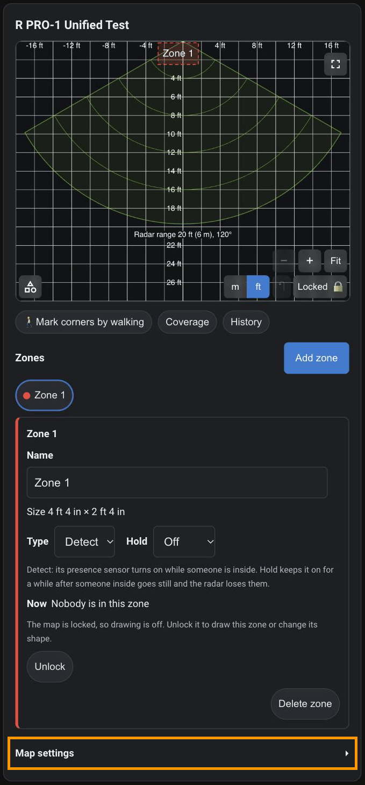
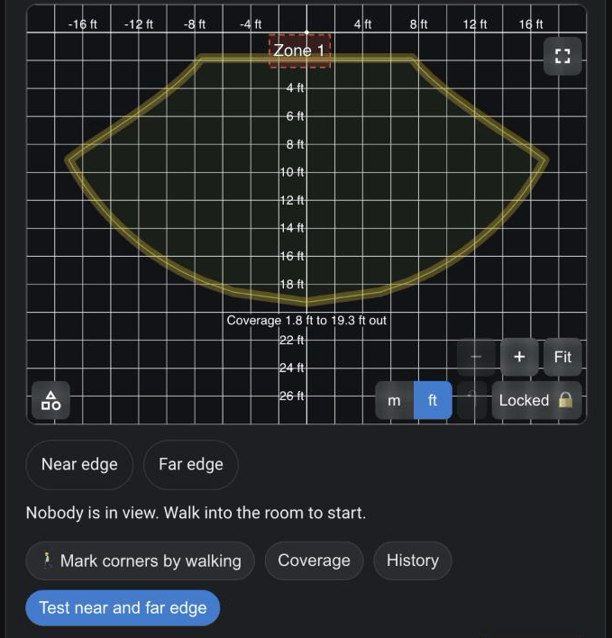

# Mount your radar high or on the ceiling

Your radar doesn't have to sit at chest height on a wall. It can hang high up and look down over the furniture, or sit on the ceiling. Tell the zone map how it hangs, and the dots on the map land where people really are on the floor. Your zones and their presence sensors then match the room.

You don't need to know anything about radar to do this. Each step below says what to do and shows what you should see. Plan on about ten minutes once the sensor is up.

This guide covers the LD2450 radar in the Apollo R PRO-1 and Apollo MTR-1, and LD2460 tracking radars on ESPHome devices.

## Which mount is right for me?

Find where your sensor is, then follow its steps.

- **On a wall at about chest height, looking straight out:** keep **Wall**, the default. It watches a wedge about 6 m (20 ft) out. There's nothing to change.
- **High on a wall or in a ceiling corner, 2 to 2.7 m (6.6 to 8.9 ft) up, tilted down:** choose **High**. It watches most of the room, from a little out from the wall to about 5.9 m (19.3 ft) out. Go to [Mount an LD2450 high on a wall](#mount-an-ld2450-high-on-a-wall).
- **On the ceiling near a wall, looking straight down:** choose **Ceiling**. It watches a narrow strip along that wall, about 5.9 m (19.3 ft) long and 1.2 m (3.9 ft) deep under a 2.7 m (8.9 ft) ceiling. Go to [Mount an LD2450 on the ceiling](#mount-an-ld2450-on-the-ceiling).
- **An ESPHome device with an LD2460 radar, on a wall or the ceiling:** choose **Wall** or **Ceiling**. On the ceiling it watches a circle up to 4 m (13.1 ft) out. Go to [Set up an LD2460 tracking radar](#set-up-an-ld2460-tracking-radar).

!!! tip "Not sure? Pick High for a whole room"

    The R PRO-1 and MTR-1 see a whole room best from high on a wall. On the ceiling they see only a narrow strip, which suits a hallway, a doorway, the side of a bed, or a desk.

Here's how the map changes on a real R PRO-1 as you switch between **Wall**, **High**, and **Ceiling**:

<video src="/assets/apollo-mmwave-mount-switch.mp4" poster="/assets/apollo-mmwave-mount-switch-poster.jpg" autoplay loop muted playsinline aria-label="The zone map card for an R PRO-1 in Home Assistant, in feet and locked, with one zone, Zone 1, drawn next to the radar. On Wall, the map shows a wedge 120 degrees wide with the caption Radar range 20 ft (6 m), 120°. On High, the wedge becomes a fan that starts a little out from the wall, with the caption Coverage 1.8 ft to 19.3 ft out, and a Test near and far edge button appears under the map. On Ceiling, the map turns short and wide around a strip under a dashed wall line, with the radar as a green dot on the line, the caption Coverage 0.0 ft to 3.9 ft out, and a Test wall line and edge button. Then Wall brings the wedge back."></video>

!!! note "Before you start"

    - **Apollo mmWave Dashboard 2.5.1 or later.** To see your version, open **Apollo mmWave Dashboard** under **Settings → Marketplace** (or in **HACS** on Home Assistant 2026.10 and earlier). If **Settings → System → Updates** lists an Apollo mmWave Dashboard update, install it first, as [Update Apollo mmWave Dashboard](apollo-mmwave-dashboard-setup.md#update-apollo-mmwave) shows. Then restart Home Assistant and reload the page, as [Load the new cards](apollo-mmwave-dashboard-setup.md#load-the-new-cards) shows. Version 2.4.2 and earlier have no mounts, and on 2.5.0 a ceiling map is tall with empty space under the strip.
    - **You're signed in to Home Assistant as an administrator.** Other users see the mount but can't change it.
    - **Your sensor's tab has a zone map.** If it doesn't, start with the [Apollo mmWave Dashboard setup guide](apollo-mmwave-dashboard-setup.md).
    - **The Radar setup card on that tab shows no problems.** If it offers a button such as **Set Zone Type to Disabled**, press it first. Otherwise the map can't show people.
    - **A tape measure**, to measure how high the sensor is.
    - **A phone or tablet** with the dashboard open, so you can watch the map while you walk around the room.

!!! warning "Already drew zones? Check them after you switch"

    Choosing **High** or **Ceiling** moves the dots closer to the sensor, to where people really are. Zones stay where you drew them, so a zone drawn on **Wall** may no longer cover the right spot. Walk through each zone at the end and redraw any that's off.

## Open Map settings

Every mount is set in **Map settings**, at the very bottom of the zone map card. Start here whichever mount you picked.

1. Click **Apollo mmWave Dashboard** in the Home Assistant sidebar, then click your sensor's tab along the top. Scroll down to the **Zone Map** heading. You should see the zone map card under it, with your sensor's name at the top.

2. Scroll down past the map and the **Zones** panel to the bottom of the same card. Click **Map settings**. The section opens, and you should see **Mounted on** with three buttons: **Wall**, **High**, and **Ceiling**.

    

    

Keep this section open. The next steps happen here.

!!! tip "If you don't see High"

    **High** is only for the LD2450 in the R PRO-1 and MTR-1. An LD2460 shows **Wall** and **Ceiling** only. If **Mounted on** is missing, update to 2.5.1 or later and reload the page as [Load the new cards](apollo-mmwave-dashboard-setup.md#load-the-new-cards) shows.

## Mount an LD2450 high on a wall

Up high, the sensor stays out of reach and looks over the couch instead of at the back of it. The map then shows how far each person is from the wall across the floor.

1. Mount the sensor 2 to 2.7 m (6.6 to 8.9 ft) up, on a wall or in a ceiling corner, facing into the room. Tilt it down 25 to 35 degrees, and keep it level from side to side. You should see its front pointing at the middle of the room's floor.
2. Under **Mounted on**, press **High**. You should see **High** turn blue, the line **In use: High, as chosen here.**, and three new settings: **Mount height**, **Tilt down:**, and **Person height**.

    ![Map settings with High picked under Mounted on: the line In use: High, as chosen here., Mount height 7.2 ft, the Tilt down: slider at 30° with the hint How far the sensor points down from level. Tilt changes what it covers, not where it places people. and the note Locked with the map. Press Locked on the map to change it., Person height 3.3 ft with the hint The height of a person's chest, where the radar sees them best. 1 m (3.3 ft) suits most adults standing., then the lines Covers from about 1.8 ft to 19.3 ft out from the wall., Closer than that, people are under the radar's view. Tilt it down more to see closer., a note that positions are least accurate close under the radar and for people sitting or lying down, and a note that the radar's built-in zones don't line up with this map](/assets/apollo-mmwave-mount-high-settings.png)

3. Measure from the floor to the sensor. Type that number in **Mount height**, then click outside the box or press Enter. You should see **Saved** next to the box. The number is in the same units as the map (ft or m).

    !!! tip "If the number changes by itself"

        **Mount height** takes 1.2 to 4 m (3.9 to 13.1 ft). A number outside that range changes to the nearest limit, with a note that starts **Enter a mount height from**. Check that you typed it in the units shown beside the box. The **m** and **ft** buttons in the map's bottom-right corner switch the units.

4. Scroll up to the map and press **Locked**, the button with a padlock in the map's bottom-right corner. You should see it change to **Unlocked**. The sliders in the next steps only move while the map is unlocked. Then scroll back down to **Map settings**.
5. Drag the **Tilt down:** slider to roughly how far the sensor points down. A rough guess is fine. You should see the number after **Tilt down:** change, and the numbers in the **Covers from about** line change with it.

    !!! tip "If the slider is gray"

        The map is still locked. Do step 4 again: press **Locked** on the map so it reads **Unlocked**.

6. Leave **Person height** at 3.3 ft (1 m). It's how high a standing adult's chest is, and the radar sees people best at the chest. You should see **3.3** (or **1** in meters). If people in this room mostly sit, as in a home theater, change it to 2.3 ft (0.7 m).
7. Read the line **Covers from about 1.8 ft to 19.3 ft out from the wall.** (your numbers depend on your heights). You should see where the radar starts and stops seeing people. In this example, that's from about 0.6 m to 5.9 m out. Anyone closer to the wall than the first number is too close for the radar to see.

    !!! tip "If the first number is too far out"

        Tilt the sensor down a little more, then move **Tilt down:** to match. At 45 degrees down, a sensor 2.2 m (7.2 ft) up sees from about 0.2 m (0.7 ft) out.

8. Find **Cone rotation:**, lower in **Map settings**, under the coverage lines and notes. If your sensor faces straight into the room, leave it at 0°. Otherwise drag it until the shape on the map points the way the sensor faces in the room, as [Match the map to how the sensor is mounted](apollo-mmwave-dashboard.md#match-the-map-to-how-the-sensor-is-mounted) shows. You should see the number after **Cone rotation:** match the way the sensor faces.
9. Scroll up to the map. You should see a fan in place of the wedge, starting a little out from the wall, with a caption such as **Coverage 1.8 ft to 19.3 ft out**. A **Test near and far edge** button appears under the map.

    

10. Walk into the room. You should see a numbered dot follow you, closer to the top of the map when you're near the wall. If you already have a zone, it fills in while you're inside it.

    <video src="/assets/apollo-mmwave-mount-high.mp4" poster="/assets/apollo-mmwave-mount-high-poster.jpg" autoplay loop muted playsinline aria-label="An LD2450 zone map on a High mount, locked, in feet, with the radar's coverage drawn as a fan from a near edge a little out from the wall to a far edge, and a zone named Desk in the middle of it. Dot 1 starts at the near edge and walks straight out from the wall, leaving a short trail. While the dot is inside Desk, the zone fills in solid with a solid outline, and once the dot walks past it, Desk goes back to a pale fill with a dashed outline."></video>

11. Press **Unlocked** on the map. You should see it read **Locked** again. This keeps a stray scroll or tap from moving the map.

Your sensor is now mapped from up high. Next, [check that it works](#test-the-edges).

## Mount an LD2450 on the ceiling

From the ceiling, an LD2450 watches a strip of floor along one wall. That's a good fit for a hallway, a doorway, the side of a bed, or a desk.

!!! tip "Why it has to be near a wall"

    Looking straight down, the radar can tell how far along the wall you are and how far from it, but not which side of it you're on. So the map puts everyone on one side, the room side. With the sensor close to a wall, everyone in the room really is on that side, and the map is right.

1. Pick the strip you want to watch and the wall beside it. Mount the sensor on the ceiling close to that wall, looking straight down. You should see its front facing the floor.
2. Turn the sensor so the edge that would face up on a wall points toward the wall (or straight away from it). Walking along the wall then moves your dot left and right. Don't worry about getting it right now: step 8 checks it.
3. Under **Mounted on**, press **Ceiling**. You should see **Ceiling** turn blue, the line **In use: Ceiling, as chosen here.**, **Ceiling height**, **Person height**, and a box that explains the room side.

    ![Map settings with Ceiling picked under Mounted on: the line In use: Ceiling, as chosen here., Ceiling height 8.9 ft, Person height 3.3 ft with its hint, a box that reads Looking straight down, this radar cannot tell which side of it someone is on, so it shows everyone on one side. Mount it near a wall, turned so walking along the wall moves your dot left and right. Everyone in the room is then on the room side. If people show up past the wall line, turn on Flip room side., an unticked Flip room side box with the line Zones stay where they are, so redraw any zone drawn for the other side., then the lines Covers a strip about 19.3 ft along the wall and 3.9 ft into the room. and A ceiling sensor of this kind sees a narrow strip. For a whole room, mount it high on a wall and choose High., and notes on accuracy and the radar's built-in zones](/assets/apollo-mmwave-mount-ceiling-settings.png)

4. Measure from the floor to the ceiling. Type that number in **Ceiling height**, then click outside the box or press Enter. It takes 2 to 4 m (6.6 to 13.1 ft). You should see **Saved** next to the box, and the numbers in the **Covers a strip about** line change.
5. Leave **Person height** at 3.3 ft (1 m), the chest height of a standing adult. If people there mostly sit or lie down, as at a desk or a bed, change it to 2.3 ft (0.7 m).
6. Read the line **Covers a strip about 19.3 ft along the wall and 3.9 ft into the room.** You should see how big the strip is. Under a 2.7 m (8.9 ft) ceiling, that's about 5.9 m along the wall and 1.2 m into the room.
7. Scroll up to the map. You should see a short, wide map: the radar as a green dot on a dashed wall line at the top, and the strip under it. A **Test wall line and edge** button appears under the map.

    

8. Walk along the wall, under the sensor, with your phone. You should see your dot move left and right along the dashed wall line.

    !!! tip "If your dot moves up and down instead"

        The sensor is turned the wrong way. Turn it a quarter turn on the ceiling and walk along the wall again.

9. Step away from the wall into the room. You should see your dot move down into the strip, on the room side of the wall line.

    !!! tip "If your dot shows up past the wall line"

        Tick **Flip room side** in **Map settings**. The strip and the dots move to the other side of the wall line. Zones stay where they are, so redraw any zone you drew on the wrong side.

    <video src="/assets/apollo-mmwave-mount-ceiling.mp4" poster="/assets/apollo-mmwave-mount-ceiling-poster.jpg" autoplay loop muted playsinline aria-label="An LD2450 zone map on a Ceiling mount in feet, under a caption that reads Map settings: Flip room side is off. The map is short and wide: the radar is a green dot on a dashed wall line near its top, and its coverage is a strip under the line. Dot 1 walks along the strip from left to right, leaving a trail. The caption changes to Map settings: Flip room side is on, the strip and the dot move above the wall line, and the dot walks back from right to left. The caption changes back to off, and the strip returns under the wall line."></video>

10. Leave **Map rotation:** in **Map settings** at 0° if your dot moved left and right along the wall line in step 8. Turn it only if you want the map to face another way. If the slider is gray, press **Locked** on the map so it reads **Unlocked** first, and press it again when you're done. You should see **Map rotation:** at the angle you want.

The strip is now on the map, on the room side of the wall line. Next, [check that it works](#test-the-edges).

## Set up an LD2460 tracking radar

An LD2460 tracks up to 5 people. Its tab works like an LD2450 tab, and its **Map settings** offer **Wall** and **Ceiling**. You don't enter a mount height or a person height: the map uses the positions the radar reports as they are.

1. Mount the radar. On a wall, follow your device's own guide, facing into the room. On the ceiling, mount it 2.5 to 3 m (8.2 to 9.8 ft) up, looking straight down, near the middle of the room.
2. On the sensor's tab, find **Installation Mode** on the **LD2460 Live** card. You should see **side** for a wall or **top** for a ceiling.
3. Open **Map settings** and look at **Mounted on**. While the radar reports its mode, the buttons are grayed out and the line reads **In use: Ceiling. The radar reports a ceiling mount.** (or **Wall**). If **Installation Mode** is missing or unknown, the buttons work: press **Wall** or **Ceiling** yourself.

    !!! tip "If the radar reports the wrong mount"

        The dashboard can't change **Installation Mode**. Change the installation setting on the radar itself, where your device's firmware offers one.

4. On a ceiling, type the floor-to-ceiling height in **Ceiling height**. You should see a line such as **The radar covers up to 13.1 ft out from the spot under it, its most.** (about 4 m). Above 3 m (9.8 ft), people far from the middle may be missed.

    

5. Drag **Map rotation:** until the grid lines up with the room's walls. You should see the radar in the middle of a circle on a ceiling mount.

On a ceiling, with no zones yet and the map unlocked, **Add whole-room zone** under the **Zones** heading adds one zone over everything the radar sees. Next, [check that it works](#test-the-edges).

## Check that it works { #test-the-edges }

Each mount has a test that shows where the radar sees you and where its view ends. It takes a minute. Be the only person in the room, and carry your phone or tablet with the dashboard open.

The test shows where the radar stops seeing you in your room.

=== "High"

    1. Press **Test near and far edge** under the map. You should see the fan get a thick yellow or orange outline, the checks **Near edge** and **Far edge**, and the line **Nobody is in view. Walk into the room to start.**

        

    2. Walk into the middle of the room until your dot shows. Then walk slowly toward the wall under the sensor until **Near edge** gets a check mark. You should see **You are at the near edge. Any closer and the radar loses you.**
    3. Walk slowly straight out into the room. You should see lines such as **You are 9.2 ft out, 7.3 ft from the edge of what the radar sees.**
    4. Keep going until **Far edge** gets a check mark. You should see **You are at the far edge, about 19.3 ft out.** (about 5.9 m).

    <video src="/assets/apollo-mmwave-mount-high-test.mp4" poster="/assets/apollo-mmwave-mount-high-test-poster.jpg" autoplay loop muted playsinline aria-label="Test near and far edge on an LD2450 zone map on a High mount in feet. The fan of coverage gets a thick outline, and the checks Near edge and Far edge appear under the map with the line Nobody is in view. Walk into the room to start. Dot 1 appears at the near edge, the near edge glows, Near edge gets a check mark, and the line reads You are at the near edge. Any closer and the radar loses you. The dot walks straight out, with lines such as You are 9.2 ft out, 7.3 ft from the edge of what the radar sees. At the far edge, the far edge glows, Far edge gets a check mark, and the line reads You are at the far edge, about 19.3 ft out. The dot vanishes, and the line reads Lost you at 19.2 ft out, at the edge. That is the end of the radar's view."></video>

=== "Ceiling (LD2450)"

    1. Press **Test wall line and edge** under the map. You should see the strip get a thick yellow or orange outline, a dashed circle around the radar, the checks **Wall line** and **At the edge**, and the line **Nobody is in view. Walk under the radar to start.**

        

    2. Stand right under the sensor. You should see **Wall line** get a check mark and **You are right under the radar, on the wall line.**
    3. Walk straight out into the room until **At the edge** gets a check mark. You should see **You are at the far edge, about 3.9 ft out.** (about 1.2 m).
    4. Walk along the strip to one end. You should see **You are at the side edge of what the radar sees. Leaving from here counts as leaving.**

    <video src="/assets/apollo-mmwave-mount-ceiling-test.mp4" poster="/assets/apollo-mmwave-mount-ceiling-test-poster.jpg" autoplay loop muted playsinline aria-label="Test wall line and edge on an LD2450 zone map on a Ceiling mount in feet. The short, wide strip gets a thick outline, a dashed circle marks the spot under the radar, and the checks Wall line and At the edge appear with the line Nobody is in view. Walk under the radar to start. Dot 1 appears under the radar, Wall line gets a check mark, and the line reads You are right under the radar, on the wall line. The dot walks out to the strip's far edge, At the edge gets a check mark, and the line reads You are at the far edge, about 3.9 ft out. It then walks along the strip, with lines such as You are 2.6 ft out, 1.3 ft from the edge of what the radar sees., to the strip's side edge, where the line reads You are at the side edge of what the radar sees. Leaving from here counts as leaving."></video>

=== "Ceiling (LD2460)"

    1. Press **Test center and edge** under the map. You should see the checks **Right under the radar** and **At the edge**.
    2. Stand right under the radar. You should see **You are right under the radar. It sees you here.**
    3. Walk slowly out toward a wall. You should see lines such as **You are 10.2 ft from the spot under the radar, 2.9 ft from the edge.**
    4. Keep going until **At the edge** gets a check mark. You should see **You are at the edge of what the radar sees, about 13.1 ft out.** (about 4 m).

    <video src="/assets/apollo-mmwave-ld2460-ceiling.mp4" poster="/assets/apollo-mmwave-ld2460-ceiling-poster.jpg" autoplay loop muted playsinline aria-label="An LD2460 zone map on a ceiling mount in feet, with the radar as a green dot in the middle of a circle of coverage and two people tracked. Add whole-room zone is pressed, and Zone 1 fills the circle and lights up. Test center and edge is pressed: the checks Right under the radar and At the edge appear with the line More than one person is in view. Only the person testing should be in the room. Once one person is left, they walk to the spot under the radar, Right under the radar gets a check mark, and the line reads You are right under the radar. It sees you here. They walk out toward the edge, with lines such as You are 10.2 ft from the spot under the radar, 2.9 ft from the edge., and at the edge At the edge gets a check mark and the line reads You are at the edge of what the radar sees, about 13.1 ft out. Leaving from here counts as leaving, so held zones turn off without waiting."></video>

A check mark on both checks means the mount is set up. Press the test button again to end the test.

!!! tip "If the test loses you in the middle"

    Something blocks the radar there, such as a tall shelf, or you stood still too long. Move the obstacle or walk a little faster, and try again. The test doesn't check your zones, so walk through each zone you drew before you changed the mount, and redraw any that's off.

## Add a zone that covers everything

On **High** and **Ceiling**, one press gives you a zone over everything the radar sees, so you have a presence sensor for the whole view right away.

1. Press **Locked** on the map so it reads **Unlocked**.
2. Under the **Zones** heading, press **Add coverage zone** (**Add whole-room zone** on an LD2460 ceiling). It shows only while the radar has no zones yet. You should see **Zone 1** appear with the shape of the radar's view.
3. Walk into the room. You should see **Zone 1** fill in while you're inside it.

<video src="/assets/apollo-mmwave-coverage-zone.mp4" poster="/assets/apollo-mmwave-coverage-zone-poster.jpg" autoplay loop muted playsinline aria-label="An LD2450 zone map on a High mount in feet, with no zones yet and the radar's coverage drawn as a fan. Add coverage zone is pressed, and Zone 1 appears with the fan's shape, a dot on each corner, and its button under Zones. Dot 1 walks into the room from the far left, and Zone 1 fills in solid while it's inside."></video>

Already have a zone? Open it in the **Zones** panel and press **Coverage** under **Draw shape**. On an LD2460 ceiling, press **Square** or **Circle** beside **Whole room** under **Draw shape**.

To draw smaller zones over the couch, the desk, or the bed, see [Add a zone](apollo-mmwave-dashboard.md#add-a-zone) and [Draw a zone](apollo-mmwave-dashboard.md#draw-a-zone). [Mark corners by walking](apollo-mmwave-dashboard.md#mark-corners-by-walking) works on every mount, and the corners land where you stood on the floor.

!!! success "Next step: use your zones in automations"

    Your radar is mapped from where it hangs. Now make a zone do something: each zone has its own presence sensor.

    [Use the zone sensors](apollo-mmwave-dashboard.md#use-the-zone-sensors){ .md-button .md-button--primary }

## How the map works out positions { #why-the-heights-matter }

You don't need this section to set up a mount. It explains why the heights matter.

The LD2450 measures how far away someone is and their angle left or right, but not how far below it they are. From up high, that distance includes the drop from the radar down to the person. So someone 1 m (3.3 ft) from the wall reads about 1.6 m (5.1 ft) out from a radar 2.2 m (7.2 ft) up. On **High** and **Ceiling**, the map takes that drop out using **Mount height** (or **Ceiling height**) and **Person height**. **Tilt down:** changes what the radar covers, never where it places someone.

![Two diagrams. The first, High mount seen from the side: a radar 2.2 m up a wall, tilted down 30 degrees, with its beam spreading 35 degrees up and down across the room. A dashed line marks a person's chest height of 1 m, a bracket marks the 1.2 m drop from the radar down to it, and a person stands 1 m from the wall. A red line from the radar to the person's chest is labeled The radar reports 1.56 m, and a blue arrow along the floor is labeled High shows 1.0 m out from the wall. Ticks on the chest line mark the near edge, about 0.6 m, and the far edge, about 5.9 m. The second, Ceiling mount seen from above: a radar 2.7 m up on the wall line, a strip under it on the room side about 5.9 m along the wall and about 1.2 m into the room, and an arrow along the wall labeled Walking along the wall moves your dot left and right](/assets/apollo-mmwave-mount-diagram.png)

For a radar 2.2 m (7.2 ft) up and a person's chest 1 m (3.3 ft) off the floor:

| Out from the wall | The radar reports | High shows |
| --- | --- | --- |
| 0.5 m (1.6 ft) | 1.30 m (4.3 ft) | 0.50 m (1.6 ft) |
| 1 m (3.3 ft) | 1.56 m (5.1 ft) | 1.00 m (3.3 ft) |
| 2 m (6.6 ft) | 2.33 m (7.6 ft) | 2.00 m (6.6 ft) |
| 3 m (9.8 ft) | 3.23 m (10.6 ft) | 3.00 m (9.8 ft) |
| 5 m (16.4 ft) | 5.14 m (16.9 ft) | 5.00 m (16.4 ft) |

An LD2460 works differently: the map uses the positions it reports as they are. It only needs to know whether the radar is on a wall or the ceiling, and on a ceiling how high it is, to draw what the radar covers.

## What accuracy to expect

The heights turn a slanted distance into a distance across the floor, and a small error in the reading grows a little on the way:

- **Close under the radar** is least accurate. On a ceiling 2.7 m (8.9 ft) up, a 10 cm (4 in) error in the reading moves a dot about 28 cm (11 in) when you're 0.5 m (1.6 ft) from the wall line, and about 17 cm (7 in) at the strip's far edge, 1.2 m (3.9 ft) out. Errors shrink with distance.
- **Sitting or lying down** puts the chest lower than **Person height**, so people show a little farther out than they are. Someone seated (chest about 0.7 m or 2.3 ft) under a radar 2.7 m (8.9 ft) up, with the default 1 m (3.3 ft), shows about 1.2 m (3.8 ft) out when they're 0.5 m (1.6 ft) out. Lower **Person height** if the room is mostly seated.
- **The edges are soft.** A radar beam fades out rather than stopping at a line, so the coverage on the map is close, not exact. The test in [Check that it works](#test-the-edges) shows where the edges are in your room.
- **History** is drawn with the mount settings in use now, not the ones in use when it was recorded. The panel reads **History is drawn with the mount settings in use now.**

## Why built-in zones don't line up

The LD2450 has its own built-in zones (the **Zone Type** setting and the zone coordinates on the R PRO-1 and MTR-1). The radar works them out from the slanted distances it measures, and the dashboard can't correct them, so on **High** or **Ceiling** they don't line up with the map. Leave **Zone Type** on **Disabled**, as the **Radar setup** card recommends, and draw zones on the zone map instead. **Map settings** says the same: **The radar's built-in zones use its own uncorrected coordinates, so on a High or Ceiling mount they do not line up with this map. Draw zones here instead.**

## Troubleshooting

### Dots show past the wall line on a ceiling LD2450

The radar can't tell which side of it someone is on, so the map picks one. Tick **Flip room side** under **Map settings**, then redraw any zone you drew on the wrong side. If dots jump from one side of the wall line to the other, the sensor is turned the wrong way: turn it so walking along the wall moves your dot left and right, as step 8 of [Mount an LD2450 on the ceiling](#mount-an-ld2450-on-the-ceiling) shows.

### The ceiling map is tall, with empty space under the strip

That's how 2.5.0 draws it. Update to 2.5.1 or later, as [Update Apollo mmWave Dashboard](apollo-mmwave-dashboard-setup.md#update-apollo-mmwave) shows, and reload the page. The map then fits the strip.

### People vanish close to a high sensor

They're closer to the wall than the near edge, too close for the radar to see. The line **Covers from about 1.8 ft to 19.3 ft out from the wall.** says where the view starts. Tilt the sensor down more, then set **Tilt down:** to match. At 45 degrees down, a sensor 2.2 m (7.2 ft) up sees from about 0.2 m (0.7 ft) out.

### Dots sit too far out, or a zone turns on late

Check that **Mounted on** matches how the sensor hangs: on **Wall**, a sensor up high shows people farther out than they are. Then measure **Mount height** or **Ceiling height** again, and lower **Person height** if the room is mostly for sitting. The [support file](apollo-mmwave-dashboard.md#send-apollo-a-support-file) lists each radar's mount and the settings in use.

### The mount buttons are grayed out

On an LD2460 that reports its **Installation Mode**, the radar decides, and the line under the buttons says which mount it reports. The buttons work only while **Installation Mode** is missing or unknown. To change the reported mode, change the installation setting on the radar itself, where your device's firmware offers one. Only administrators can change the mount, so check that you're signed in as one. If **Tilt down:**, **Cone rotation:**, or **Map rotation:** is grayed out, the map is locked: press **Locked** on the map.

### A zone drawn before the change is in the wrong place

Zones keep the shape you drew. Positions change when you change the mount or its heights, so a zone drawn on **Wall** for a sensor that's really up high now sits farther from the wall than the people in it. Redraw it, or press **Coverage** in its editor to give it the whole view.
