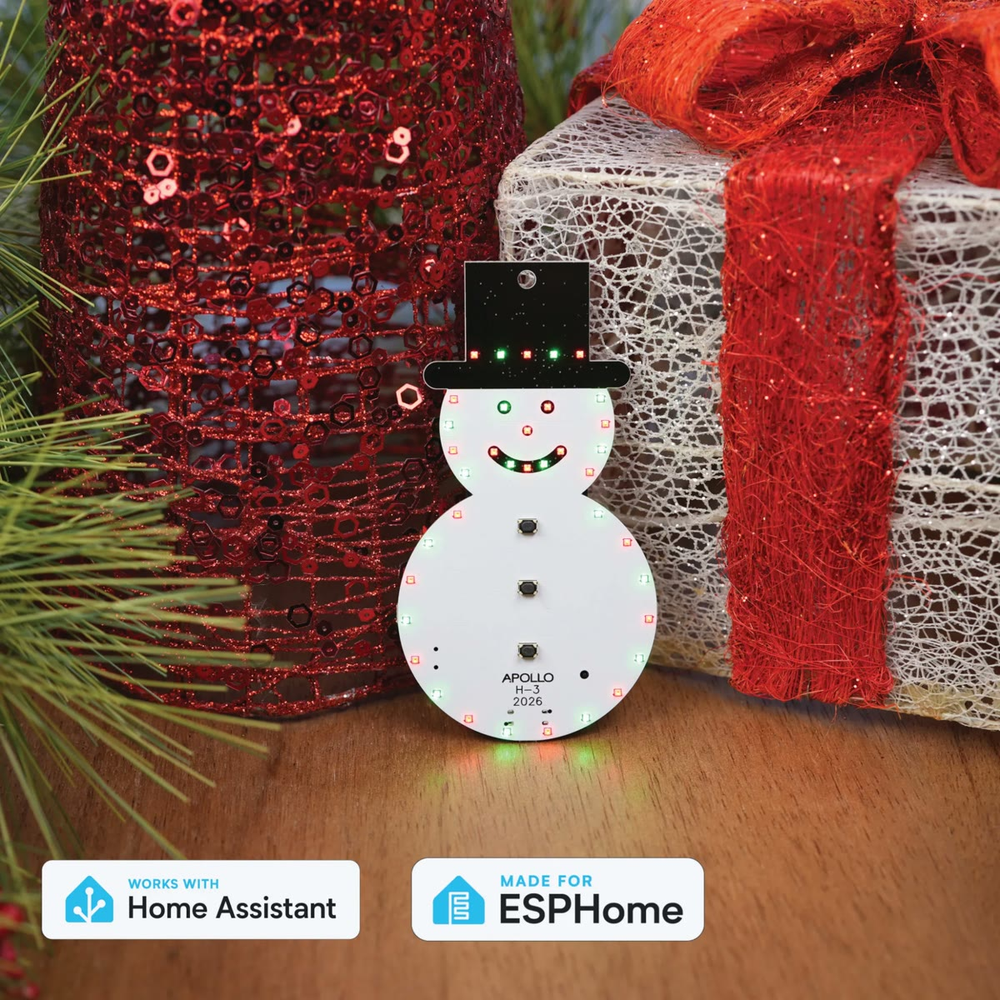

**Can be powered by USB-C or two AA batteries.** We suggest non-rechargeable AAs.

The Apollo H-3 is the third edition of our annual holiday ornament! It's our way of saying thank you for your support and giving back to our community. **100% of the profit from this ornament goes to charity.** This year we are supporting [St. Jude Children's Research Hospital](https://www.stjude.org/). Learn about [our year and the charities](https://apolloautomation.com/pages/year-in-review-2026).

## How to use

Your H-3 plays songs right out of the box, with no Wi-Fi or app needed.

1. Put in the two AA batteries, or connect the ornament to a USB-C wall plug.
2. Slide the switch on the back to **On**.
3. Press any of the three buttons on the front of the snowman to play a song. Double press or hold a button to play its alternate song.

<video src="/assets/h-3-battery-install.mp4" autoplay loop muted playsinline aria-label="Two AA batteries pressed into the holder on the back of the H-3, the switch slid to On, then the ornament turned over and its LEDs lighting up red and green"></video>

Each button has two songs, and each song comes with its own LED effect:

| Button | Single press | Double press or hold |
| --- | --- | --- |
| Button 1 | Frosty the Snowman | Blue Christmas |
| Button 2 | Rudolph the Red-Nosed Reindeer | Do You Want to Build a Snowman |
| Button 3 | Jingle Bells | Barbie Girl |

!!! tip "Hold the button when the ornament is asleep"

    The ornament sleeps between songs to save its batteries. A double press only works while it's awake, so if it's asleep, hold a button for about a second to play the alternate song.

!!! warning "Battery safety"

    Please use all battery safety precautions. We suggest removing the batteries from the H-3 if you store it for long periods of time.

## Add it to Home Assistant

You can also integrate it with Home Assistant to unlock more features, such as changing the songs and LED effects, Bluetooth proxy, and Bluetooth tracking. You will need to <a href="https://wiki.apolloautomation.com/products/h3/troubleshooting/reflash/" target="_blank" rel="noreferrer nofollow noopener">reflash it to the smart firmware</a> first!

**New for 2026:** The H-3 has 37 RGB LEDs split into five zones you can control separately (body, hat, eyes, nose, and mouth), six songs across three buttons, and runs on two AA batteries.

## Who are we?

Apollo is run by a couple of friends in Versailles, KY. We build IoT solutions for various applications like motion, air quality, environment monitoring, and more. We can design custom solutions for your needs.

If you have a project you think we might be a good fit for, reach out to us at **support@apolloautomation.com**.

!!! success "Next step: set up your H-3"

    Walk through power, songs, and the optional Home Assistant setup.

    [H-3 getting started](setup/getting-started.md){ .md-button .md-button--primary }
