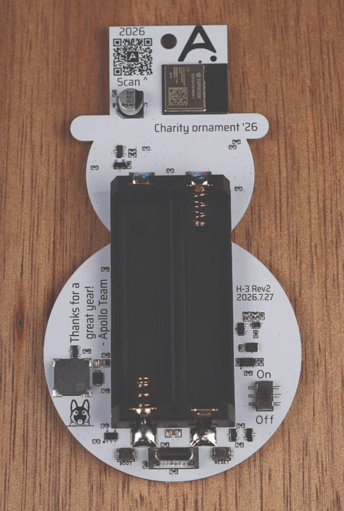
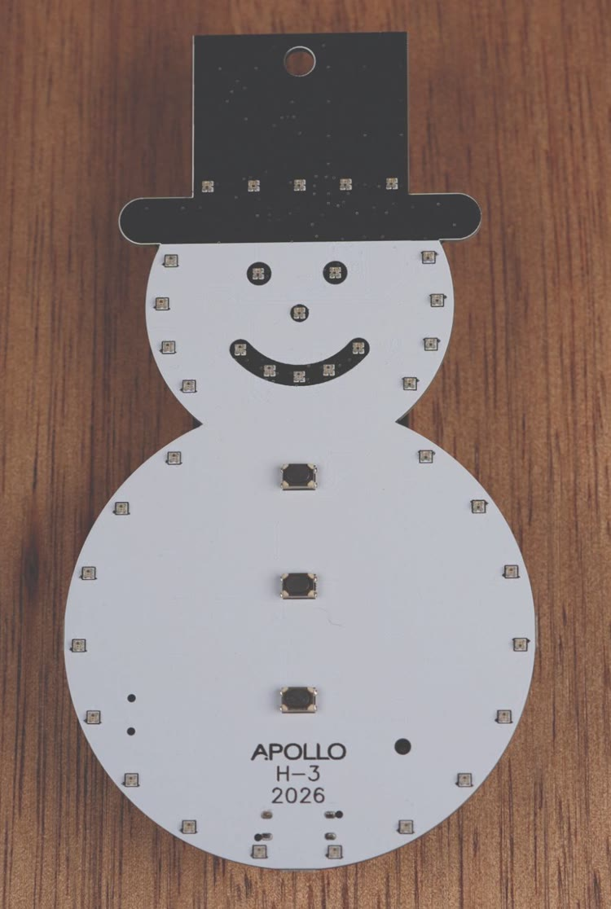

# Getting started

Follow these steps to power up your ornament, play its holiday songs, and optionally add it to Home Assistant.

**1\. Powering On the H-3**

Insert two AA batteries. We suggest non-rechargeable AAs.

<video src="/assets/h-3-battery-install.mp4" autoplay loop muted playsinline aria-label="Two AA batteries pressed into the holder on the back of the H-3, the switch slid to On, then the ornament turned over and its LEDs lighting up red and green"></video>

You can also run the ornament from a USB-C wall plug instead of batteries.

<video src="/assets/h-3-plug-in-usb-c.mp4" autoplay loop muted playsinline aria-label="A USB-C cable plugged into the port at the bottom of the back of the H-3"></video>

**2\. Turning On the Ornament**

Slide the switch on the back of the ornament to **On**. A new ornament lights all of its LEDs green for about 5 seconds, then turns them off. That green means the firmware started and every LED works.

About 15 seconds after it powers on, the ornament goes to sleep to save its batteries. If the ornament is asleep, press one of the buttons on the front to wake it. That press also plays the button's song.

**3\. Play Holiday Songs**

Press one of the three buttons on the front of the snowman to play its first song. To play its second song, double press the button or hold it for about a second:

| Button | Single press | Double press or hold |
| --- | --- | --- |
| Button 1 | Frosty the Snowman | Blue Christmas |
| Button 2 | Rudolph the Red-Nosed Reindeer | Do You Want to Build a Snowman |
| Button 3 | Jingle Bells | Barbie Girl |

A double press only works while the ornament is awake. If it's asleep, hold the button instead. Pressing a button during a song switches to the new song.

**4\. Add to Home Assistant** (Optional)

For additional customization, <a href="https://wiki.apolloautomation.com/products/h3/troubleshooting/boot-mode/" target="_blank" rel="noreferrer nofollow noopener">put the H-3 in boot mode</a>, then flash the [smart H-3 firmware](https://install.apolloautomation.com/#/h-3) and connect it to Home Assistant following the [setup guide](https://wiki.apolloautomation.com/products/general/setup/getting-started/). With Home Assistant you can add new songs, change LED effects, and create custom automations.

**5\. Enjoy Your Ornament**

Hang the H-3 on your tree, place it on a mantel, or incorporate it into any holiday setup. Share your setup with us in the community!

!!! warning "Battery safety"

    Please use all battery safety precautions. We suggest removing the batteries from the H-3 if you store it for long periods of time.

[Join our Discord if you need more help! :simple-discord:](https://link.apolloautomation.com/discord){                  .md-button }
