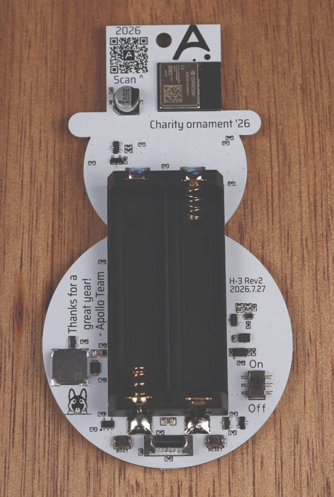

Boot mode is what lets you reflash the firmware over USB. You need it to move between the basic firmware and the smart firmware, and to recover an ornament that has stopped responding.

1\. Take the batteries out of the H-3. (1)
{ .annotate }

1.  With batteries in, the ornament stays powered, so plugging in USB never restarts it and it can't enter boot mode.

2\. Locate the boot button on the back of the ornament. With the back facing you and the hat at the top, it's the small button to the left of the USB-C port, labeled **BOOT**.

3\. Hold the boot button down, plug a USB-C cable that supports data into the ornament and your computer, then let go of the button.

<video src="/assets/h-3-boot-mode.mp4" autoplay loop muted playsinline aria-label="Holding the BOOT button on the back of the H-3 with a thumb while plugging a USB-C cable into the port next to it"></video>

4\. You are now ready to reflash your device!

[Click here to go to the reflashing guide!](https://wiki.apolloautomation.com/products/h3/troubleshooting/reflash/){  .md-button .md-button--primary }
