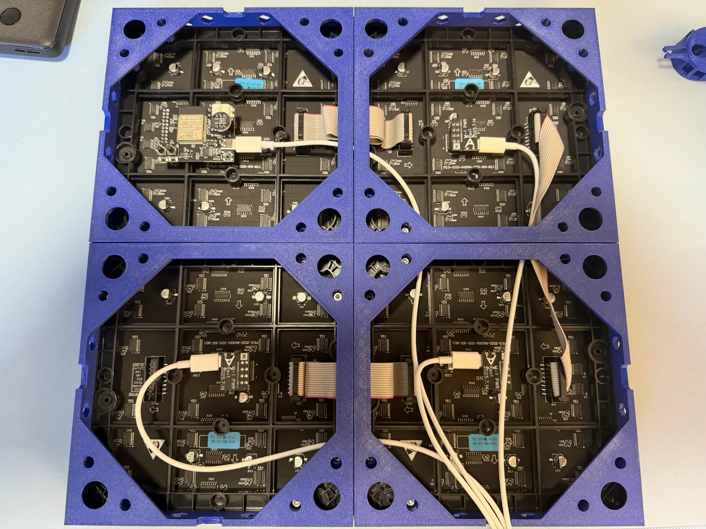

# Bigger boards (Game Day Scoreboard)

One Apollo M-1 controller drives up to four 64x64 panels, and Game Day Scoreboard uses every one of them. Two panels side by side give you the wide board, with big scores, the records, and the timeout pips. Three or four in a row stretch it across the wall, and two rows of two put the board on top with a clock, today's scores, or a second game underneath. It's the same firmware for every arrangement: the layout is a setting on the device page, so you can grow your board later without reflashing.

!!! note "Before you start"

    - Your M-1 runs Game Day Scoreboard and is on your Wi-Fi. See [Getting started (Game Day Scoreboard)](/products/m1/setup/getting-started-m1-game-day.md).
    - The settings in [Everyday use (Game Day Scoreboard)](/products/m1/setup/game-day-everyday-use.md) work the same on every size of board, so start there if you haven't.
    - Up to three more M-1 panels, a ribbon data cable and a Matrix Power Module for each extra panel, and a USB-C power supply for every panel. [Multiple Panels](/products/m1/setup/m1-multiple-panels.md) lists the parts.
    - Three or four panels? Set up Wi-Fi through the panel's hotspot. See [Bluetooth setup is off on bigger boards](#bluetooth-setup-is-off-on-bigger-boards).

## Pick your arrangement

| Your panels | Pick on the device page | Size | What the board shows |
| --- | --- | --- | --- |
| Two side by side | **One 128x64 panel** (or two 64x64 side by side) | 128x64 | The wide board: logos at the edges, big scores, and the records and timeout pips in the middle. |
| Three side by side | **Three wide** | 192x64 | The wide board across the row, or the board plus a second area on the right panel. |
| Four side by side | **Four wide** | 256x64 | The wide board across the row, or the board plus a second area on the right two panels. |
| Two rows of two | **Two rows of two** | 128x128 | The wide board on top and a second area underneath. |

Four panels is the most one M-1 drives, in a row or in two rows of two.

## Power every panel

Each 64x64 panel can draw about 3A at 5V at full white, and the M-1 controller's onboard power covers only the panel it sits on. Every panel after the first needs its own Matrix Power Module and its own USB-C feed.

!!! warning "Size the power for all the panels"

    Use 5 V supplies rated for the panels they feed. A phone charger or a computer's USB port is usually too weak, and a supply that's fine for one or two panels can sag with four at full brightness. When the power dips and the scoreboard restarts twice in a row, it holds its brightness to about a quarter of full so it stays on, and the bottom line says **Check power supply** every two minutes. Fix the supply, then press **Clear** in the notice on the device page.

A new install starts at about half brightness, 128 of 255. Raise it with **Brightness** in the **Quick settings** card once your supplies are in place.

## Chain and arrange the panels

The wiring is the same whichever firmware you run, so the [Multiple Panels](/products/m1/setup/m1-multiple-panels.md) page has the step-by-step photos for each arrangement. Follow its **Hardware setup** section, then come back here: its **Software setup** and **Segment setup** sections are for WLED, and Game Day Scoreboard doesn't need them. The **WLED only** warning at the top of its **2x2 Grid** tab compares WLED with WLED-MM: Game Day Scoreboard drives two rows of two with that same wiring.

### Panels in a row

1. Lay the panels face down with the M-1 controller's panel at the far left.
2. Run a ribbon cable from each panel's **JOUT** port to the next panel's **JIN** port, left to right.
3. Press a Matrix Power Module onto each extra panel, USB-C port facing right, and plug in every USB-C cable.

Seen from the front, the controller's panel is the right-hand end of the row. If the parts of the board show in the wrong order, put the panels in the reverse order.

### Two rows of two

The ribbon cables are short, so the Multiple Panels build turns the bottom two panels upside down, which puts their ports next to the top row's. Seen from the back, the controller is on the top-left panel and the chain runs top left, top right, bottom right, then bottom left. That build is the **Bottom row upside down** choice below, where every new panel starts.

Printed frames hold a row or a grid together as one flat piece. See [Wall mounting your M-1 panels](/products/m1/setup/m1-wall-mounting.md).

## Set the layout on the device page

The Game Day installer only offers one or two panels, so for three or four, [flash the firmware](/products/m1/setup/getting-started-m1-game-day.md#flash-game-day-scoreboard) with the **One 64x64 panel** picture. Once your panels are wired and powered, tell the scoreboard what it's driving. This is also how you switch layouts later, with your team and settings kept.

1. Open the device page and tap **Setup** to open the Setup card.
2. Under **Matrix**, click the picture that matches your panels: **One 128x64 panel**, **Three wide**, **Four wide**, or **Two rows of two**.
3. Confirm when the page asks. It says **Restarting as** and the size, the panel restarts with the new layout, and the page reconnects when it's back.

The board now fills every panel. For two rows of two, one more choice appears under the pictures once the panel is back: **How the rows are mounted**.

!!! tip "The picture repeats, or some panels stay dark?"

    The layout doesn't match the number of panels you have. Pick the picture with as many panels as you wired. More fixes are in the [Game Day Scoreboard panel sizes guide](https://github.com/ApolloAutomation/gameday-scoreboard-main/tree/main/docs/wiki/src/content/docs/using/panel-sizes.md).

### How the rows are mounted

Two rows of two make one chain of four panels, and which row sits upside down changes where each part of the board goes. Pick the choice that matches your build. Seen from the back, where the cables are:

| Choice | How the panels sit |
| --- | --- |
| **Bottom row upside down** | The folded build from the Multiple Panels page. The controller's panel is top left and the second is top right. The bottom row is upside down, with the third panel under the second and the fourth under the first, so every cable stays short. A new panel starts here. |
| **All upright** | Every panel stands the right way up. The controller's panel is top left and the second is top right, then a longer cable runs back across to the third, under the first. The fourth is under the second. |
| **Top row upside down** | The top row is the one turned over. The controller's panel is top right and the second is top left, with the third under the second and the fourth under the first. |

Changing it restarts the panel. If part of the board still shows upside down, the choice doesn't match your build:

| You picked | What you see | Pick instead |
| --- | --- | --- |
| **Bottom row upside down** | The bottom half upside down | **All upright** |
| **Bottom row upside down** | Both halves upside down | **Top row upside down** |
| **All upright** | The bottom half upside down | **Bottom row upside down** |
| **All upright** | The top half upside down | **Top row upside down** |
| **Top row upside down** | Both halves upside down | **Bottom row upside down** |
| **Top row upside down** | The top half upside down | **All upright** |

If the bottom half's left and right sides are swapped with **All upright**, or each bottom panel shows its own part upside down with **Bottom row upside down**, every panel stands upright but the third sits under the second. That bottom row runs the other way, and no choice fixes it. Move the third panel under the first and the fourth under the second and keep **All upright**, or turn the bottom row upside down and pick **Bottom row upside down**. Seeing either one any other way? The bottom panels don't sit where the first table puts them for your choice, so move them there.

## Add a second area

Three wide, four wide, and two rows of two can show something else beside the board, with its own ticker and its own celebrations. On two rows of two, the board is the top half. On three or four in a row, the board moves to the left two panels, seen from the front, and looks the same as on two panels.

| Arrangement | The second area | Starts on |
| --- | --- | --- |
| Two rows of two | **Bottom half**, 128x64 | **Clock and date** |
| Four wide | **Right two panels**, 128x64 | **Nothing: the board fills the row** |
| Three wide | **Right panel**, 64x64 | **Nothing: the board fills the row** |

One or two panels have no second area. To pick what it shows, open the **Quick settings** card and choose under **Shows**, in the part named for where your second area is. It changes at once, with no restart.

| Choice | What it shows |
| --- | --- |
| **Rotating live games** | The other live games in the leagues you follow, about 8 seconds each. With **Switch to big plays in other games** on, a big play in one of them shows in the second area while the board stays on its own game. Minor league baseball, AHL, and ECHL games aren't in the rotation. |
| **A second team's game** | Another team's next game, its live game with its own celebrations, and its final. Tap **Pick a team** under **Second team** to choose it. It can be any team but your own, and not a golf tour or a racing series. It doesn't need to be a favorite. |
| **Today's scores** | Recent final scores and the games still to come today, for your team's and your favorites' leagues. |
| **Clock and date** | The time and the date, with your next games in its ticker. When the board already shows a clock, the second area shows the date instead of a second clock. |
| **Nothing: the board fills the row** | Three and four wide only: the board stretches across every panel. |

A line under **Shows** says what the second area is doing now, like **Rotating 3 live games.** or **No other live games: showing the clock.** During night hours, **Today's scores** and the rotation give way to the clock, while a second team's live game still shows.

!!! tip "Watch your data with a busy second area"

    **Clock and date** reads nothing extra. **A second team's game** uses about 2 to 7 MB an hour while that game is on, and **Rotating live games** checks other live games about every 45 seconds. On a capped internet plan, **Data used** in the Device card shows how much the panel has downloaded.

## Good to know on bigger boards

A few things work differently once the board spans more than two panels.

### Bluetooth setup is off on bigger boards

With three or four panels, the scoreboard keeps Bluetooth setup off to leave the panels the memory they need. Set up Wi-Fi through the panel's hotspot instead: scan the QR code on its setup screen with your phone's camera. One or two panels work as before. The Setup card on the device page says so under the pictures.

### Splashes and the ticker

- **Three or four in a row:** while the board fills the row, a splash puts the team's logo at the left end, the words in the middle, and the points at the right end, with the number only for runs, like **+2**. With a second area picked, the board's splashes look as they do on two panels, and the second area's own splashes stay inside it.
- **Two rows of two:** the board's splashes cover all four panels, and the bottom half waits under them, then gets its whole turn. Under **Clock and date**, the bottom half has its own ticker in bigger letters, with your next games.

### A factory reset brings back the starting layout

A [factory reset](https://github.com/ApolloAutomation/gameday-scoreboard-main/tree/main/docs/wiki/src/content/docs/using/buttons-and-resets.md) erases every setting, the layout included. An M-1 starts again as one 64x64 panel, or as 128x64 if you installed with the 128x64 picture and the panel hasn't taken an update since. Pick your layout again in the Setup card afterward.

!!! success "Next step: fill your new board"

    Your board spans the wall. Now decide what it follows and how it celebrates: modes, big plays in other games, clock and text size, the idle display, and night hours are all in the everyday use guide.

    [Use your scoreboard every day](/products/m1/setup/game-day-everyday-use.md){ .md-button .md-button--primary }

## Learn more

- [Panel sizes and layouts](https://github.com/ApolloAutomation/gameday-scoreboard-main/tree/main/docs/wiki/src/content/docs/using/panel-sizes.md) in the Game Day Scoreboard docs covers what each layout shows, the second area, and splashes in detail.
- [Panels and power](https://github.com/ApolloAutomation/gameday-scoreboard-main/tree/main/docs/wiki/src/content/docs/diy/panels.md) covers chaining and power from the firmware's side.
