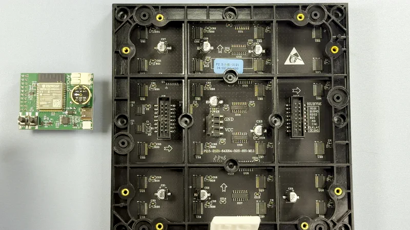

# Getting started (Game Day Scoreboard)

!!! tip "Running WLED instead?"

    M-1 units ship with WLED. If you want to keep it, the [Getting Started page](/products/m1/setup/getting-started-m1.md) covers it. You can come back to Game Day Scoreboard any time, and go back to WLED the same way.

Game Day Scoreboard turns your Apollo M-1 LED Matrix into a scoreboard for your team. Before a game it shows the matchup, both records, the start time, the betting line, and the TV network. Once the game starts it switches to the live score and game clock, and when your team scores or makes a big play, it fills the panel with a splash in the team's color, with its logo and the points it gained. After the final it stays on the score for a while, then looks up the next game.

It follows the NFL, college football, MLB, minor league baseball, the NBA, the WNBA, men's college basketball, the NHL, the AHL, the ECHL, MLS, and the Premier League, plus golf's PGA Tour and LPGA Tour, Formula 1, and the NASCAR Cup Series. The panel reads the scores by itself (from ESPN, from MLB's stats service for minor league baseball, and from HockeyTech for the AHL and the ECHL), so there's no hub, account, or other computer to run. It serves its own settings page, it drives one to four panels, and it shows up in Home Assistant as an ESPHome device if you want it there. Apollo Automation maintains the open-source firmware at [ApolloAutomation/gameday-scoreboard-main](https://github.com/ApolloAutomation/gameday-scoreboard-main).

!!! note "Before you start"

    - An M-1 with a **Rev6** controller. The revision is printed on the back of the board, and every M-1 sold today is Rev6.
    - A desktop or laptop computer with Chrome or Edge, and a USB-C cable that carries data.
    - A 2.4 GHz Wi-Fi network and its password. The panel can't join a 5 GHz network.
    - A phone with a camera, to scan the panel's QR codes. Any iPhone or Android phone works, with no app to install.

!!! warning "Rev6 controllers only"

    Game Day Scoreboard uses the MoonHub75 pin layout, which the Rev6 controller shares. An older Rev4 controller wires the panel to different pins, so the prebuilt firmware won't drive it.

## Attach the M-1 controller

Your M-1 LED Matrix and M-1 controller ship separately to keep them safe in transit. Gently press the controller onto the back of the panel, as shown below. Skip this if your M-1 is already together.

## Flash Game Day Scoreboard

The Game Day Scoreboard installer flashes the firmware from your browser, with nothing to install on your computer. Flashing replaces WLED, along with its presets and settings.

1. Open the [Game Day Scoreboard DIY installer](https://apolloautomation.github.io/gameday-scoreboard-main/install/diy/) in Chrome or Edge.
2. Click the picture that matches your setup. The **Install for MoonHub75** button appears once you pick.
    - **One 64x64 panel** for a single M-1, and for three or four M-1 panels.
    - **One 128x64 panel** (or two 64x64 side by side) for two M-1 panels in a row.
3. Plug the M-1 controller into your computer with the USB-C cable.
4. Click **Install for MoonHub75** and pick the M-1's port when the browser asks. This is the right build for the M-1: the two boards share a pin layout.
5. Wait for the install to finish. Leave the cable plugged in until it does.

The panel lights up with **GAME DAY** across the top and **Starting** under it, then shows **SETUP** and a QR code while it waits for Wi-Fi. The picture you clicked only sets the layout the panel starts with. You can change it any time on the panel's settings page, with nothing to reflash.

!!! tip "Three or four panels?"

    The installer offers one or two panels. For three or four, pick **One 64x64 panel**, finish setting up, then choose **Three wide**, **Four wide**, or **Two rows of two** on the panel's settings page. The [Bigger boards guide](/products/m1/setup/game-day-bigger-boards.md) covers wiring, power, and the layout choice.

!!! tip "The browser doesn't see your M-1?"

    Put the controller into boot mode and try again: hold the boot button while you plug in the USB-C cable. See [M-1 Boot Mode](/products/m1/troubleshooting/m1-boot-mode.md).

## Connect to Wi-Fi

Your M-1 needs your home Wi-Fi to read the scores. Use your main network, not a guest network: a guest network can let the panel join but keep your phone from reaching it afterward. There are two ways to give it your network:

- **Right after the install,** the installer offers to put the panel on your Wi-Fi. Enter your network name and password there, and move on to [Pick your team](#pick-your-team).
- **From the panel's hotspot.** While it shows **SETUP**, the panel runs its own Wi-Fi network named **Game Day** plus six letters and numbers, like **Game Day 2f6a70**, and shows a QR code that joins it.

To use the hotspot:

1. Point your phone's camera at the QR code on the panel and tap to join, or pick the **Game Day** network from the Wi-Fi list on any phone or laptop. On a single 64x64 panel, the QR code takes turns with the words, so wait for its turn. A setup page opens.
2. Pick your Wi-Fi network and enter the password.
3. Save.

If the setup page doesn't open by itself, open `192.168.4.1` in a browser. If your phone warns that the network has no internet, choose to stay connected.

The panel joins your Wi-Fi and shows a new QR code, this one for its own settings page, then its address, like **gameday-2f6a70.local**. For the first 30 seconds, the ticker along the bottom also shows its IP address and address, like **IP 192.168.1.50 | gameday-2f6a70.local**.

!!! tip "About the QR codes on the screen"

    Every QR code the panel shows works with your phone's camera. During setup it joins the panel's hotspot, and once the panel is on your Wi-Fi it opens the panel's settings page. The separate Game Day phone app isn't maintained by Apollo Automation and may not find panels running this firmware. You don't need it: the hotspot and the settings page do everything it does.

The panel remembers up to five networks. If it loses Wi-Fi it says **Wi-Fi lost, reconnecting** while it tries to rejoin, and within a few minutes it brings its hotspot back with **Wi-Fi lost, scan to fix**. After a new router or Wi-Fi password, scan that QR code and give the panel the new network. A router that was only down needs nothing: the panel rejoins by itself.

## Pick your team

The panel serves its own settings page, the device page. This is where you pick your team and set up everything else, from any phone or computer on your Wi-Fi.

1. Scan the QR code the panel shows with your phone's camera, or open the address it shows, like `http://gameday-2f6a70.local`, in a browser. If your phone won't open `.local` names, use the IP address from the ticker instead.
2. Tap **Change team**.
3. Pick a league tab and tap a logo, or search for any team. The **On now** tab lists today's games: tap the side you want to follow.

The page says **Now following the** and the team's name, and the panel switches to them within a few seconds. Until you pick a team, the ticker asks you to, with the panel's IP address. To see the address again any time, hold the boot button on the controller for about 1.5 seconds.

The league tabs are **NFL**, **NCAAF**, **MLB**, **MiLB**, **MLS**, **EPL**, **NBA**, **WNBA**, **NCAAM**, **NHL**, **AHL**, and **ECHL**, then **Golf** (the PGA Tour and the LPGA Tour) and **Racing** (Formula 1 and the NASCAR Cup Series). A golf tour or a racing series is followed like a team, with the week's tournament or race weekend in place of a game.

The timezone follows the browser you open the page in, so start times read right without setting anything.

## Find your way around the device page

The top of the device page mirrors the panel: both logos, the score, the clock, and the ticker. Under it, the **Quick settings** card holds what you change most: **Panel on**, **Brightness**, **Follow this game** while there's a game to follow, and the **Idle display**. On three or four panels it also holds what the second area **Shows**.

Next come the mode buttons, **My team**, **Live games**, and **Favorite teams**, and then the cards: **Panel**, **Favorites**, **Favorite players**, **Bets**, **Ticker**, **Celebrations**, **Remote**, **Setup**, and **Device**. Tap a card's name to open it, and tap again to fold it. Your browser remembers which cards you opened.

!!! success "Next step: make the scoreboard yours"

    Your team is on the board. Now choose how the panel spends its day: follow several teams or every live game, catch big plays in other games, make the clock bigger, dim it at night, and track your favorite players and bets.

    [Use your scoreboard every day](/products/m1/setup/game-day-everyday-use.md){ .md-button .md-button--primary }

## Add it to Home Assistant

Nothing about the scoreboard needs Home Assistant, but it's an ordinary ESPHome device, so it fits right in. Once it's added, you can automate the panel's power and brightness and react to the game itself.

1. With Home Assistant on the same network, go to **Settings → Devices & services**. Home Assistant discovers the panel as a new ESPHome device and lists it under **Discovered**.

    

2. Click **Add** (or **Configure**) and confirm. The firmware has no API encryption key, so there's no key to enter.
3. Pick an area for the panel if you like, and finish.

Not discovered? Add it by its address instead:

1. Go to **Settings → Devices & services** and click **Add integration**. The button below covers this step and the next.

    

2. Pick **ESPHome**.
3. Enter the panel's `.local` name or IP address.

Your scoreboard now shows up under the ESPHome integration with the entities worth automating: **Team**, **Mode**, **Power**, **Brightness**, **Scroll Speed**, **Select Page**, **Game Status**, **Last Play**, **Firmware**, and **Install Updates Automatically**, the **Refresh Now**, **Check for Updates**, and **Reboot** buttons, and the WizMote pairing controls. The **Team** list covers every league except men's college basketball and minor league baseball, whose lists would make it too long; pick those teams on the device page.

Favorites, the timezone, the ticker and celebration switches, the Live games leagues, the panel layout, the idle display, night hours, the second area, favorite players, and bets live on the device page only. The **Microphone Enabled** switch belongs to the [microphone addon](/products/m1/addons/adding-microphone-to-m-1.md); the scoreboard doesn't use the microphone.

**Game Status** changes when a game starts, when someone scores, and when it ends, which makes it a great trigger for your own automations. It stays on the game your mode follows, even while the panel visits a big play in another game.

!!! success "Next step: celebrate scores with your lights"

    Make your room join in when your team scores: the step-by-step guide sets up an automation that flashes your lights on every score.

    [Flash your lights when your team scores](/products/m1/examples/game-day-score-lights.md){ .md-button .md-button--primary }

### Adopt it in ESPHome Device Builder

Adopting the panel in the **ESPHome Device Builder** app lets you build its firmware yourself and add your own YAML. You don't need this to use the scoreboard in Home Assistant.

1. Go to **Settings → Apps**, click **Install app**, and install the **ESPHome Device Builder** app if you don't have it yet. Click **Start**, then **Open Web UI**.

    

2. Find your panel under the discovered devices, click **Take Control**, and confirm. Device Builder discovers the panel when it's on the same network.
3. Install the firmware when Device Builder offers to, using the wireless install.

The adopted firmware gets its own API encryption key, which Home Assistant picks up from the app. Leave **Install updates automatically** off on an adopted panel: a release installed from the device page puts the prebuilt firmware back, without your changes.

## Updates

The scoreboard checks for a new release every six hours. When one is out, the **Device** card on the device page opens by itself with an **Install** button in its **Firmware** box, and the update goes over Wi-Fi with your team, favorites, and settings kept. Turn on **Install updates automatically** in the same card and the panel installs new releases by itself between 3 and 5 AM, never during a game it's following. Home Assistant's **Firmware** entity offers the same update.

If the power goes out partway through, the panel keeps running the firmware it had. Each release's changes are on the [Game Day Scoreboard changelog](https://apolloautomation.github.io/gameday-scoreboard-main/changelog/).

## Pair a WizMote remote

Game Day Scoreboard works with a WiZ WizMote, the small battery remote sold for WiZ smart bulbs. Pair it once and you can run the panel from across the room.

1. Open the **Remote** card on the device page. It starts folded, so tap **Remote** to open it.
2. Turn on **Discovery**.
3. Press any button on the remote.

The card says **Paired:** and the remote's address. **ON** and **OFF** turn the panel on and off, the brightness buttons make it brighter or dimmer, **NIGHT** drops it to a night level, and buttons **1** to **4** jump to your first four favorite teams. Pairing a second remote replaces the first, and **Unpair remote** forgets it.

## Go back to WLED

You can return your M-1 to WLED at any time with the Apollo M-1 installer. See [Factory re-flash M-1](/products/m1/troubleshooting/m1-reflash.md).

## Learn more

- [Everyday use](/products/m1/setup/game-day-everyday-use.md) covers the modes, big plays, the idle display, night hours, favorite players, bets, and the ticker.
- [Bigger boards](/products/m1/setup/game-day-bigger-boards.md) covers three and four panels in a row, two rows of two, and the second area.
- The [Game Day Scoreboard docs](https://github.com/ApolloAutomation/gameday-scoreboard-main/tree/main/docs/wiki/src/content/docs) cover every setting, each sport's board, the boot button's holds and resets, and fixes for the things that go wrong.

Found a bug? [Open an issue on GitHub](https://github.com/ApolloAutomation/gameday-scoreboard-main/issues).
