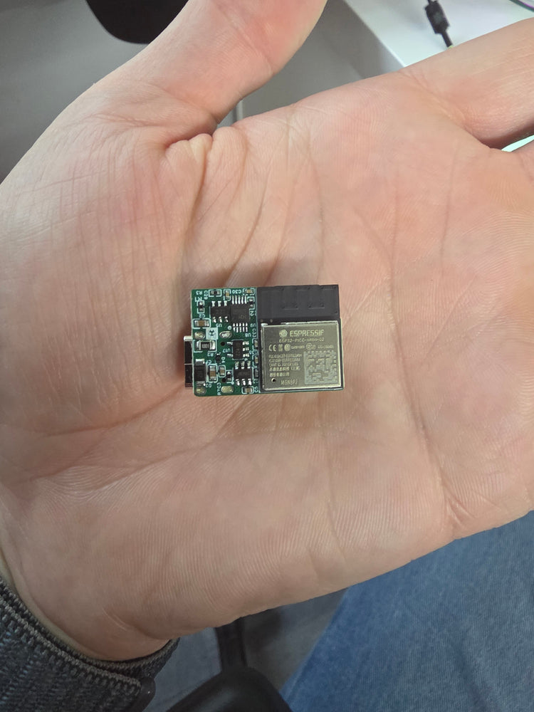
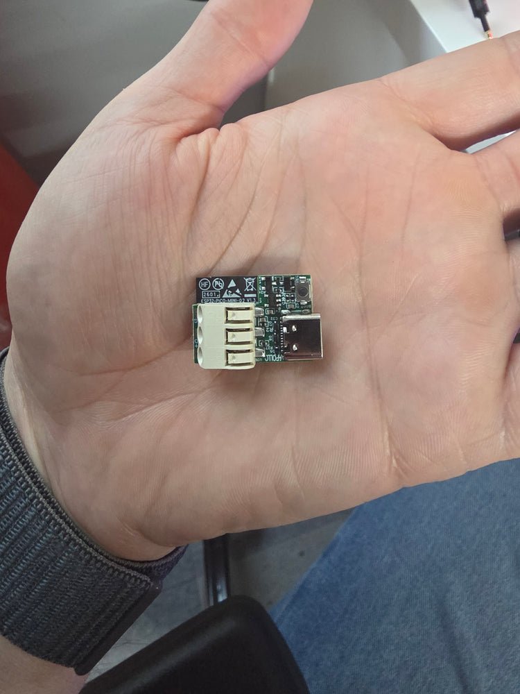

# MLED-1 introduction

The Apollo MLED-1 is a mini LED controller for addressable LED strips. It runs Apollo's build of WLED, so you get WLED's effects, palettes, and presets from the moment it's on your Wi-Fi, and Home Assistant picks it up through the WLED integration.

**Small enough to hide:** The MLED-1 fits in the palm of your hand, with one WAGO output for your LED strip. Tuck it behind a TV, under a shelf, or inside a project box.

**WLED, set up for the MLED-1:** The firmware already knows which pin drives your strip and names its own setup hotspot, **Apollo MLED-1 Hotspot**. Pick your strip's type and length, and you're lighting it up.

**Control it your way:** Use the WLED web page in any browser, the WLED app for iPhone and Android, or Home Assistant. It all runs with local control: your home runs on your own network, and your devices keep working even if your internet goes down or Apollo goes away.

**Wi-Fi setup over USB:** Flash the firmware and put the MLED-1 on your Wi-Fi in one go from the Apollo installer in your browser. No hotspot needed.

## Product details

| Spec | Detail |
| --- | --- |
| **Rating** | 5V, 3A |
| **LED output** | One WAGO connector for an addressable LED strip, with data on GPIO 13 |
| **Microcontroller** | ESP32-PICO-MINI-02 with 8MB flash |
| **Connectivity** | Wi-Fi |
| **Setup** | Improv over USB serial from the Apollo installer, plus the open **Apollo MLED-1 Hotspot** at `4.3.2.1` |
| **Home Assistant** | WLED integration |
| **Firmware** | Apollo's build of WLED 16.0.1, open source under the EUPL-1.2. Source on [GitHub](https://github.com/ApolloAutomation/MLED-1). |

!!! tip "Ask Apollo for help, not the WLED project"

    The MLED-1's firmware is a modified version of WLED and isn't an official WLED release. If something isn't working, reach out to us on [Discord](https://link.apolloautomation.com/discord) and we'll help you sort it out.

[Get started with your MLED-1 :material-arrow-right:](setup/getting-started.md){ .md-button .md-button--primary }
[Join our Discord if you need more help! :simple-discord:](https://link.apolloautomation.com/discord){ .md-button }
