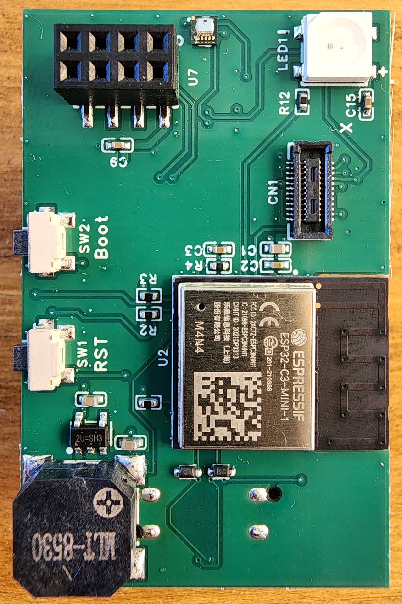
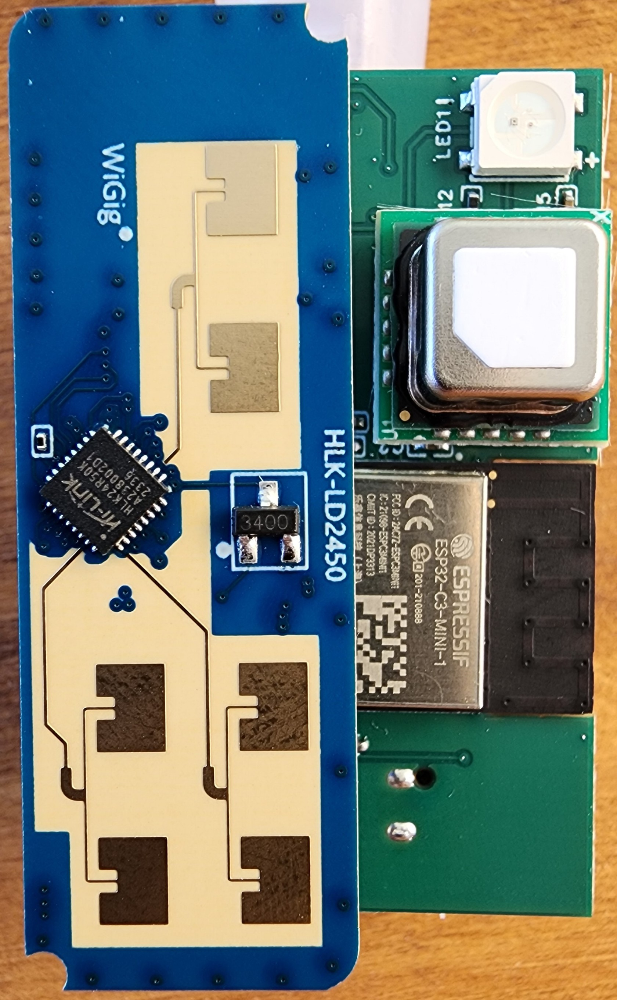
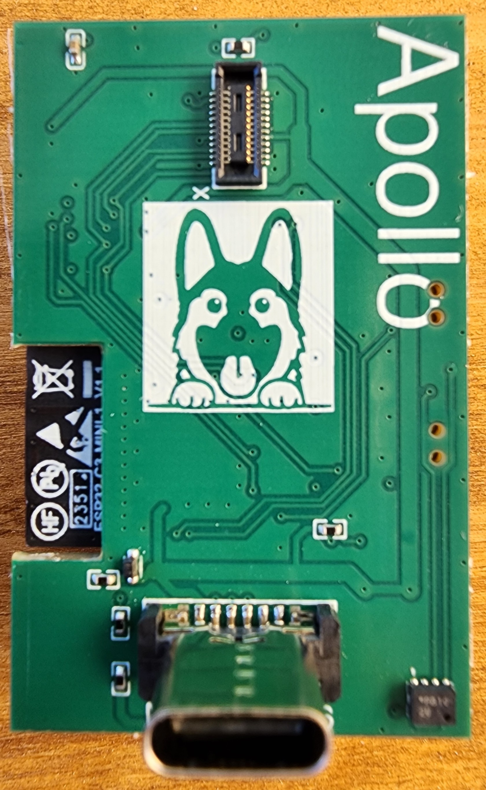
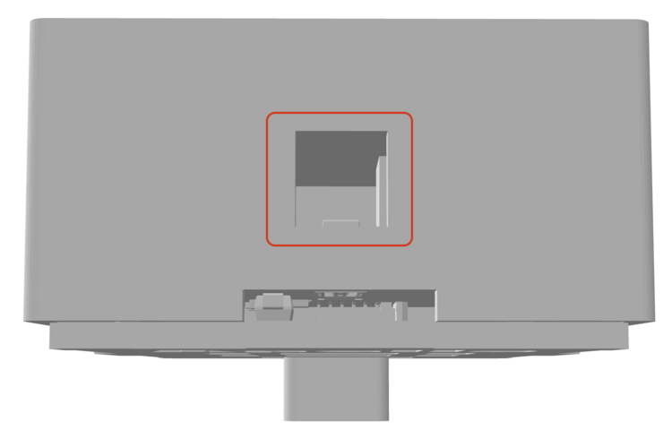
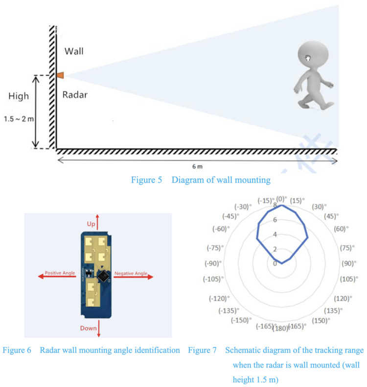
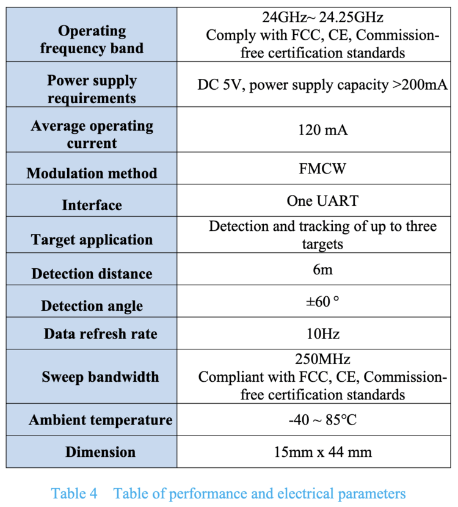
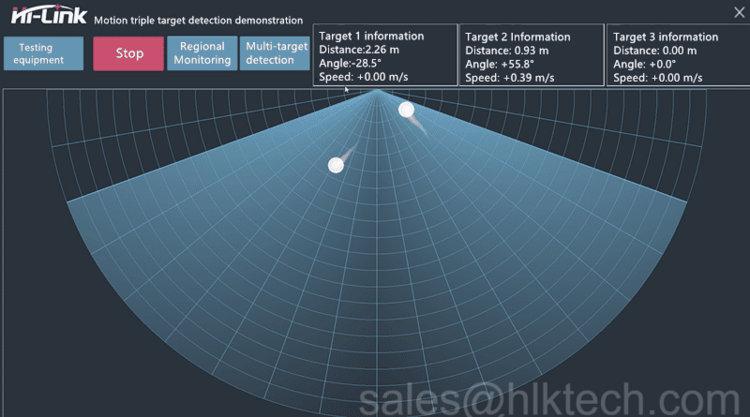

# General tips

## **MTR-1 PCB with sensors**



## **Light sensor (LTR-390UV)**



When mounting the MTR-1 be sure to position the device so that the large hole at the top is not covered. This allows more light to enter and will ensure better accuracy

The onboard RGB LED will trigger the light sensor. Be cognizant of this when making automations based on light/LUX.

## **Mounting**



Where you mount the MTR-1 decides what its radar sees, and the zones you draw only match the room from that spot. Keep these in mind before you pick one:

- **A corner mount sees a little past both walls.** The radar's view is 120 degrees wide and a corner is 90, so aimed along the corner's diagonal, the view reaches about 15 degrees past each wall. Through a thin wall it can pick up someone a short way into the next room, close to the sensor. The radar sees nothing behind itself, so where you can, put a neighboring room behind the sensor rather than beside its view.
- **Mirrors, glass, and tile make ghosts.** Radar bounces off mirrors, glass shower doors, windows, and tiled walls, so a bathroom in particular can show a target where nobody is, or show one person twice. Aim the sensor away from large mirrors and glass where you can.
- **Keep zones off shared walls.** Draw a Room zone about 30 cm (1 ft) inside any wall it shares with another room, so someone on the other side of the wall doesn't turn it on.
- **Zones belong to the mounted sensor.** A zone matches the room only while the sensor stays mounted the way it was when you drew it. Move it or turn it and the whole room moves around the radar, so redraw your zones after you move it. Never judge detection with the MTR-1 in your hand: hold it and the dots and zones won't match the room.


## **LD2450 performance and electrical parameters**

## [**LD2450 datasheet**](https://www.tinytronics.nl/index.php?route=product/product/get_file&amp;file=6000/HLK-LD2450-Instruction-Manual.pdf)



## **Expanding horizontal distance as target moves further away**

The detection is 60 degrees from center on each side. So it is a cone when you are close to it but at 4 feet away to the side you might not be visible. If you are further from the wall it can detect further in a horizontal distance.



## **Increased ESP temperature**

If you are experiencing higher than normal ESP temperatures ~140+ degrees F then <a href="https://wiki.apolloautomation.com/products/general/setup/adjusting-wifi-power/" target="_blank" rel="noreferrer nofollow noopener">changing the Wi-Fi power save mode</a> option might help decrease the temperature. Here is the link to the ESPHome WiFi Component [Power Save Mode](https://esphome.io/components/wifi.html#power-save-mode).

## **Improve Wi-Fi connection**

The Wi-Fi interface of all ESP32 devices offers three power save modes to reduce the amount of power spent on Wi-Fi. While some options can reduce the power usage of the ESP, they generally also decrease the reliability of the Wi-Fi connection, with frequent disconnections from the router in the highest power saving mode. Switch to "none" to get the best Wi-Fi performance!

```yaml
wifi:
  # ...
  power_save_mode: none
```