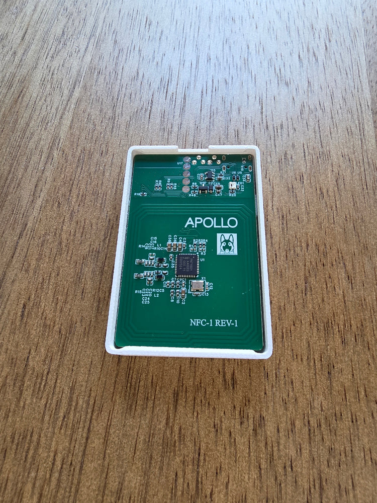
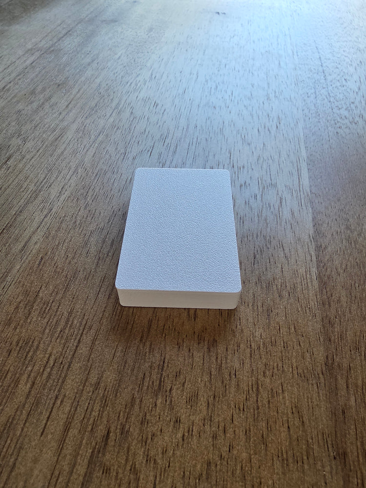

# NFC-1 introduction

The Apollo NFC-1 is an NFC reader, writer, and emulator that runs ESPHome and connects to Home Assistant. Tap a tag or card on it and Home Assistant gets a tag scan, ready to run an automation.

**Scan tags into Home Assistant:** Every tag you tap shows up under **Settings → Tags** in Home Assistant, and its UID and content land on the NFC-1's device page. Use a tag by the door, the bed, or your desk to arm the alarm, start a bedtime scene, or switch on work mode.

**Write, clean, and format tags:** Write a URL, a line of text, or a brand-new Home Assistant tag from your dashboard, with no phone app needed. After every write, the NFC-1 reads the tag back to check it. Clean or format a tag to reuse it.

**Card emulation:** Turn on **Card Emulation** and the NFC-1 acts as a tag itself. Visitors tap their phone on it to open a link, such as your guest page or a menu. On Android, it can open the Home Assistant app.

**Feedback you can see and hear:** An RGB LED and a buzzer confirm every scan, write, and error. Adjust the brightness and volume, or turn either one off.

**Bluetooth proxy:** Place the NFC-1 where Bluetooth is weak and switch on its Bluetooth proxy to relay nearby BLE sensors and devices to Home Assistant.

**Updates over the air:** Update the firmware from Home Assistant, on the Stable or Beta channel.

## What's in the box

- NFC-1

## Product details

| Spec | Detail |
| --- | --- |
| **NFC controller** | NXP PN7160 |
| **Microcontroller** | ESP32-C6 with 8MB flash |
| **Connectivity** | Wi-Fi and Bluetooth LE (Zigbee and Thread capable at chip level) |
| **Tag modes** | Read, Write, Clean, Format |
| **Write types** | URLs (up to 120 characters), text, and Home Assistant tags, with an automatic check after each write |
| **Card emulation** | Acts as a tag for phones to tap, with an optional Home Assistant app launch on Android |
| **Supported tags** | NTAG / MIFARE Ultralight and MIFARE Classic |
| **Feedback** | RGB LED and buzzer, with adjustable brightness and volume |
| **Setup** | Improv over Bluetooth or USB serial, plus a Wi-Fi fallback hotspot |
| **Firmware** | Open source ESPHome. Custom builds need ESPHome 2026.8 or newer. Source on [GitHub](https://github.com/ApolloAutomation/NFC-1). |

[Get started with your NFC-1 :material-arrow-right:](setup/getting-started.md){ .md-button .md-button--primary }
[Join our Discord if you need more help! :simple-discord:](https://link.apolloautomation.com/discord){ .md-button }
